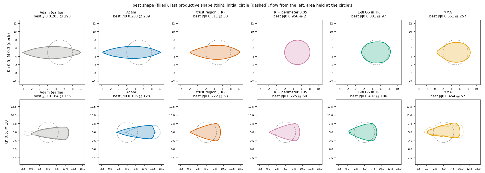
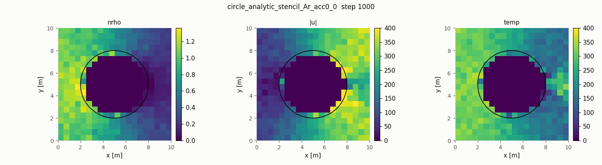
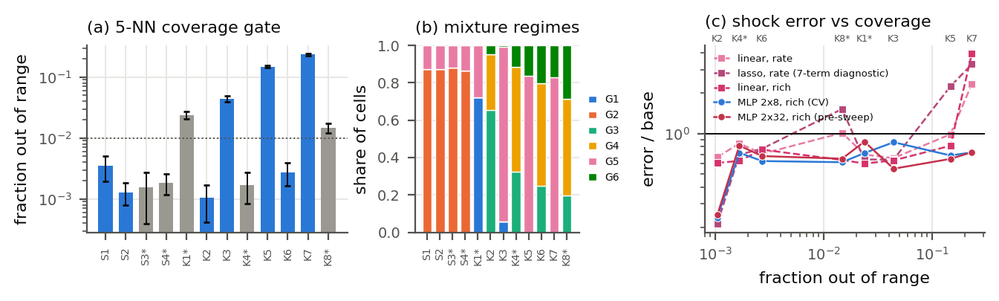

# JAX-DSMC

**A differentiable particle simulator for rarefied gas flow, and a shape optimiser built on it.**

When a gas is thin enough that molecules travel a body length or more between collisions (high
altitude, vacuum systems, micro-devices), the Navier-Stokes equations stop working and the standard
tool is **Direct Simulation Monte Carlo (DSMC)**: simulate millions of representative molecules that
fly, bounce off walls and collide at random. JAX-DSMC is a DSMC code written in
[JAX](https://github.com/jax-ml/jax), so it runs on GPUs and can be differentiated.

The hard part is the derivative. A DSMC run is random, so "the gradient of the drag with respect to the
shape" means the gradient of an *average over random runs*, and plain automatic differentiation of
one run does not give it. This repository implements a **particle-carried ensemble adjoint**
(after Caflisch, Silantyev and Yang, arXiv 2603.20946) that does, checked against finite differences,
and uses it to **optimise the shape of a body for minimum drag at fixed cross-section area**.



*Starting from a circle (dashed), the optimiser reshapes the body to cut its drag to 0.10-0.20 of the
circle's at the same area: a slender lens in a slow rarefied flow (top), a sharp wedge at Mach 10
(bottom). Each column is a different optimisation algorithm.*

> **This branch (`neural-collision`)** adds a third use of the differentiable solver: **learning a
> collision model for coarse cells**, trained through the simulation, so that DSMC can run on cells
> several mean free paths wide. See [Learned coarse-cell collision operator](#learned-coarse-cell-collision-operator-branch-neural-collision)
> below, the write-up in `docs/learning_report/report.pdf`, and
> [Reproducing the learned-collision results](#reproducing-the-learned-collision-results).

## What you can do with it

- **Simulate rarefied flow** in 1-3 D: NTC collisions with the VSS molecular model, periodic /
  specular / diffuse / inflow / outflow boundaries, and embedded bodies (polygons, circles/spheres,
  or smooth level-set shapes) on a Cartesian grid with cut cells. Validated against the SPARTA DSMC
  code and analytic results (table below).
- **Differentiate it.** Exact pathwise derivatives of a run with `jax.grad`, and the ensemble adjoint
  for derivatives of *expected* quantities (drag, heat flux, ...) with respect to wall, gas and shape
  parameters.
- **Optimise shapes** (2-D) with the ensemble-adjoint gradient: Adam by default, plus trust-region,
  L-BFGS, MMA and several optax optimisers for comparison.
- **Learn a coarse-cell collision operator** (this branch): a per-cell correction to a
  Fokker-Planck collision model, linear (lasso) or a small neural network, trained by
  differentiating through the solver against fine-cell references.

## Quick start

Requires Python >= 3.10. There is no package to install: clone the repository and run everything
from its root directory.

```bash
git clone <this repository> && cd JAX-DSMC
python3 -m venv .venv && source .venv/bin/activate
pip install "jax[cuda12]"              # NVIDIA GPU; or: pip install jax   (CPU only)
pip install -r requirements.txt        # numpy, scipy, matplotlib, optax, pytest

pytest -q                              # the test suite (CPU, a few minutes)
python3 -m examples.bkw --n-part 40000 --seeds 16 --plot   # gas relaxing to equilibrium vs theory
```

Then, in rough order of cost (the mesh and optimisation examples want a GPU):

```bash
python3 -m examples.shock --dims 1 2 3 --plot                        # shock waves in 1, 2 and 3 D
python3 -m examples.mesh.forward --case circle --seed 0              # flow past a cylinder (vs SPARTA)
python3 -m examples.ensemble_mesh --body levelset --parameter radius # shape gradient vs finite differences
python3 -m examples.mesh.optimize --iterations 12 --seeds-per-iterate 2 --tag demo   # optimise a shape
python3 -m examples.mesh.movie --tag demo --mp4                      # ... and make a movie of it
```

Every example has `--help` and a README with its results (`examples/README.md` lists them).
Importing `jax_dsmc` switches JAX to 64-bit floats. On WSL, GPU runs of the mesh examples need
`XLA_FLAGS=--xla_gpu_enable_command_buffer=` (the mesh scripts set it themselves).



*Argon flowing left to right past a cylinder (SPARTA's circle example): density, speed and temperature
per cell after 1000 steps. It matches SPARTA's run of the same case within the statistical noise
(`examples/mesh/README.md`).*

## How it works, briefly

- **Forward solver** (`jax_dsmc/`): every step (sort particles into cells, move, bounce off walls,
  inject, collide) is a pure JAX function of the state and pre-drawn random numbers, with fixed
  array shapes so the whole run compiles to one GPU program.
- **Gradients**: for one run, `jax.grad` reproduces the published discrete adjoint exactly. For the
  *average* over runs, the forward run records each particle's history, a backward sweep carries an
  adjoint value per particle back through the collisions (`jax_dsmc/ensemble_device.py`,
  `cell_fit.py`), and a shape derivative turns the values at the body surface into a gradient on the
  shape's coefficients (`jax_dsmc/shape.py`).
- **Shape optimiser** (`examples/mesh/optimize.py`): the body is the zero contour of a cubic B-spline
  level set; each step smooths the gradient, keeps the area fixed, and moves the surface by at most
  5 cm. Large runs go to a Slurm cluster (`examples/mesh/cluster/`).

## Learned coarse-cell collision operator (branch `neural-collision`)

**The problem.** DSMC is accurate only when its collision cells are smaller than a mean free path.
Collision partners are picked anywhere in a cell, so in a large cell distant particles exchange
momentum and heat as if they had met, and the simulated gas becomes too viscous and too conductive
(by `(16 / 45 pi) (dx / lambda)^2` for the viscosity). At a fixed number of particles per cell, cells
8x larger per direction would need 64x fewer particles in 2-D and 512x fewer in 3-D.

**The approach.** Start from a cheap relaxation-type collision model, the ES Fokker-Planck operator
with velocity reconstruction (the "base"), and learn a per-cell correction to it. The model reads
nine dimensionless properties of each cell, one per known error mechanism (cell size, time step,
particle count, local gradients), and adjusts how that cell's particles relax: the stress and
heat-flux relaxation rates and, in the "rich" version, the targets and shape of the relaxation
(twelve bounded outputs, zero at initialisation). A coarse cell has no exact local answer, so the
correction is trained *through* the simulation: short coarse runs are compared with fine-cell NTC
references, and the gradient comes from reverse-mode automatic differentiation through 100 steps of
the solver.

**The study** (twelve 2-D flows: four decaying shear waves and eight normal shocks at Mach 1.5-10,
two coarse resolutions; train on five, test on seven, plus a Mach 10 cylinder):

- An interpretable **lasso** (Gauss-Newton, cross-validated over flows) and a small **MLP**
  (an L9 orthogonal-array sweep of depth, width, weight decay and learning rate, with
  leave-one-flow-out cross-validation) are compared against eight classical collision schemes.
- Inside the conditions seen in training, linear and neural corrections are about equally
  accurate (0.4-0.7 of the base error). On the strongest unseen shocks the linear models are
  1.5-2.7x *worse* than no correction, while the network still improves on the base (0.7).
- **Unsupervised analysis explains why.** PCA of the per-cell inputs shows they are strongly
  correlated (four components carry 90 % of the variance), so lasso coefficients cannot be
  attributed to single mechanisms. A 5-nearest-neighbour **coverage gate** on the inputs flags
  exactly the two unseen shocks where the linear models fail (15 % and 23 % of cells out of range,
  against <= 4.4 % elsewhere), and a Gaussian mixture shows the training set has no strong shock
  at the finer coarse resolution.
- Against the classical baselines the learned operator is the most accurate on shear flows, but
  plain NTC remains better on most shocks, which are strongly non-equilibrium and local. The
  recommendation is therefore a per-regime choice of collision scheme, with the network behind
  the coverage gate.



*(a) Share of each flow's cells outside the training data (5-nearest-neighbour gate; grey:
training flows). (b) The cells in six Gaussian-mixture regimes. (c) Error relative to the base on
the eight shocks against the out-of-range share: the linear models (dashed) blow up exactly where
the gate fires, the networks (solid) do not.*

| file | contents |
|---|---|
| `jax_dsmc/collide/relax.py` | BGK, ES-BGK and ES-FP operators, the cell inputs, the linear / MLP corrections and the rich outputs |
| `examples/learned_collision/` | flows (`flows.py`), fine references (`refdata.py`), training (`train.py`), Gauss-Newton lasso (`lasso.py`), sweep design (`sweep.py`), evaluation (`evaluate.py`), cylinder (`circle.py`) |
| `examples/mesh/cluster/study.py` | the exact command of every cluster job (groups `lcref` ... `lcp3circ`) |
| `scratch/lc_cellfeat.py`, `scratch/lc_unsup.py` | per-cell inputs; PCA, Gaussian mixture and coverage gate |
| `docs/learning_report/` | the write-up (`report.pdf`), `make_figures.py` (every figure and table), and the reproduction scripts |

### Reproducing the learned-collision results

Every result file behind the figures and tables (all JSON results and the per-cell inputs, 33 MB)
is the release asset `lc_results_2026-11-15.tar.gz` of the GitHub release `learned-collision-report`
(SHA-256 `9b22f2699f951782bb72b352ff0eab833ae4907ac5b63946b6e0848e969a9dd0`). Run data are not in git;
the fine reference snapshots (6 GB) are regenerated by the full pipeline. All drivers use fixed
seeds (`--seed 0` by default; the sweep's two all-flow runs use seeds 0 and 1).

**1. Figures and tables from the released results** (any machine, CPU, about ten minutes). The
headline table is printed and written to `docs/learning_report/tables/headline.tex`.

```bash
git clone -b neural-collision https://github.com/missle2/JAX-DSMC.git && cd JAX-DSMC
python3 -m venv .venv && source .venv/bin/activate           # Python >= 3.10
pip install --upgrade pip
pip install "jax==0.6.2" flax==0.10.7 optax==0.2.8 numpy==2.2.6 scipy==1.15.3 \
            matplotlib==3.10.9 scikit-learn==1.7.2
curl -LO https://github.com/missle2/JAX-DSMC/releases/download/learned-collision-report/lc_results_2026-11-15.tar.gz
sha256sum lc_results_2026-11-15.tar.gz                       # compare with the hash above
tar -xzf lc_results_2026-11-15.tar.gz                        # -> examples/learned_collision/results/
JAX_ENABLE_X64=1 JAX_PLATFORMS=cpu PYTHONPATH=. python3 docs/learning_report/make_figures.py
(cd docs/learning_report && latexmk -pdf report.tex)         # optional: rebuild the PDF
```

**2. Every simulation, on a SLURM cluster with NVIDIA GPUs** (CUDA 12 driver; every job fits one
24 GB GPU except the two fine cylinders, which need 48 GB). On a login node:

```bash
git clone -b neural-collision https://github.com/missle2/JAX-DSMC.git && cd JAX-DSMC
module load python                                           # site-specific: any Python >= 3.10
python3 -m venv $HOME/jax-env && source $HOME/jax-env/bin/activate
pip install --upgrade pip
pip install "jax[cuda12]==0.6.2" flax==0.10.7 optax==0.2.8 numpy==2.2.6 scipy==1.15.3 \
            matplotlib==3.10.9 scikit-learn==1.7.2
# the sweep's plan (which 63 runs, 177 iterations each) from the release archive:
curl -LO https://github.com/missle2/JAX-DSMC/releases/download/learned-collision-report/lc_results_2026-11-15.tar.gz
tar -xzf lc_results_2026-11-15.tar.gz examples/learned_collision/results/sweep_plan_v3.json
# edit the #SBATCH account / partition lines of docs/learning_report/run_lc.sbatch, then
# check that a compute node sees its GPU (expect [CudaDevice(id=0)] in check_*.out):
sbatch --job-name=check --export=ALL,CMD="python3 -c 'import jax; print(jax.devices())'" \
       docs/learning_report/run_lc.sbatch

# the pipeline, one stage at a time (start each when `squeue -u $USER` shows the last finished;
# DRY=1 prints the jobs instead of submitting them):
bash docs/learning_report/reproduce.sh refs        # fine references: 8 slab flows, 2 cylinders
bash docs/learning_report/reproduce.sh prep        # warm pool, input statistics, baselines, coarse cylinders
bash docs/learning_report/reproduce.sh train       # linear, lasso, rich models, the L9 sweep (~55 GPU-h)
bash docs/learning_report/reproduce.sh eval        # all twelve flows and the cylinder
bash docs/learning_report/reproduce.sh analysis    # CPU: cylinder report, PCA / mixture / gate, figures, PDF
```

`reproduce.sh` takes every job's command from `examples/mesh/cluster/study.py`, the same
definitions used for the report's runs; `run_lc.sbatch` is a generic one-GPU job script. The
headline (cross-validated) network alone, after the `refs` and `prep` stages:

```bash
LC="python3 -m examples.learned_collision"
for s in 0 1; do
  $LC.train --model mlp --depth 2 --width 8 --weight-decay 0.001 --lr 0.01 --iters 177 \
    --cases S3 S4 K1 K4 K8 --validate-train --seed $s --tag cv_v3_p3_all_s$s \
    --outputs rich --features features_v4.json --warm-pool v1
  $LC.evaluate --cases S1 S2 S3 S4 K1 K2 K3 K4 K5 K6 K7 K8 --operators \
    --theta train_mlp_cv_v3_p3_all_s$s.json --seeds 512 --tag test_v3p3_s$s
done
```

## Status

| area | state | evidence |
|---|---|---|
| Collisions (NTC + VSS) | validated | equilibrium relaxation rate within -0.08 +- 0.12 % of theory (`examples/bkw`) |
| Shocks, transport | validated 1-3 D | normal-shock thickness 5.98 / 6.12 / 6.18 vs Bird's 6.2 (`examples/shock`); viscosity within 0.4 % of Chapman-Enskog (`examples/turbulence`, `examples/couette`) |
| Embedded bodies | validated vs SPARTA | cylinder drag within 0.3 % (z = 1.4); free-molecular drag vs closed form (`examples/mesh`) |
| Pathwise derivatives | exact | match the papers' hand-coded adjoints to 1e-11 (`tests/test_adjoint_oracle.py`) |
| Ensemble adjoint | validated vs finite differences | wall, gas, inflow and shape parameters; e.g. -0.7 +- 0.8 % on a rarefied (Kn 0.5) shape gradient, 16 seeds |
| 2-D shape optimisation | working, research in progress | drag 0.15 (Kn 0.5) and 0.045 (Mach 10) of the circle's; L/D maximization analysis ongoing; optimizer, filter, and level set constraint study ongoing. |
| Multi-GPU decomposition | built, tested on simulated devices | not benchmarked on real multi-GPU |
| 3-D shape optimisation | working, research in progress | Successful minimum drag of sphere at above cases, similar drag reductions. L/D and heat constrained drag minimization studies ongoing. |
| Learned coarse-cell collisions (this branch) | 2-D study complete | network 0.35-0.71 of the base operator's error on unseen flows with cells 4-16x coarser than the reference; best on shear flows, NTC still better on most shocks (`docs/learning_report/report.pdf`) |

Monte Carlo results here are quoted with standard errors over >= 16 independent seeds; fewer seeds
have misled this project more than once.

## Repository map

| path | contents |
|---|---|
| `jax_dsmc/` | the solver (`simulate.run` is the entry point), its adjoints, and `mesh/` for embedded bodies |
| `examples/` | one directory per validation case, the ensemble-adjoint runners, `mesh/` (bodies, shape optimiser, cluster scripts) and `learned_collision/` (this branch) |
| `tests/` | the pytest suite |
| `docs/` | specification, design record and derivations (see below) |
| `scratch/` | the probe scripts that settled each design decision, one study per directory |
| `papers_reference/` | the adjoint papers the method builds on |

## Documentation

| document | what it is for |
|---|---|
| `docs/HANDOFF.md` | **start here to work on the code**: current state, decisions and why, traps, how to run things |
| `docs/PLAN.md` | roadmap: done, current, open |
| `docs/PSEUDOCODE.md` | the specification: algorithms, data layout, the random-number contract, the ledger of measured claims |
| `docs/math/` | derivations and validation slides (PDFs included) |
| `docs/learning_report/` | the learned-collision write-up (`report.pdf`), its figure script and the reproduction scripts (`reproduce.sh`, `run_lc.sbatch`) |
| `docs/ADJOINT_BRANCH_REVIEW.md`, `docs/ADJOINT_CORRECTIONS.md`, `docs/ATTRIBUTION.md`, `docs/REVIEW_2026-09-14.md`, `docs/FORWARD_JIT_IMPLEMENTATION.md` | dated reviews and records, each headed by what still holds |
| `examples/README.md`, `examples/mesh/README.md`, `examples/mesh/cluster/README.md` | how to run each example, and the cluster studies with their results |

## Development

```bash
pytest -q                     # CPU, 4 simulated devices (tests/conftest.py)
pytest --gpu -q               # the same on the accelerator
ruff check . && ruff format --check .
```

The code on `main` stays differentiable end to end; a faster, non-differentiable SPARTA-faithful
forward lives on the branch `sparta-match`.

## References

The adjoint method follows `[P1]` arXiv 2009.01363, `[P2]` arXiv 2207.11579 and `[P3]`
arXiv 2603.20946 (Caflisch, Silantyev, Yang and co-authors; copies in `papers_reference/`). The DSMC
algorithms follow G. A. Bird, *Molecular Gas Dynamics and the Direct Simulation of Gas Flows*, and
the SPARTA code (sparta.github.io), which is the reference for the validation cases.
