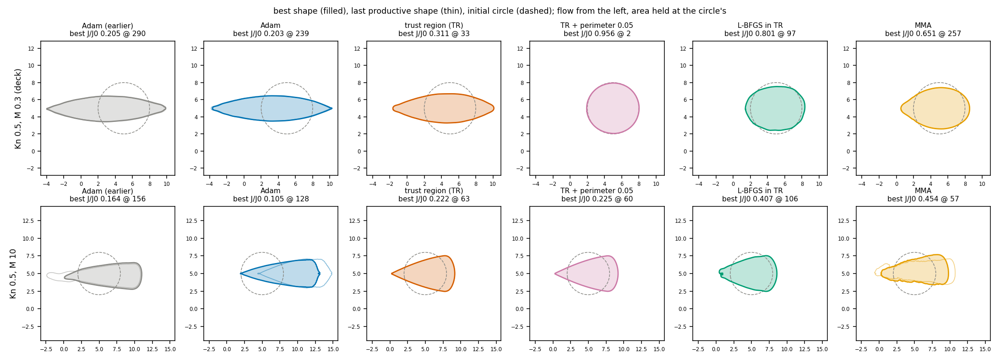
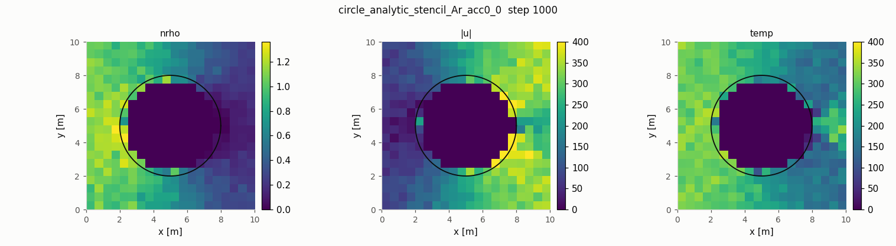

# JAX-DSMC

**A differentiable particle simulator for rarefied gas flow, and a shape optimiser built on it.**

When a gas is thin enough that molecules travel a body length or more between collisions (high
altitude, vacuum systems, micro-devices), the Navier-Stokes equations stop working and the standard
tool is **Direct Simulation Monte Carlo (DSMC)**: simulate millions of representative molecules that
fly, bounce off walls and collide at random. JAX-DSMC is a DSMC code written in
[JAX](https://github.com/jax-ml/jax), so it runs on GPUs and can be differentiated.

The hard part is the derivative. A DSMC run is random, so "the gradient of the drag with respect to the
shape" means the gradient of an *average over random runs*, and plain automatic differentiation of
one run does not give it. This repository implements a **particle-carried ensemble adjoint**
(after Caflisch, Silantyev and Yang, arXiv 2603.20946) that does, checked against finite differences,
and uses it to **optimise the shape of a body for minimum drag at fixed cross-section area**.



*Starting from a circle (dashed), the optimiser reshapes the body to cut its drag to 0.10-0.20 of the
circle's at the same area: a slender lens in a slow rarefied flow (top), a sharp wedge at Mach 10
(bottom). Each column is a different optimisation algorithm.*

## What you can do with it

- **Simulate rarefied flow** in 1-3 D: NTC collisions with the VSS molecular model, periodic /
  specular / diffuse / inflow / outflow boundaries, and embedded bodies (polygons, circles/spheres,
  or smooth level-set shapes) on a Cartesian grid with cut cells. Validated against the SPARTA DSMC
  code and analytic results (table below).
- **Differentiate it.** Exact pathwise derivatives of a run with `jax.grad`, and the ensemble adjoint
  for derivatives of *expected* quantities (drag, heat flux, ...) with respect to wall, gas and shape
  parameters.
- **Optimise shapes** (2-D) with the ensemble-adjoint gradient: Adam by default, plus trust-region,
  L-BFGS, MMA and several optax optimisers for comparison.

## Quick start

Requires Python >= 3.10. There is no package to install: clone the repository and run everything
from its root directory.

```bash
git clone <this repository> && cd JAX-DSMC
python3 -m venv .venv && source .venv/bin/activate
pip install "jax[cuda12]"              # NVIDIA GPU; or: pip install jax   (CPU only)
pip install -r requirements.txt        # numpy, scipy, matplotlib, optax, pytest

pytest -q                              # the test suite (CPU, a few minutes)
python3 -m examples.bkw --n-part 40000 --seeds 16 --plot   # gas relaxing to equilibrium vs theory
```

Then, in rough order of cost (the mesh and optimisation examples want a GPU):

```bash
python3 -m examples.shock --dims 1 2 3 --plot                        # shock waves in 1, 2 and 3 D
python3 -m examples.mesh.forward --case circle --seed 0              # flow past a cylinder (vs SPARTA)
python3 -m examples.ensemble_mesh --body levelset --parameter radius # shape gradient vs finite differences
python3 -m examples.mesh.optimize --iterations 12 --seeds-per-iterate 2 --tag demo   # optimise a shape
python3 -m examples.mesh.movie --tag demo --mp4                      # ... and make a movie of it
```

Every example has `--help` and a README with its results (`examples/README.md` lists them).
Importing `jax_dsmc` switches JAX to 64-bit floats. On WSL, GPU runs of the mesh examples need
`XLA_FLAGS=--xla_gpu_enable_command_buffer=` (the mesh scripts set it themselves).



*Argon flowing left to right past a cylinder (SPARTA's circle example): density, speed and temperature
per cell after 1000 steps. It matches SPARTA's run of the same case within the statistical noise
(`examples/mesh/README.md`).*

## How it works, briefly

- **Forward solver** (`jax_dsmc/`): every step (sort particles into cells, move, bounce off walls,
  inject, collide) is a pure JAX function of the state and pre-drawn random numbers, with fixed
  array shapes so the whole run compiles to one GPU program.
- **Gradients**: for one run, `jax.grad` reproduces the published discrete adjoint exactly. For the
  *average* over runs, the forward run records each particle's history, a backward sweep carries an
  adjoint value per particle back through the collisions (`jax_dsmc/ensemble_device.py`,
  `cell_fit.py`), and a shape derivative turns the values at the body surface into a gradient on the
  shape's coefficients (`jax_dsmc/shape.py`).
- **Shape optimiser** (`examples/mesh/optimize.py`): the body is the zero contour of a cubic B-spline
  level set; each step smooths the gradient, keeps the area fixed, and moves the surface by at most
  5 cm. Large runs go to a Slurm cluster (`examples/mesh/cluster/`).

## Status

| area | state | evidence |
|---|---|---|
| Collisions (NTC + VSS) | validated | equilibrium relaxation rate within -0.08 +- 0.12 % of theory (`examples/bkw`) |
| Shocks, transport | validated 1-3 D | normal-shock thickness 5.98 / 6.12 / 6.18 vs Bird's 6.2 (`examples/shock`); viscosity within 0.4 % of Chapman-Enskog (`examples/turbulence`, `examples/couette`) |
| Embedded bodies | validated vs SPARTA | cylinder drag within 0.3 % (z = 1.4); free-molecular drag vs closed form (`examples/mesh`) |
| Pathwise derivatives | exact | match the papers' hand-coded adjoints to 1e-11 (`tests/test_adjoint_oracle.py`) |
| Ensemble adjoint | validated vs finite differences | wall, gas, inflow and shape parameters; e.g. -0.7 +- 0.8 % on a rarefied (Kn 0.5) shape gradient, 16 seeds |
| 2-D shape optimisation | working, research in progress | drag 0.15 (Kn 0.5) and 0.045 (Mach 10) of the circle's; L/D maximization analysis ongoing; optimizer, filter, and level set constraint study ongoing. |
| Multi-GPU decomposition | built, tested on simulated devices | not benchmarked on real multi-GPU |
| 3-D shape optimisation | working, research in progress | Successful minimum drag of sphere at above cases, similar drag reductions. L/D and heat constrained drag minimization studies ongoing. |

Monte Carlo results here are quoted with standard errors over >= 16 independent seeds; fewer seeds
have misled this project more than once.

## Repository map

| path | contents |
|---|---|
| `jax_dsmc/` | the solver (`simulate.run` is the entry point), its adjoints, and `mesh/` for embedded bodies |
| `examples/` | one directory per validation case, the ensemble-adjoint runners, and `mesh/` (bodies, shape optimiser, cluster scripts) |
| `tests/` | the pytest suite |
| `docs/` | specification, design record and derivations (see below) |
| `scratch/` | the probe scripts that settled each design decision, one study per directory |
| `papers_reference/` | the adjoint papers the method builds on |

## Documentation

| document | what it is for |
|---|---|
| `docs/HANDOFF.md` | **start here to work on the code**: current state, decisions and why, traps, how to run things |
| `docs/PLAN.md` | roadmap: done, current, open |
| `docs/PSEUDOCODE.md` | the specification: algorithms, data layout, the random-number contract, the ledger of measured claims |
| `docs/math/` | derivations and validation slides (PDFs included) |
| `docs/ADJOINT_BRANCH_REVIEW.md`, `docs/ADJOINT_CORRECTIONS.md`, `docs/ATTRIBUTION.md`, `docs/REVIEW_2026-09-14.md`, `docs/FORWARD_JIT_IMPLEMENTATION.md` | dated reviews and records, each headed by what still holds |
| `examples/README.md`, `examples/mesh/README.md`, `examples/mesh/cluster/README.md` | how to run each example, and the cluster studies with their results |

## Development

```bash
pytest -q                     # CPU, 4 simulated devices (tests/conftest.py)
pytest --gpu -q               # the same on the accelerator
ruff check . && ruff format --check .
```

The code on `main` stays differentiable end to end; a faster, non-differentiable SPARTA-faithful
forward lives on the branch `sparta-match`.

## References

The adjoint method follows `[P1]` arXiv 2009.01363, `[P2]` arXiv 2207.11579 and `[P3]`
arXiv 2603.20946 (Caflisch, Silantyev, Yang and co-authors; copies in `papers_reference/`). The DSMC
algorithms follow G. A. Bird, *Molecular Gas Dynamics and the Direct Simulation of Gas Flows*, and
the SPARTA code (sparta.github.io), which is the reference for the validation cases.
