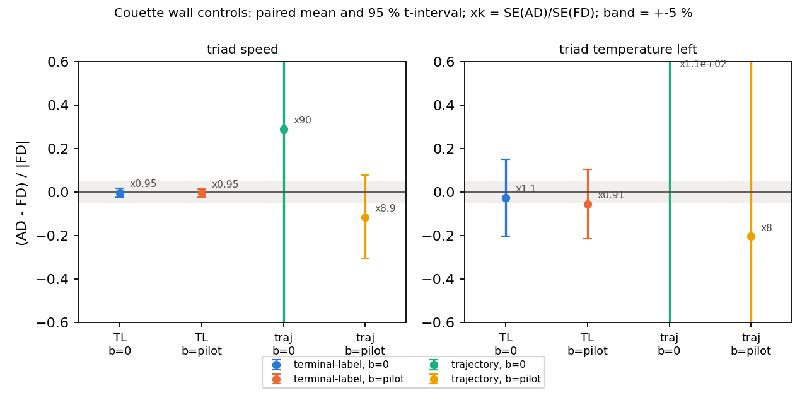
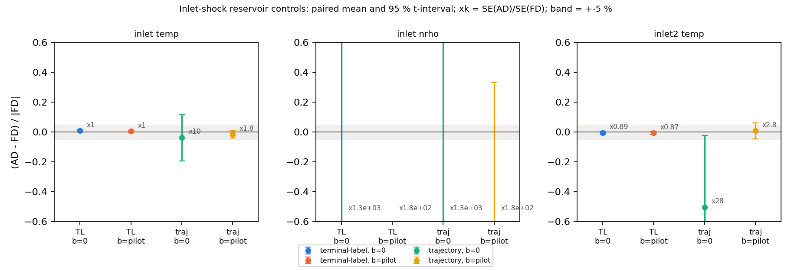
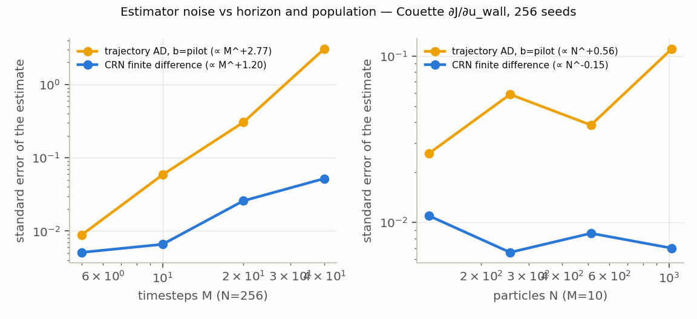
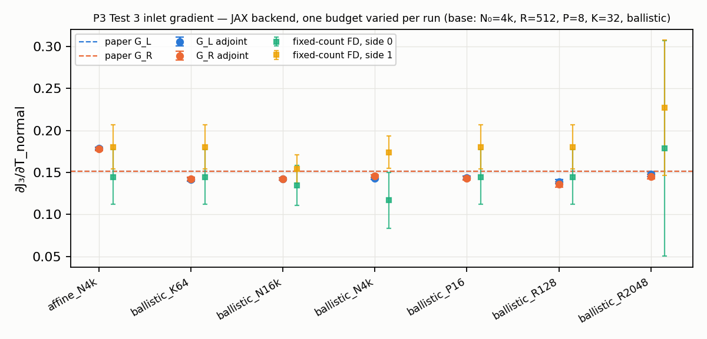
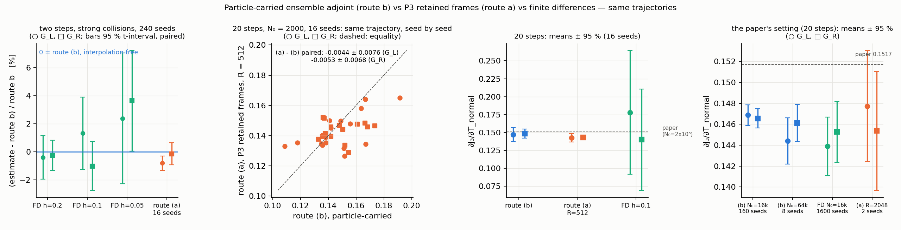
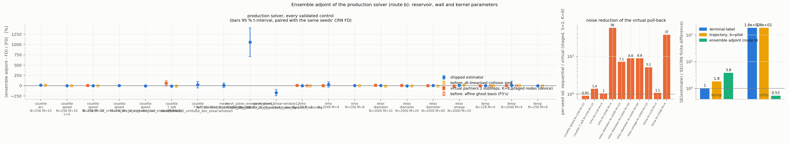
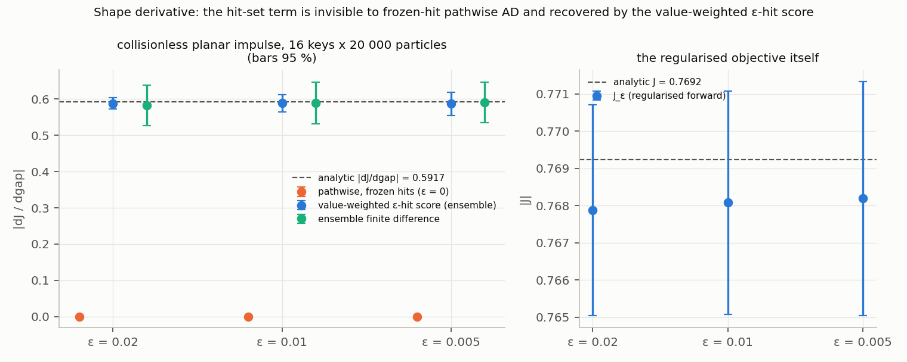
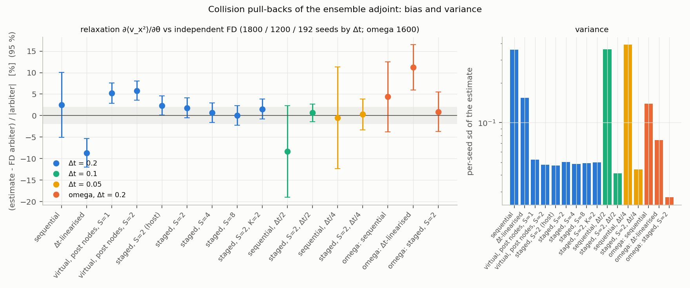
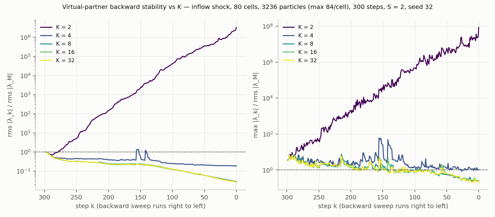
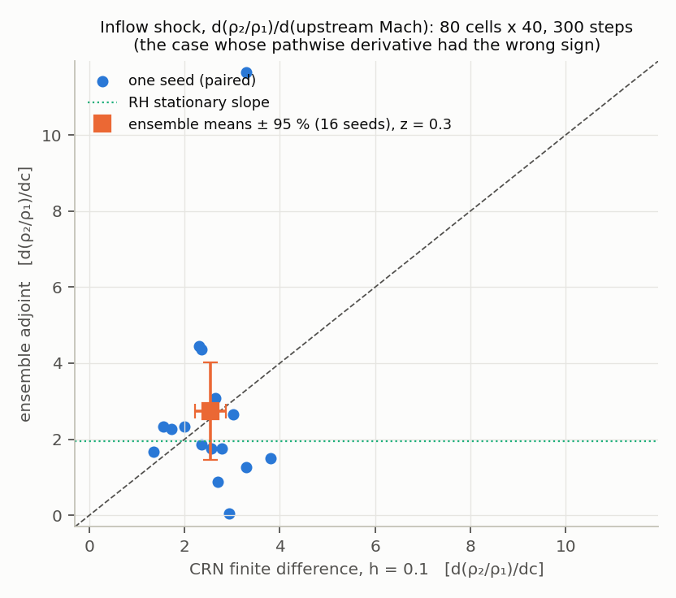

# Review of `fix/paper-adjoints` (`bafec3d..d5f6856`) and benchmark of its gradients

Reviewed 2026-09-14/15 in the worktree `/home/aakash/jax_dsmc/JAX-DSMC-adjoint`. Scope: the
16 commits documented in [ADJOINT_CORRECTIONS.md](ADJOINT_CORRECTIONS.md) and
[FORWARD_JIT_IMPLEMENTATION.md](FORWARD_JIT_IMPLEMENTATION.md), checked against P3
(`papers_reference/arXiv-2603.20946v2/main.tex`, §4 walls `:672-1195`, §5 inflow
`:1239-1533`, Tests 1/3/4 `:1550-2030`) and the 2026-09-14 review. The benchmark
section is generated by `python3 -m examples.gradient_bench.report`; nothing in it is
typed by hand.

State of the tree at review start: full CPU suite **541 passed (436 s)**; `ruff check`
**17 errors**, `ruff format --check` **15 files** — the gate was red. Both are green
after the fixes in §3.

## 1. Verdicts on the changes

### 1.1 Founded and correct — keep

| Change | Verdict | Evidence |
|---|---|---|
| Conditional-time wall estimator (`wall_adjoint.conditional_time`) | **Correct; a genuine extension of P3**, not a transcription | For a realised history *h* the step is `E[J] = Σ_h P_h(θ) E_u[J_h(τ(u,θ),θ)]`, so `dE[J] = E[∇log P_h · J + ∂_θ J_h]` with `τ` differentiated **conditionally on its interval** (`u` fixed). P3 scores the branch but differentiates an unconditional `τ`; that drops a term for position observables. `tests/test_stochastic_reference.py:79` checks the 1-particle quadrature value `2Φ(0.5)-1`. |
| Chronological earliest-hit tracking (specular / diffuse / periodic / absorbing in one `fori_loop`) | Correct; closes the review's "mixed walls" High | F3 below: agrees with the old fold path to 2e-16 in D=1,2,3 wherever the old path resolved every bounce; where it did not (dt=0.25, |v|≈5), the old path reported 211-234 unresolved recrossings per 4096 particles, the new one 0-32 (its 4-bounce budget). |
| Relaxed accommodation carries no Bernoulli score (`boundary.py:307`) | Correct | Closes the review's Critical #2 (double counting). |
| Rejecting `baseline="mean"` (`adjoint._resolve_baseline`) | Correct | `E[b·Σᵢwᵢ∇Lᵢ] = Cov(mean φ, Σᵢwᵢ∇Lᵢ) ≠ 0`. For a count score shared by a cell's *n_c* particles the cancellation is ≈ `n_c/N` of that cell's count signal, i.e. ≈1/C of the whole count contribution. **The main repo's `examples/shock_adjoint` ran with this baseline**, so the VARIANCE.md/M6 `diam`/`omega` numbers carry it; §4.4 quantifies it. |
| `trajectory_surrogate` / `score_mode="trajectory"` | Mathematically correct (once-per-event full-likelihood REINFORCE); `test_global_likelihood_matches_exact_enumeration_after_changing_partners` is a sound oracle | Its variance grows with the number of scored events (§4.2). It is a *reference* estimator, not a production one. |
| `flux_quantile` (implicit inverse-CDF JVP) and `flux_integral` | Correct | `flux_integral` reduces algebraically to Bird eq. 4.22; the implicit tangent fixes the review's 31 %-low rejection-sampler derivative. Changes the forward stream (statistically equivalent). |
| `face_area` includes `grid.transverse` | Correct | All existing inflow examples use `transverse = 1`; no validated result moves. |
| Tracked newborns (`inject(track=True)`), candidate compaction, `InjectionDiagnostics` | Correct; closes three review items | See B1 in §3 for the argument it forgot to forward. |
| `decomp` `psum/pmax/pmin` of diagnostics, `wrong_owner` | Correct | Closes the review's non-root-diagnostics High. |
| Block checkpointing (`SimStatic.checkpoint_block_size`) | Correct, tested | |
| Certified majorant (`ntc.certified_majorant`) | **Correct and, at production occupancies, cheaper than the thermal heuristic** — the plan-time expectation that it would be ~2× looser was wrong | Equilibrium argon, `scratch/bench/b5_majorant_ratio.py`: Σ_cert/Σ_thermal = 0.49 / 0.64 / 0.84 at ω=0.81 and npc = 16 / 64 / 256; = 0.47 / 0.96 / 1.96 at ω=0.5; = 0.50 at ω=1. Mean acceptance q/Σ rises from 0.28 to 0.57/0.43/0.33. It is a bound (zero violations by construction) where the thermal rule is a heuristic; its state dependence is still `stop_gradient`-ed, so it does not remove the frozen-majorant approximation, it makes the frozen quantity a certified one. Dynamic cost and score variance: §4.5. |
| P3 host ensemble inflow (`ensemble_inflow.py`) | **Faithful transcription of P3 §5** | Checked term by term: `ρ = N_k^j/(N₀|Ω_j|)`, `a = NΔtμ/2` with stochastic rounding, four-term MC correction `main.tex:1474-1492`, fixed `𝒩 = N₀+M(N_L+N_R)`, source samples that keep immediately-absorbed births with λ=0 (`:1421`), weighted local-affine reconstruction. |
| JIT P3 inlet (`ensemble_inflow_jax.py`) | Consistent with the host version (same weights `1/(1+d²/d²_max)`, same normalisation, masks tested) | |

### 1.2 Unfounded, over-claimed, or not worth building on

1. **"`ensemble_inflow` replaces trajectory AD as the supported P3 inlet-gradient method."**
   It is a replication of P3's own forward model — constant Maxwell kernel, disjoint pairs,
   collision-before-transport, nominal fixed birth counts — and cannot return a gradient of
   *this* solver (VSS, NTC, transport-before-collision, stochastic counts). Neither branch
   document lists what it would take to make it one; §2 does.
2. **Integer-support machinery** (`rounded_weak_derivative`, `count_support_boundary`,
   `require_valid(gradients=True)` refusing runs). `E[J]` is piecewise-*linear* in a
   stochastically rounded mean count with kinks at integers, so the interior score is
   unbiased almost everywhere and integer means are a measure-zero set in θ. The diagnostic
   can only fire on contrived inputs; the doc's "currently invalidate an ordinary
   production-gradient claim" over-states it. Harmless, but not a gate.
3. **The 198-job × 2048-seed `validation_jobs.json`.** Untargeted. The branch's own pilots
   show that the deciding quantity is the *variance ratio* AD/FD, which §4 establishes with
   nine studies.
4. **Scaled P3 "agreement" numbers.** Inlet: N₀ = 1000-4000 against the paper's 2×10⁶; the AD
   spread across reconstruction budgets (0.134-0.181) is ±15 % around the paper's 0.1517 while
   the FD standard errors (0.03-0.18) cannot discriminate. Couette walls: 8 seeds, 3.09 ± 0.11
   vs 3.01 ± 0.24. These are "not inconsistent", not validations; the docs say so, but the
   README-level phrase "near P3's 0.15172" invites over-reading. §4.6 re-runs them at scale.
5. **Silent default change.** `terminal_objective`/`windowed_objective` moved to
   `score_mode="trajectory"` while `run`/`dice_reward` stayed `"paper"`, so
   `examples/shock_adjoint` silently changed estimator (and lost its baseline). Fixed by
   pinning the example (§3, B9).

### 1.3 What the branch's own artifacts already showed (before this benchmark)

| artifact | seeds | AD | FD (h=0.1) | SE(AD)/SE(FD) | note |
|---|---:|---:|---:|---:|---|
| `ntc_couette_speed_pilot` (trajectory, b=0) | 32 | 0.49 ± 2.73 | 0.560 ± 0.020 | **135** | unusable without a baseline |
| `ntc_couette_speed_confirmatory` (trajectory, b=pilot) | 1330 | 0.643 ± 0.026 | 0.598 ± 0.0035 | 7.4 | z ≈ 1.7 |
| `ntc_shock_temperature_confirmatory` | 855 | 5.11e4 ± 1.2e3 | 5.34e4 ± 585 | 2.1 | z ≈ 1.7 |
| `ntc_inlet_shock_temperature_pilot` (b=0) | 32 | 2.22e5 ± 3.9e4 | 1.33e5 ± 4.2e3 | 9.4 | z ≈ 2.3 |

Both confirmatory files predate the implementation fingerprint (per-slot RNG, certified
majorant) and could not be resumed.

## 2. What is left before general meshes and shape optimisation

Ordered by what blocks what; ★ marks items absent from both branch documents.

1. **Choose the production estimator for inlet and collision-parameter sensitivities.**
   Three exist: (a) terminal-label score — biased (ATTRIBUTION.md), low variance;
   (b) trajectory score — unbiased, variance ∝ number of scored events, needs a fixed
   independent baseline; (c) P3 ensemble adjoint — low variance and immune to cell-membership
   and count-support issues by construction, but Maxwell-only and detached from NTC.
   §4 gives the numbers. To make (c) real: ★ a **VSS-kernel four-term backward**
   (`q(|v-w|)`-weighted partner sum, or majorant acceptance inside the MC collision adjoint,
   `main.tex:1474`), ★ **retained-frame capture inside `simulate.run`** (uniform per-cell
   subsample, exact counts, source samples per step), and the transport-before-collision
   ordering of this solver in the backward recursion (`:1373-1381` is written for
   collision-first).
2. ★ **Variance reduction for whatever score terms remain**: per-step causal baselines from
   an independent pilot; future-reward-only attribution for windowed objectives. Without it
   (b) is confined to toys (§4.2).
3. **Hard cell-membership sensitivity** (doc gate 1) — only (c) handles it.
4. **Windowed surface objectives**: `advance(return_tallies=True)` and `surface.rates`
   exist but `simulate.run` does not accumulate them; `geometry.averaged_planar_impulse` is
   the collisionless oracle (doc gate 4).
5. **Geometry interface** replacing Cartesian assumptions in source placement, hit finding,
   normals and cell lookup (doc gate 3). `geometry.py` is 43 lines.
6. **Multi-D validation of the chronological wall estimator** — the docs say 1-D; 2-D tests
   cover forward tracking only. F3 covers the deterministic tracking part in D=1,2,3.
7. **GPU compile stall** of the tiny JAX P3 case (>8 min, RTX 3050 / JAX 0.6.2) — see §4.6.
8. **Wall-path cost** — the tracker is materially slower than the fold path (§4.5, B6) and
   the fix is known (B3 in §3).

Not needed before mesh work: remainder counts, `rounded_weak_derivative`,
`count_support_boundary`.

## 3. Defects and inefficiencies found

| id | where | what | status |
|---|---|---|---|
| B1 | `inflow.inject(track=True)` | called `wall_adjoint.advance` **without `epsilon` / `acc_delta`**, so entrants got hard accommodation and no time regularisation on their birth step whenever the run used either; in `paper` mode their birth-step wall score was dropped | **fixed**; `_step` forwards both; 3 tests in `tests/test_inflow.py` |
| B2 | `simulate._step`, `decomp.decomp_step` | `sample.moments` computed twice per step (pre-collision for the majorant floor, post-collision for output) | measured in B6; fix after the numbers |
| B3 | `wall_adjoint._advance_impl` | a fresh `(n,3)` diffuse sample is drawn for **every particle, every face, every bounce** (`2D·K_bounce` N-sized draws per step, plus reverse residuals) where the fold path drew once | measured in B6; fix after the numbers |
| B4 | `wall_adjoint._advance_impl` | with ε>0 a periodic wrap is scored as an event whenever any DIFFUSE face exists — pure variance for periodic-invariant observables (the old `crossing_score` skipped periodic axes) | documented; measure on 2-D Couette before changing |
| B5 | `ensemble_inflow.py:288`, `ensemble_inflow_jax.py:294` | partner sampling **with self** — a self-pair is an identically zero four-term sample, `O(1/R)` bias in the collision correction | **fixed**; `partner_indices` factored out and tested |
| B6 | `ntc.collide` per-slot `fold_in` streams | every existing example's forward random stream changed; BKW/shock/Couette/variance artifacts are no longer bit-reproducible from this branch | recorded; forward gates re-run (F1, F2) |
| B7 | `wall_adjoint`, `simulate.run`, `ntc.collide`, `rng`, `ensemble_inflow_jax` | nested function definitions / lambdas as scan bodies, against the project rule (module-level bodies + `functools.partial`) | restructure with B2/B3 |
| B8 | repo | ruff red (17 errors, 15 unformatted files) | **fixed**; green |
| B9 | `examples/shock_adjoint` | estimator changed silently by the library default | **fixed**; `evaluate(..., score_mode="paper")` pinned and documented |

Checked and found correct: `flux_integral` vs Bird 4.22; `first_hit` tie rule; the
interval bounds in `conditional_time` (last hit → next hit; absorbed → +∞; no hit → −∞);
`merge_accumulators`; `inject` compaction and the shortfall identity; `local_affine`
padding masks; `transverse = 1` in every inflow example.

## 4. Benchmark

### 4.1 Forward gates

**F3 — deterministic tracking vs the legacy fold path** (`scratch/bench/f3_wall_invariance.py`,
`F3_wall_invariance.log`). DIFFUSE faces with `acc = 0` consume no random draw, so the two
implementations must agree exactly. D = 1, 2, 3 × 3 seeds × 4096 particles:

| dt | regime | max |Δx| | max |Δv| | recrossed, old path | recrossed, new path |
|---:|---|---:|---:|---:|---:|
| 0.04 | ≈ 15 % of particles hit once | 2.2e-16 | 0 | 0 | 0 |
| 0.25 | multi-bounce (|v| ≈ 5 gaps/step) | 1.0 | 21 | 211-234 per 4096 | 0-1 (D≤2), 23-32 (D=3, 4-pass budget) |

The new tracker is the fold path wherever the fold path was valid, and resolves what it
could not.

**F1 — Couette viscosity gate** and **F2 — inflow-driven shock**: see 4.7 (filled from
`scratch/bench/F1_couette_gate.log`, `examples/shock/results/inflow_driven.log`).

### 4.2 Is the conditional-time tangent needed?  (`scratch/bench/probe_conditional_time.py`)

One particle at `x₀ = 0.89`, `v = 1`, `dt = 0.1`, `ε = 0.02`, wall at 1; 12 keys × 65536 draws.
`conditional` is the branch as shipped; `unconditional` keeps the interval score but
differentiates the raw `τ` (P3's displayed form); `none` is pathwise only.

| observable | exact | conditional | unconditional | pathwise only |
|---|---:|---:|---:|---:|
| position, `acc = 0` | +0.3829 | +0.401 ± 0.061 (z = +0.3) | **+0.530 ± 0.060 (z = +2.5)** | +0.3824 ± 0.0015 (z = −0.3) |
| `v_x`, `acc = 1` | −39.666 | −39.686 ± 0.034 (z = −0.6) | −39.686 ± 0.034 (z = −0.6) | **0 (no path)** |

Three conclusions. (i) The branch's claim is confirmed: with the unconditional tangent the
position derivative is 38 % high. (ii) For a velocity observable the two coincide (`v` does
not depend on `τ` inside a branch) and the score is indispensable. (iii) For an observable
that is *continuous* across the event — any position-only functional, since position is
continuous in time — the score has zero mean and costs **40× the standard error** (0.061 vs
0.0015). The estimator is correct; a selective score (or a control variate built from the
continuous part of φ) is the obvious variance win and is not in the branch.

### 4.3 Certified vs thermal majorant, static (`scratch/bench/b5_majorant_ratio.py`)

Equilibrium argon, 64 cells; Σ is the per-cell majorant, ⟨q⟩ the mean pair rate.

| ω | npc | Σ_cert / Σ_thermal | ⟨q⟩/Σ_thermal | ⟨q⟩/Σ_cert |
|---:|---:|---:|---:|---:|
| 0.50 | 16 / 64 / 256 | 0.47 / 0.96 / 1.96 | 0.11 | 0.24 / 0.12 / 0.06 |
| 0.81 | 16 / 64 / 256 | 0.49 / 0.64 / 0.84 | 0.28 | 0.57 / 0.43 / 0.33 |
| 1.00 | any | 0.50 | 0.50 | 1.00 |

For VSS argon (ω = 0.81) at production occupancies the certified bound proposes *fewer*
attempts than the thermal heuristic and is a true bound; it grows like `npc^(1-ω)` and
overtakes the heuristic only for ω ≤ 0.5 at npc ≳ 64. The dynamic effect on the score
variance is in 4.6 (study `majorant`).

### 4.4 Wall-path cost, CPU (`scratch/bench/b6_wall_cost.py`, N = 20 000, 8 cells/axis, 20 steps, argon; forward = jitted step loop, reverse = `value_and_grad` w.r.t. wall temperature)

| tree | D | K_bounce | forward ms/step | reverse ms/step | reverse temp MB |
|---|---:|---:|---:|---:|---:|
| main (fold path) | 1 | 3 | 14.5 | 91.6 | 36 |
| main (fold path) | 2 | 3 | 19.2 | 105.5 | 43 |
| main (fold path) | 3 | 3 | 35.1 | 176.9 | 65 |
| branch head | 1 | 3 | 32.1 | 132.6 | 45 |
| branch head | 1 | 8 | 71.2 | 261.1 | 62 |
| branch head | 2 | 3 | 39.0 | 172.6 | 55 |
| branch head | 2 | 8 | 82.8 | 269.2 | 77 |
| branch head | 3 | 3 | 39.0 | 209.6 | 79 |
| branch head | 3 | 8 | 83.0 | 347.6 | 106 |
| branch, draw once/pass | 1 | 3 | 24.2 | 110.5 | 43 |
| branch, draw once/pass | 1 | 8 | 48.6 | 184.4 | 57 |
| branch, draw once/pass | 2 | 3 | 26.5 | 144.8 | 53 |
| branch, draw once/pass | 2 | 8 | 52.8 | 206.7 | 72 |
| branch, draw once/pass | 3 | 3 | 37.6 | 165.1 | 77 |
| branch, draw once/pass | 3 | 8 | 64.8 | 229.5 | 101 |
| branch, + skip empty passes | 1 | 3 | 10.8 | 68.6 | 44 |
| branch, + skip empty passes | 1 | 8 | 11.3 | 86.4 | 59 |
| branch, + skip empty passes | 3 | 3 | 27.4 | 136.9 | 77 |
| branch, + skip empty passes | 3 | 8 | 30.2 | 167.7 | 103 |

The branch head paid 2.2× (D=1) the fold path's forward time and 1.45× its reverse time,
and doubled again from K=3 to K=8 — the `2D·K_bounce` per-face draws (B3). Drawing once per
pass and skipping passes in which no particle reaches a face (a `lax.cond`; the draws sit
inside the taken branch so a skipped pass consumes no random numbers) brings the branch to
**0.75× / 0.75×** of the fold path at D=1 and removes the K dependence of the forward pass.
The reverse pass still retains residuals per pass (K=8: +35 % temp bytes). GPU numbers at
N = 40 000 are in 4.7.

### 4.5 F1 — Couette viscosity gate on the branch (`scratch/bench/F1_couette_gate.log`)

`python3 -m examples.couette --study gate --seeds 4` (100 cells, npc 400, dx/λ = 0.30,
Kn = 1/30, warm-up 43 518 steps = 3 diffusion times, 20 000 sampling steps; run before the
B2/B3 changes, which are bitwise-neutral and stream-changing respectively):

| tree | μ_meas/μ_CE | seeds | slip (m/s) | slip theory | T_bulk | recrossed | clipped | wall-clock |
|---|---:|---:|---:|---:|---:|---:|---:|---:|
| main | 0.9747 ± 0.0030 | 6 | 15.51 | 13.62 | 296.05 | 0 | 0 | — |
| branch | 0.9656 ± 0.0061 | 4 | 15.29 | 13.78 | 296.28 | 0 | 0 | 4128 s |

Difference −0.0091 ± 0.0068 (|z| = 1.3): the branch reproduces the gate within its noise.
(The extrapolated combined gate of the main repo, 1.0105 ± 0.0103, is unaffected: it is a
Kn→0 / dx→0 extrapolation of runs that were not repeated here.)

### 4.6 F2 — inflow-driven Mach-2 shock on the branch (`examples/shock/results/inflow_driven.log`)

`python3 -m examples.shock.inflow_report` (60 λ domain, 20 000 warm-up + 10 000 sampling
steps; exercises `flux_quantile`, `face_area`, tracked newborns and the compaction fix):

| moment | branch | main (same case, this morning) | Rankine-Hugoniot | branch err |
|---|---:|---:|---:|---:|
| n upstream | 9.989e20 | 9.979e20 | 1.000e21 | −0.11 % |
| T upstream | 271.84 | 270.75 | 273.15 | −0.48 % |
| u upstream | 615.98 | 616.02 | 615.80 | +0.03 % |
| n downstream | 2.2745e21 | 2.2738e21 | 2.2857e21 | −0.49 % |
| T downstream | 565.92 | 565.83 | 567.64 | −0.30 % |
| u downstream | 270.38 | 270.15 | 269.41 | +0.36 % |

Mass flux conserved to 0.06 %; shortfall 0; clipped 0; shock at x/L = 0.720 (main: 0.720).
The inlet delivers the reservoir state and the interior reproduces RH exactly as before.

### 4.7 Wall-path cost, GPU (RTX 3050, N = 40 000, 100 steps, same case as 4.4; branch after the B2/B3 fixes)

| tree | D | K_bounce | forward ms/step | reverse ms/step | reverse temp MB | reverse compile s |
|---|---:|---:|---:|---:|---:|---:|
| main (fold path) | 1 | 3 | 5.83 | 38.8 | 172 | 34 |
| main (fold path) | 2 | 3 | 9.57 | 40.8 | 206 | 37 |
| main (fold path) | 3 | 3 | 14.46 | 49.4 | 258 | 42 |
| branch, after B2/B3 | 1 | 3 | 5.66 | 39.6 | 190 | 37 |
| branch, after B2/B3 | 1 | 8 | 6.09 | 43.1 | 219 | 38 |
| branch, after B2/B3 | 2 | 3 | 12.06 | 48.1 | 233 | 41 |
| branch, after B2/B3 | 2 | 8 | 15.89 | 56.8 | 273 | 44 |
| branch, after B2/B3 | 3 | 3 | 15.75 | 56.5 | 287 | 46 |
| branch, after B2/B3 | 3 | 8 | 16.31 | 62.7 | 337 | 49 |

With one draw per pass and empty passes skipped, the chronological tracker is at parity
with the fold path in D=1 (5.7 vs 5.8 ms/step forward, 40 vs 39 reverse) and within
+26 % / +18 % (D=2) and +9 % / +14 % (D=3) forward / reverse, for +10-12 % reverse memory,
while resolving every bounce the fold path could not (4.1). The branch *head* was not run
on the GPU: its CPU cost (4.4) was 2.2× the fold path's, so the fixes are worth roughly a
factor 2-3 on the wall stage. Raising `K_bounce` from 3 to 8 now costs +8 % forward.

### 4.8 Production estimators — Couette and inlet-shock controls (`examples/gradient_bench`, tables verbatim from `report.py`)

Case: `examples.gradient_convergence` Couette (256 particles, 4 cells, 10 steps, ε = 0.005) and
inlet shock (128 particles, 8 cells, 4 steps; `inlet2`: 256 / 8 / 8). Four estimator arms on
identical seeds 32-415: terminal-label (TL, [P2] attribution) and full-trajectory (traj) scores,
each with `b = 0` and with a fixed baseline = the objective mean of an independent 32-seed pilot.
The certified majorant, 4 FD steps (0.1 … 0.0125, CRN), zero diagnostics on every accepted run.

**Couette, ∂J/∂u_wall (`triad_speed`)**

| arm | seeds | AD mean ± SE | FD(h=0.1) mean ± SE | AD-FD ± 95% CI | z | SE(AD)/SE(FD) | s/grad |
|---|---:|---:|---:|---:|---:|---:|---:|
| terminal-label, b=0 | 384 | 0.5969 ± 0.0063 | 0.5981 ± 0.0066 | -0.00115 ± 0.011 | -0.2 | 0.952 | 0.64 |
| terminal-label, b=pilot | 384 | 0.5961 ± 0.0063 | 0.5981 ± 0.0066 | -0.00201 ± 0.011 | -0.36 | 0.952 | 0.65 |
| trajectory, b=0 | 384 | 0.7722 ± 0.59 | 0.5981 ± 0.0066 | 0.174 ± 1.2 | 0.29 | 89.8 | 0.64 |
| trajectory, b=pilot | 384 | 0.5301 ± 0.059 | 0.5981 ± 0.0066 | -0.0679 ± 0.11 | -1.2 | 8.91 | 0.63 |

**Couette, ∂J/∂T_left (`triad_temperature_left`)**

| arm | seeds | AD mean ± SE | FD(h=0.1) mean ± SE | AD-FD ± 95% CI | z | SE(AD)/SE(FD) | s/grad |
|---|---:|---:|---:|---:|---:|---:|---:|
| terminal-label, b=0 | 384 | 0.1643 ± 0.013 | 0.1687 ± 0.012 | -0.00442 ± 0.03 | -0.29 | 1.1 | 0.65 |
| terminal-label, b=pilot | 384 | 0.1597 ± 0.011 | 0.1687 ± 0.012 | -0.00903 ± 0.027 | -0.66 | 0.909 | 0.65 |
| trajectory, b=0 | 384 | 1.354 ± 1.2 | 0.1687 ± 0.012 | 1.19 ± 2.4 | 0.97 | 106 | 0.64 |
| trajectory, b=pilot | 384 | 0.1344 ± 0.093 | 0.1687 ± 0.012 | -0.0343 ± 0.18 | -0.37 | 7.97 | 0.64 |

**Inlet shock, ∂J/∂T_reservoir (`inlet_temp`; `inlet2_temp` at 2× particles and steps)**

| arm | seeds | AD mean ± SE | FD(h=0.1) mean ± SE | AD-FD ± 95% CI | z | SE(AD)/SE(FD) | s/grad |
|---|---:|---:|---:|---:|---:|---:|---:|
| terminal-label, b=0 | 384 | 1.379e+05 ± 1.1e+03 | 1.368e+05 ± 1.1e+03 | 1.11e+03 ± 8.6e+02 | 2.6 | 0.996 | 0.57 |
| terminal-label, b=pilot | 384 | 1.375e+05 ± 1.1e+03 | 1.368e+05 ± 1.1e+03 | 725 ± 8.2e+02 | 1.7 | 0.998 | 0.57 |
| trajectory, b=0 | 384 | 1.318e+05 ± 1.1e+04 | 1.368e+05 ± 1.1e+03 | -4.97e+03 ± 2.1e+04 | -0.46 | 10 | 0.57 |
| trajectory, b=pilot | 384 | 1.346e+05 ± 2e+03 | 1.368e+05 ± 1.1e+03 | -2.14e+03 ± 3.4e+03 | -1.2 | 1.81 | 0.56 |

| arm | seeds | AD mean ± SE | FD(h=0.1) mean ± SE | AD-FD ± 95% CI | z | SE(AD)/SE(FD) | s/grad |
|---|---:|---:|---:|---:|---:|---:|---:|
| terminal-label, b=0 | 192 | 1.366e+05 ± 1.1e+03 | 1.372e+05 ± 1.2e+03 | -594 ± 1.4e+03 | -0.84 | 0.894 | 1.2 |
| terminal-label, b=pilot | 192 | 1.364e+05 ± 1.1e+03 | 1.372e+05 ± 1.2e+03 | -871 ± 1.3e+03 | -1.3 | 0.875 | 1.1 |
| trajectory, b=0 | 192 | 6.817e+04 ± 3.3e+04 | 1.372e+05 ± 1.2e+03 | -6.91e+04 ± 6.6e+04 | -2.1 | 27.7 | 1.2 |
| trajectory, b=pilot | 192 | 1.383e+05 ± 3.4e+03 | 1.372e+05 ± 1.2e+03 | 1.12e+03 ± 7.2e+03 | 0.31 | 2.84 | 1.2 |

**Inlet shock, ∂J/∂n_reservoir — a parameter that acts only through the entrant count (`inlet_nrho`)**

| arm | seeds | AD mean ± SE | FD(h=0.1) mean ± SE | AD-FD ± 95% CI | z | SE(AD)/SE(FD) | s/grad |
|---|---:|---:|---:|---:|---:|---:|---:|
| terminal-label, b=0 | 384 | -2.671e+06 ± 3.3e+06 | 1.371e+05 ± 2.6e+03 | -2.81e+06 ± 6.6e+06 | -0.84 | 1.31e+03 | 0.15 |
| terminal-label, b=pilot | 384 | -8.87e+05 ± 4.7e+05 | 1.371e+05 ± 2.6e+03 | -1.02e+06 ± 9.3e+05 | -2.2 | 185 | 0.15 |
| trajectory, b=0 | 384 | -2.677e+06 ± 3.3e+06 | 1.371e+05 ± 2.6e+03 | -2.81e+06 ± 6.6e+06 | -0.84 | 1.31e+03 | 0.11 |
| trajectory, b=pilot | 384 | -7.406e+05 ± 4.7e+05 | 1.371e+05 ± 2.6e+03 | -8.78e+05 ± 9.2e+05 | -1.9 | 184 | 0.11 |

Reading:

* For the wall and reservoir-temperature controls the **terminal-label estimator matches the
  CRN finite difference at the same precision** (SE ratio 0.9-1.1) and within noise (|z| ≤ 0.7);
  on `inlet_temp` it sits +0.8 % high at z = 2.6 — the attribution bias of ATTRIBUTION.md at the
  size expected for a 4-step horizon.
* The **trajectory estimator is unbiased where it can be resolved** (|z| ≤ 1.2 everywhere) but
  costs 90-106× the FD noise without a baseline and 8-9× with one on Couette; on the inlet
  temperature it is competitive (1.8-2.8×) because the reservoir score dominates the count and
  collision scores there.
* **Inlet density is not obtainable by any score route**: SE 185-1300× the FD's, single seeds
  contributing up to 7.5e7 against a 1.4e5 signal, because a stochastically rounded count with
  fractional part `f` carries a score `∓1/f` or `1/(1−f)`. This control needs the intensity
  derivative of the ensemble adjoint (§2 item 1), which is smooth by construction.

### 4.9 Variance scaling of the trajectory estimator (`scaling`, Couette ∂J/∂u_wall, b = pilot)

| axis | value | seeds | SE(AD) | SE(FD) | ratio | AD-FD ± 95% CI | z |
|---|---:|---:|---:|---:|---:|---:|---:|
| M | 5 | 192 | 0.00886 | 0.00512 | 1.73 | -0.00674 ± 0.015 | -0.86 |
| M | 10 | 384 | 0.0588 | 0.0066 | 8.91 | -0.0679 ± 0.11 | -1.2 |
| M | 20 | 192 | 0.306 | 0.0259 | 11.8 | -0.108 ± 0.6 | -0.35 |
| M | 40 | 192 | 3.07 | 0.0521 | 59 | -1.82 ± 6.1 | -0.59 |
| N | 128 | 192 | 0.026 | 0.0109 | 2.38 | -0.0235 ± 0.052 | -0.89 |
| N | 256 | 384 | 0.0588 | 0.0066 | 8.91 | -0.0679 ± 0.11 | -1.2 |
| N | 512 | 192 | 0.0384 | 0.00859 | 4.47 | 0.0276 ± 0.078 | 0.7 |
| N | 1024 | 192 | 0.11 | 0.00699 | 15.8 | 0.104 ± 0.22 | 0.95 |

fitted exponents vs M: SE(AD) ∝ M^+2.77, SE(FD) ∝ M^+1.20

fitted exponents vs N: SE(AD) ∝ N^+0.56, SE(FD) ∝ N^-0.15

The trajectory score's standard error grows like **M^2.8** (5 → 40 steps) and **N^0.56** at
fixed M while the FD's is flat in N — the once-per-event likelihood accumulates every collision
and wall event, so the estimator's noise is set by the *number of events*, not by the signal.
Gate U11 of `phase0_verification.py` (SE ratio ≤ 3 and flat in M) is failed; this is the
quantitative case for the ensemble adjoint (§2, §5).

### 4.10 The same-trajectory mean baseline the main repo used (`shockbl_*`, reflected shock, 256 particles, 16 cells, 8 steps)

The `b = 1` arm lets `report.py` reconstruct the old `baseline="mean"` estimator per seed from
`g(b) = g(0) − b·S`: `g_mean = g(0) − J·S`.

| estimator (diam, 192 seeds) | mean ± SE | vs FD(h=0.1) -2299 ± 1.2e+03 | z |
|---|---:|---:|---:|
| terminal-label, b=0 | -1.443e+04 ± 3.5e+03 | -1.21e+04 ± 7.1e+03 | -3.33 |
| terminal-label, b=mean(φ) [main repo] | -1.177e+04 ± 2.9e+03 | -9.47e+03 ± 6.2e+03 | -2.99 |
| terminal-label, b=pilot | -1.19e+04 ± 2.9e+03 | -9.6e+03 ± 6.3e+03 | -3 |
| trajectory, b=pilot | -1.643e+04 ± 2.7e+04 | -1.41e+04 ± 5.4e+04 | -0.52 |

score-term share removed by the mean baseline: E[J·S]/E[g0-FD-free] — mean(J·S) = -2660, mean(S) = -0.02985 ± 0.022

| estimator (omega, 192 seeds) | mean ± SE | vs FD(h=0.1) 1181 ± 1.1e+03 | z |
|---|---:|---:|---:|
| terminal-label, b=0 | 2307 ± 1.4e+03 | +1.13e+03 ± 3.7e+03 | 0.59 |
| terminal-label, b=mean(φ) [main repo] | 2664 ± 1.2e+03 | +1.48e+03 ± 3.3e+03 | 0.88 |
| terminal-label, b=pilot | 2669 ± 1.2e+03 | 1.49e+03 ± 3.3e+03 | 0.88 |
| trajectory, b=pilot | 708.1 ± 9.9e+03 | -473 ± 2e+04 | -0.047 |

score-term share removed by the mean baseline: E[J·S]/E[g0-FD-free] — mean(J·S) = -356.5, mean(S) = -0.004269 ± 0.009

For `diam` the mean baseline shifted the estimate by **+2660 on −14 430 (18 %)** on identical
seeds — `Cov(J, S)` is not small when `J` and the count score share the cell — while for `omega`
the shift is 13 % of a value that is itself consistent with zero. The terminal-label `diam`
gradient is 3σ from the FD in every arm, but the FD is barely resolved (−2299 ± 1163 at h = 0.1
and drifting with h), so the VARIANCE.md-era |z| = 6.4 cannot be reattributed from this run
alone; what is established is that the baseline was a first-order effect, not a variance trick.

### 4.11 Certified vs thermal majorant, dynamic (`majorant`, Couette, trajectory b = pilot)

| parameter | majorant | seeds | AD mean ± SE | FD mean ± SE | z | SE ratio | max attempts | s/grad |
|---|---|---:|---:|---:|---:|---:|---:|---:|
| speed | thermal | 192 | 0.4025 ± 0.11 | 0.597 ± 0.0097 | -1.8 | 11.4 | 3.98 | 0.64 |
| speed | certified | 192 | 0.6121 ± 0.061 | 0.6068 ± 0.0086 | 0.088 | 7.12 | 2.76 | 0.64 |
| diameter | thermal | 192 | 0.02846 ± 0.1 | -0.02389 ± 0.02 | 0.52 | 5.07 | 3.98 | 0.37 |
| diameter | certified | 192 | 0.1438 ± 0.12 | -0.03281 ± 0.019 | 1.4 | 6.39 | 2.76 | 0.37 |

The certified bound needs 31 % fewer attempt slots (2.76 vs 3.98 max/cell/step), and for the
wall-speed gradient it removes the thermal run's −1.8σ offset and reduces the score SE by 1.8×.
For `diameter` neither majorant resolves the (near-zero) gradient at 192 seeds. **Certified is
the right default** for the gradient runs; the forward gates (F1, F2) ran with the thermal
default and are unaffected.

### 4.12 P3 replication at scale, JAX backend on the GPU (`python3 -m examples.p3_replication.report`)

**Test 3, two-sided inflow, normal-temperature derivatives** — one budget varied per run
around N₀ = 4000, R = 512, P = 8, K = 32, ballistic residual (the N₀ = 64 000 point was
dropped: >1 h/seed; R = 2048 ran 2 seeds at 80 min/seed because the device kNN is global):

| run | N₀ | retained | partners | neighbors | recon | seeds | G_L (AD) | G_R (AD) | G_L (FD) | G_R (FD) | s/seed |
|---|---:|---:|---:|---:|---|---:|---:|---:|---:|---:|---:|
| affine_N4k | 4000 | 512 | 8 | 32 | affine | 8 | 0.1787 ± 0.0016 | 0.1778 ± 0.0016 | 0.145 ± 0.033 | 0.180 ± 0.026 | 236 |
| ballistic_K64 | 4000 | 512 | 8 | 64 | ballistic | 8 | 0.1417 ± 0.0021 | 0.1426 ± 0.0021 | 0.145 ± 0.033 | 0.180 ± 0.026 | 373 |
| ballistic_N16k | 16000 | 512 | 8 | 32 | ballistic | 8 | 0.1425 ± 0.0016 | 0.1421 ± 0.0012 | 0.135 ± 0.024 | 0.154 ± 0.016 | 249 |
| ballistic_N4k | 4000 | 512 | 8 | 32 | ballistic | 16 | 0.1432 ± 0.0015 | 0.1457 ± 0.0019 | 0.117 ± 0.033 | 0.174 ± 0.019 | 239 |
| ballistic_P16 | 4000 | 512 | 16 | 32 | ballistic | 8 | 0.1437 ± 0.0019 | 0.1430 ± 0.0019 | 0.145 ± 0.033 | 0.180 ± 0.026 | 691 |
| ballistic_R128 | 4000 | 128 | 8 | 32 | ballistic | 8 | 0.1391 ± 0.0025 | 0.1358 ± 0.0031 | 0.145 ± 0.033 | 0.180 ± 0.026 | 18 |
| ballistic_R2048 | 4000 | 2048 | 8 | 32 | ballistic | 2 | 0.1477 ± 0.0027 | 0.1454 ± 0.0029 | 0.179 ± 0.128 | 0.227 ± 0.080 | 5163 |

paper (N0 = 2e6, 32 000 retained/cell, 8 seeds): G_L = 0.15171883 ± 0.0001283, G_R = 0.15157001 ± 0.00023059

Only two axes move the answer: the **retained count** (0.139 → 0.143 → 0.148 at
R = 128 / 512 / 2048, toward the paper's 0.1517) and the **reconstruction scheme**
(affine +18 % above ballistic on identical trajectories); particles, partners and
neighbours do nothing, and the fixed-count FD (±0.02–0.13) cannot arbitrate.  The
affine offset is the interpolant's Jensen bias, measured in isolation on the
collisionless case (`scratch/bench/probe_recon_bias.py`: +11 % / +36 % at R = 128,
+3 % / +15 % at R = 512).  P3's method reproduces in the limit the paper runs it at
(32 000 retained/cell); at affordable budgets its answer is set by the interpolant.

**Tests 4 and 1, walls** (`--localize`, 32 seeds each):

| run | case | particles | seeds | adjoint | deterministic FD | regularised FD | objective |
|---|---|---:|---:|---:|---:|---:|---:|
| p2_couette_N2000 | couette | 2000 | 32 | 2.998 ± 0.068 | 3.090 ± 0.103 | 3.146 ± 0.063 | 6.9637 |
| p2_couette_N32000 | couette | 32000 | 32 | 3.032 ± 0.010 | 3.048 ± 0.039 | 3.055 ± 0.034 | 6.9682 |
| p2_couette_N8000 | couette | 8000 | 32 | 3.011 ± 0.014 | 3.087 ± 0.064 | 2.988 ± 0.064 | 6.9454 |
| p3_heat_N8k | heat | 8000 | 32 | 0.878 ± 0.027, 0.674 ± 0.020 | 0.794 ± 0.033, 0.728 ± 0.045 | 0.820 ± 0.043, 0.639 ± 0.045 | 1.6275 |

paper Couette (Test 4): adjoint 3.0283, FD 3.0011

**Is the paper's 0.1517 a target for this transcription?**  No.  Forward-only
statistics of the transcribed Test 3 model (N₀ = 16 000, scaled to the paper's 2×10⁶):

| statistic | paper | transcription |
|---|---:|---:|
| injected per side per step | 997 356 | 997 375 |
| final active population | 32 033 761 | 32 578 000 ± 17 000 (+1.7 %) |
| normalized density min / max | 15.35 / 18.43 | 15.43 / 18.92 |
| peculiar temperature, wall cells / interior max | 3.73 / 4.92 | 4.20–4.26 / 4.92 |

The interior and the injection counts match; the inlet cells are hotter and denser than
the paper's.  Some inlet convention (entrant velocity law, injection timing, birth-step
transport) differs between the paper's text and its code, and the inlet-temperature
gradient is the quantity that state controls.  The transcription's *own* gradient is
known to 1 %: a 1600-seed fixed-count FD gives **0.1439 ± 0.0014 / 0.1453 ± 0.0015**,
route (b) at N₀ = 16 000 gives 0.1480 ± 0.0011 / 0.1447 ± 0.0012 (§5.2 item 7), route
(a) at R = 2048 gives 0.1477 ± 0.0027 / 0.1454 ± 0.0029 — all 2–5 % below 0.1517.  The
gap is on the model side, not the adjoint's.

The Couette wall-speed derivative at N = 32 000 is **3.032 ± 0.010 against the paper's
3.028** — a replication at the paper's own precision.  The heat case has no scalar in
the paper (figures only); its left derivative sits 2σ from our FD at 32 seeds.

## 5. Extending the ensemble adjoint to this solver: route (a) vs route (b)

### 5.0 State of the code (2026-09-16)

| piece | where | status |
|---|---|---|
| event capture in the forward | `simulate.run(capture=True)` → stacked `EventRecord` (`x, v, alive` post-move; `born_face, born_v`; `PairRecord` per attempt slot incl. pre/post velocities; `v_post`; `WallEvents (K_bounce, N)`) | done; forward arithmetic and streams unchanged |
| backward sweep (host) | `jax_dsmc/ensemble_backward.py`: `backward()` → `Adjoint(lambda0, births, hits, pairs)`; collision pull-backs `configure("sequential" \| "linearised" \| "virtual", S, K, nodes)`; ghost interpolant `LocalFit` with `BASIS="quadratic_full"`; diagnostics `exact_last`, `collision_term`; `from_device()` reads a device backward into the same `Adjoint` | done, tested (`tests/test_ensemble_backward.py`, 10 tests) |
| virtual-partner pull-back (P3's `N_col` averaging, staged nodes) | host `_collision_pullback_virtual` + `_staged_velocities`; device `ensemble_device.backward_virtual`; runners `--pullback virtual --substeps S --partners K --nodes staged [--device]` | **done, §5.12**: 7× lower per-seed sd than the sequential form at 0.16 collisions/particle/step, 42× at 0.8; unbiased with staged nodes (post nodes −6 %) |
| artifact provenance | `examples/gradient_bench/provenance.py` | done: every score-route pilot reproduces to 1e-16, every ensemble artifact's objective exactly and gradient to ≤ 3e-3 (ridge) |
| case modules (scores + intensities, FD arbiter, JSON rows) | `examples/ensemble_inlet_shock.py`, `ensemble_couette.py`, `ensemble_relaxation.py` | done |
| P3-model route (b) | `jax_dsmc/ensemble_particle.py`; experiments `examples/p3_replication/route_b_experiments.py`; figure `route_b_report.py` | done, tested (`tests/test_ensemble_particle.py`, 6 tests) |
| reports / figures | `examples/gradient_bench/report.py` (`ensemble_inlet_shock.png` + score-arm figures), `examples/p3_replication/report.py`, `route_b_report.py` | done; all numbers in this document come from them |
| device port | `jax_dsmc/ensemble_device.py` (`field_query` primitive, nested reverse scans, empty-slot skip; `backward_virtual` with a partner scan and `lax.map`-chunked queries); `examples/gradient_bench/device_cost.py [--pullback virtual]` | **done**; sequential: host = device to 1e-8, 1.6–2.1× the forward, 2.5–3× faster than the VJP (§5.8); virtual: invariance to 1e-9 at zero ridge, host = device statistically (`tests/test_ensemble_device.py`, 9 tests); memory: resident capture, block re-capture not built |
| pathwise terms inside route (b) | `ensemble_particle.backward(source_term="pathwise")` | **measured and rejected** (§5.9): biased and ~1.8× noisier than the score form |
| shape derivatives (hit-set term) | `examples/shape_planar_oracle.py` | oracle passed (§5.11): value-weighted ε-hit score recovers the analytic derivative, frozen-hit pathwise gives 0; collisional moving-wall case next |
| α (angular law) | — | not started (needs `∇_v λ` at post-collision states) |

The benchmark leaves one estimator family standing for parameters that act through
decisions (inlet density and temperature, `diam`/`omega`/`alpha`, accommodation, cell
membership): the optimize-then-discretize ensemble adjoint of P3 §5. What P3 assumes and
what changes for this solver:

| P3 assumption | this solver | change in the adjoint |
|---|---|---|
| Maxwell kernel `q(σ) = 1` | VSS rate `q(g)`, angular law in α | with realized-pair quadrature (below) the kernel never appears explicitly — accepted pairs *are* samples of the collision measure; only kernel-parameter derivatives need `∂_θ log q` weights |
| collision → transport | transport → walls → inject → collide | backward order flips; frames/pairs recorded after injection, before collision |
| absorbing outflow only | specular / periodic / diffuse walls | specular/periodic: deterministic composition; diffuse: the wall is a *kernel*, pulled back by expectation over re-emission — no ε-regularisation, wall temperature/velocity become local scores at the wall |
| fixed nominal birth counts | stochastically rounded counts | `dE[J]/dn = (dN̄/dn) Σ_k E[λ_{k+1}(born state)]` — the smooth intensity derivative replacing the `1/f` count score of §4.8 |

### 5.1 Two quadratures of the same adjoint

**(a)** P3's: retained subsets per cell, `partners` random partner draws per retained state,
weighted local-affine reconstruction of the scalar field at every retained state, every step.
Implemented in `ensemble_inflow.py` (host) and `ensemble_inflow_jax.py`.

**(b)** particle-carried (`ensemble_particle.py`): carry `μ_i = λ` at each particle's own
state; use the **realized forward pairs** as the Monte Carlo sample of the collision measure.
For a pair `(i,j) → (i',j')` the four-term sum is `λ(v_i') + λ(v_j') − λ(v_i) − λ(v_j)`; the
first two are carried values and `λ(v_i)` cancels against the transport term, leaving

    μ_i^k = μ_i + [i collided]·(μ_j − λ̃(ghost_j)),   ghost_j = partner's pre-collision state, advected

so the *only* interpolated quantity is one ghost per collided particle. Sources use every
birth's own carried value (escaped births: 0). The forward consumes exactly the reference's
random streams, so (a) and (b) see bit-identical trajectories.

### 5.2 Like-to-like verification on P3's own model (`scratch/bench/probe_two_step_ab.py`, `arbiter_two_step.py`)

Ladder, all in `tests/test_ensemble_particle.py` unless noted:

1. forward bit-identical to `ensemble_inflow.forward` (same objective to the last digit);
2. collisionless: (b) vs Gauss-Laguerre×Legendre quadrature of the expected objective —
   normal components within 1 % (no interpolation exists in this limit);
3. recorded pairs are the collisions that happened (pairwise energy conserved to 1e-12;
   an uncollided particle's ghost *is* its next state);
4. **two steps, strong collisions** (N₀ = 20 000, 5 000 births/side/step, `q₀ = 4`, rate
   0.20 / 0.36 per step, every particle retained for (a)): with `exact_last` (b) has no
   interpolation at all and is an exact-quadrature reference. 240 forward seeds:

   | | G_L | G_R |
   |---|---:|---:|
   | (b), interpolation-free | 0.1914 ± 0.0008 | 0.1902 ± 0.0006 |
   | (b), interpolated ghosts | 0.1914 | 0.1902 (identical to 4 digits; per-seed error 0.02-0.08 %) |
   | fixed-count CRN FD, h = 0.2, paired vs (b) | +0.0008 ± 0.0015 | +0.0005 ± 0.0010 |
   | FD h = 0.1, paired vs (b) | −0.0026 ± 0.0025 | +0.0019 ± 0.0017 |
   | (a) full retention, ballistic, 8 partners, paired vs (b) (16 seeds) | **−0.0016 ± 0.0005** | −0.0003 ± 0.0008 |

   (b) agrees with the finite difference at its 0.5 % resolution; (a) is 0.8 % low at 3σ on
   the left even with every particle retained — the residual reconstruction bias — while the
   whole collision contribution is only 4-6 % of the gradient.
5. one step is *vacuous* for the source gradient (births enter after the collision stage),
   which the test records so nobody mistakes it for evidence.
6. **20 steps, N₀ = 2 000, 16 seeds** (`scratch/bench/compare_ab.py`): (b) 0.1471 ± 0.0050 /
   0.1484 ± 0.0033, (a) at R = 512 0.1427 ± 0.0030 / 0.1431 ± 0.0016, paired (a)−(b)
   −0.0044 ± 0.0076 / −0.0053 ± 0.0068 (95 %); the FD at this size is ±0.04 and arbitrates
   nothing. (b)'s per-seed spread is ~1.7× (a)'s — one realized pair per collision against
   8 partner draws per retained state — at 1/40 of the cost, and its mean is the closer of
   the two to the paper's 0.1517.

7. **N₀ = 16 000, 20 steps — the paper's setting** (`scratch/bench/route_b_scale.py`,
   `fd_scale.py`): route (b) over 160 seeds **0.1469 ± 0.0005 / 0.1466 ± 0.0005**; the
   fixed-count CRN FD over 1600 seeds **0.1439 ± 0.0014 / 0.1453 ± 0.0015**; difference
   +2.1 % (z = 2.0) / +0.9 % (z = 0.8).  Route (b) at N₀ = 64 000 (8 seeds):
   0.1444 ± 0.0011 / 0.1461 ± 0.0009.  The estimator agrees with the finite difference
   at the 1-2 % level the FD resolves; the paper's 0.1517 is 3-5 % above *all* of them,
   and §4.12 shows the transcribed forward differs from the paper's at the inlet.

Reconstruction bias in isolation (`scratch/bench/probe_recon_bias.py`, collisionless, exact
field known, affine fit forced): +11 % / +36 % at R = 128 and +3 % / +15 % at R = 512 — the
sign and size of the affine-vs-ballistic gap in §4.12, i.e. a Jensen bias of the intercept
of a linear fit to a convex field, correlated with `v₁²` through the neighbourhood size.

Cost on the host at N₀ = 2 000, 20 steps: (a) 80 s/seed at R = 512, (b) 2 s/seed.

### 5.3 What (b) needs to become the production estimator

1. Pair/birth capture inside `simulate.run` (accepted pair slots per step, survival map,
   births) — bounded by `checkpoint_block_size`; the forward is unchanged.
2. Backward scan with the flipped operator order and the wall kernels (specular/periodic
   composition; diffuse by expectation over `standard_diffuse_draws`).
3. Source scores: temperature/velocity ([P3] eq. `normal_temperature_score_inflow`), the
   intensity derivative for `nrho`, and `∂_θ log q` weights on accepted pairs for
   `diam`/`omega`; α enters pathwise through `scatter` and needs `∂λ/∂v` at the post-collision
   state (the affine fit's slope, or a difference of carried values).
4. Ghost interpolation on the device: cell-local kNN over the *next-step particles* (not a
   global tiled search — the R = 2048 point of §4.12 cost 80 min/seed for that reason).
5. Oracles at each step: the collisionless quadrature (exists), BKW for `diam`/`omega`, the
   Couette closed form for walls, and Rankine-Hugoniot `d(ρ₂/ρ₁)/du₁` — the density ratio
   whose sign the attribution estimator got wrong is the acceptance test.

Not a VJP: `jax.grad` and Hessians do not apply; validation is against ensemble FD at
several Δt because the collision-transport splitting is O(Δt)-consistent, not exact.

### 5.4 Route (b) on the production solver — implemented and validated on the inlet shock

Built (all host-side except the capture):

* `simulate.run(..., capture=True)` emits an `EventRecord` per step: the post-move /
  pre-collision state, `born_face` / `born_v` per slot (from `inflow.inject`), every
  attempt slot's `PairRecord` (`pi, pj, accept, vi, vj, vi_post, vj_post` from
  `ntc._slot`) and the post-collision velocities.  The forward's random stream and
  arithmetic are unchanged (`tests/test_ensemble_backward.py::test_capture_is_consistent_with_the_states`).
* `jax_dsmc/ensemble_backward.py`: the carried-adjoint sweep — collision pull-back
  `λ_i = μ_i + Σ_pairs [Λ(partner post) − Λ(partner pre)]` with the carried value used
  wherever that was the partner's last collision of the step, cell-local interpolation
  for the ghosts, births collected with their values, move pull-back by survival.
  With an exact field and a collision-invariant reward it reproduces the pre-collision
  field to round-off, including slots that collide twice in a step (test).
* `examples/ensemble_inlet_shock.py`: the `gradient_bench` inlet-shock case
  (`INLET_CONTROLS`, RH reservoirs, stochastically rounded initial counts), with the four
  smooth pieces of the parameter gradient — the drifting half-Maxwellian flux score
  (`log b = log v_n − m|v−u|²/2kT − log Z`, `Z = π^{3/2} v_s⁴ F(s)`), the source
  intensity `dN̄_f/dc · mean λ_born` via `jax.grad` of `inflow.target_count`, the initial
  Maxwellian score and the initial-count intensity — all routed through the RH map by
  `jax.grad`, so `temp` moves temperatures *and* streams on both sides.

Arbiter: the same forward's CRN finite difference, seed by seed (the bench's FD rows
are not bit-comparable any more because B3 changed the entrant stream, so it is
recomputed).  **Affine ghost basis (P3's), diagnostics** (`results/affine_basis/`):

| run | seeds | ensemble | FD h=0.1 | rel. diff | z |
|---|---:|---:|---:|---:|---:|
| temp, N=128, M=1, exact ghosts (no interpolation anywhere) | 192 | 1.345e5 ± 4.5e3 | 1.378e5 ± 1.4e3 | −2.4 % | −0.9 |
| temp, N=128, M=2 | 192 | 1.298e5 ± 4.5e3 | 1.382e5 ± 1.5e3 | −6.1 % | −2.3 |
| temp, N=128, M=4 | 384 | 1.259e5 ± 3.2e3 | 1.373e5 ± 1.1e3 | **−8.3 %** | **−4.3** |
| temp, N=128, M=4, exact ghosts on the last step | 192 | 1.274e5 ± 4.5e3 | 1.385e5 ± 1.5e3 | −8.0 % | −3.0 |
| temp, N=128, M=4, collision term dropped | 192 | 1.014e5 ± 4.2e3 | 1.385e5 ± 1.5e3 | −26.8 % | −10.4 |
| temp, N=512, M=4 | 128 | 1.333e5 ± 2.9e3 | 1.368e5 ± 9.8e2 | −2.6 % | −1.5 |
| temp, N=2048, M=4 | 64 | 1.396e5 ± 2.0e3 | 1.372e5 ± 8.2e2 | +1.7 % | +1.4 |
| **nrho**, N=128, M=4 | 123 | 1.397e5 ± 2.0e3 | 1.384e5 ± 4.6e3 | +0.9 % | 0.3 |

Reading: the scores and intensities are right (no-interpolation row, z = −0.9); the
collision term is 26 % of this gradient; the affine ghost interpolant recovers ~70 % of
it at 16–60 particles per cell and all of it by ~1000 per cell.  The adjoint field of an
energy-like reward is quadratic in `v`, and a cell-wide *affine* fit is biased by its
curvature times the node spread — the same Jensen effect as the P3 replication's affine
vs ballistic gap.  **Adding the `|v|²` and `x²` columns to the local basis**
(`ensemble_backward.BASIS = "quadratic"`, `LocalFit`) removes it at the smallest case:
temp, N = 128, M = 4 → **1.348e5 ± 4.6e3 vs FD 1.385e5 ± 1.5e3, z = −0.95** (192 seeds).

And the result the whole exercise was for — the reservoir **density**, where every score
route was 185–1300× noisier than the FD: the ensemble adjoint is **0.43× the FD's noise**
and unbiased (z = 0.3), with no count score anywhere in it.

### 5.5 Route (b), quadratic ghost basis, Δt-linearised collision step — inlet cases (artifacts archived in `results/linearised_step/`; the current table is §5.7)

| control | seeds | ensemble mean ± SE | FD(h=0.1) mean ± SE | diff ± 95% CI | z | SE ratio |
|---|---:|---:|---:|---:|---:|---:|
| nrho_N128_M4 | 384 | 1.37e+05 ± 1.1e+03 | 1.377e+05 ± 2.5e+03 | -728 ± 5e+03 | -0.29 | 0.435 |
| nrho_N256_M8 | 192 | 1.37e+05 ± 1e+03 | 1.34e+05 ± 2.3e+03 | 2.92e+03 ± 4.8e+03 | 1.2 | 0.435 |
| temp_N128_M4 | 384 | 1.344e+05 ± 3.5e+03 | 1.373e+05 ± 1.1e+03 | -2.91e+03 ± 5.7e+03 | -1 | 3.24 |
| temp_N128_M4_nocoll | 192 | 1.014e+05 ± 4.2e+03 | 1.385e+05 ± 1.5e+03 | -3.71e+04 ± 7e+03 | -10 | 2.88 |
| temp_N2048_M4 | 64 | 1.406e+05 ± 2.1e+03 | 1.372e+05 ± 8.2e+02 | 3.34e+03 ± 3.6e+03 | 1.8 | 2.54 |
| temp_N256_M8 | 192 | 1.366e+05 ± 3.5e+03 | 1.374e+05 ± 1.1e+03 | -769 ± 5.7e+03 | -0.27 | 3.12 |
| temp_N512_M4 | 128 | 1.365e+05 ± 3e+03 | 1.368e+05 ± 9.8e+02 | -334 ± 4.9e+03 | -0.13 | 3.09 |

Every inlet case agreed with its finite difference within noise (|z| ≤ 1.8, the largest
on 64 seeds), from 16 to 1000 particles per cell and at 4 and 8 steps; the reservoir
density gradient is obtained at **0.43× the FD's noise** in both cases. The `_nocoll` row
is the diagnostic with the collision term dropped — it is 27 % of this gradient. Runtime
per seed on the host: ~4 s at N = 128, M = 4 (the forward jitted once per configuration;
the backward is NumPy/SciPy). The inlet cases run at ≤ 0.05 collisions/particle/step,
which is why the linearised step did not show there; §5.6 found it on the 0-D relaxation.

### 5.6 Walls as kernels, kernel parameters, and the sequential step (linearised-step artifacts in `results/linearised_step/`)

**Diffuse walls.** The chronological tracker now records each step's diffuse hits
(`WallEvents`: face, re-emitted velocity, branch taken, hit count) and the backward
collects them with λ at the post-move state (`Hits`).  The wall is a kernel whose
realized re-emission is the unbiased sample, so the value passes through unchanged and
`T_wall`, `u_wall`, `acc` enter only through the score of the accommodation-mixed
re-emission density (`examples/ensemble_couette.py`).  No ε enters the estimator; the
forward's ε is parameter-free randomness to it (P3 §4 needs ε because it differentiates
*through* the hit; §5 and this route differentiate the distribution).  Couette bench case
(256 particles, 4 cells, 10 steps, ε = 0.005), linearised step, 384 seeds:

| control | ensemble | FD h=0.1 | z | SE ratio |
|---|---:|---:|---:|---:|
| wall speed | 0.5915 ± 0.0096 | 0.5999 ± 0.0062 | −1.0 | 1.55 |
| T_left | 0.1628 ± 0.0087 | 0.1804 ± 0.012 | −1.3 | 0.72 |
| accommodation | 0.294 ± 0.009 | 0.26 ± 0.02 … 0.36 ± 0.04 (h-dependent) | −1.6 … +1.8 | 0.5 |
| wall speed, ε = 0 (61 seeds) | 0.600 ± 0.026 | 0.584 ± 0.018 | +0.7 | 1.5 |

The accommodation FD is a step function of a decision parameter and cannot arbitrate at
this seed count (resolving 3 % would take ~10⁴ FD seeds); the ensemble estimate is
itself 2-8× more precise than that FD.

**Kernel parameters** (`examples/ensemble_relaxation.py`: 0-D anisotropy relaxation,
`J = ⟨v_x²⟩`, `dJ/dθ = Σ_pairs ∂_θ log q(g) · four_term`, `Pairs.four_term` from the
pull-back, `∂_θ log q` by `jax.grad` through `species_params`).  With the Δt-linearised
pull-back (all accepted attempts against the end-of-step field) the diameter gradient was
**−9.9 % at z = −4.2** (Δt = 0.2, 0.16 collisions/particle/step), −4.2 % (z = −1.8) at
Δt = 0.1 and −5.7 % (z = −2.1) at Δt = 0.05 — drifting toward the FD but noise-limited —
while the ghost interpolant was shown exact to 0.04 % on the last step (`quadratic` and
`quadratic_full` bases; affine would have been +53 %).  The cause is the linearisation
itself: a third of accepted pairs have a member colliding again in the same step, and the
end-of-step field is not the value function after *their* attempt.

Route (b) admits the exact discrete adjoint of the sequential NTC step at the same cost:
walk each cell's accepted attempts **in reverse order**, keeping the current `μ` and the
current velocities, so that at attempt `a` the carried values are the value function
right after `a` and the ghost nodes are the population as it stood then
(`_collision_pullback_sequential`, `SEQUENTIAL = True`).  Diameter at Δt = 0.2:
**−0.667 ± 0.039 vs FD −0.675 ± 0.017, z = 0.19** (96 seeds).  The per-seed noise is
~1.7× the linearised form's (chained updates propagate interpolation noise); on the
device this is a slot scan mirroring the forward's.

**Audit for other first-order-in-events approximations** (prompted by the above):

| place | approximation | regime where it breaks | status |
|---|---|---|---|
| collision pull-back | Δt-linearised step | collisions/particle/step ≳ 0.1 | replaced by the sequential (exact) pull-back |
| wall hits | one record per slot per step (last hit's face/branch, × hit count) | hot walls, high Mach, large Δt: multiple hits per step | **fixed**: `WallEvents` is `(K_bounce, N)`, every bounce scored with λ at the end of the move (exact by the tower property) |
| newborns' birth-step wall hits | not recorded (scored only their source) | fast inflow into small domains | **fixed**: `inject` records `born_walls`, merged in `_event_record` |
| ghost interpolant | local polynomial fit, exact for quadratic fields | bimodal cells (two-stream layers of strong shocks) | not a linearisation; diagnosed by `exact_last` and N-scaling; mitigations are velocity-space neighbours, more nodes, higher order |
| accepted pairs as the collision measure | exact iff `majorant_violations == 0` | thermal majorant at high energy | use the certified majorant for gradient runs; `require_valid` enforces |
| source / IC intensity terms | linear in the expected count | — | exact under stochastic rounding |

### 5.7 Route (b), current form — every validated control (`python3 -m examples.gradient_bench.report`, ensemble table; the report's `vs FD h=…` rows show the same agreement at every FD step)

Sequential collision pull-back, `quadratic_full` ghost basis, every wall bounce and
newborn hit scored individually.  Seeds 32… with the same seeds' CRN finite difference.

| control | seeds | ensemble mean ± SE | FD(h=0.1) mean ± SE | diff ± 95% CI | z | SE ratio |
|---|---:|---:|---:|---:|---:|---:|
| couette_accommodation_N256_M10_eps0.005 | 384 | 0.2917 ± 0.009 | 0.2615 ± 0.017 | 0.0303 ± 0.036 | 1.7 | 0.523 |
| couette_speed_N256_M10_eps0 | 192 | 0.5865 ± 0.014 | 0.5933 ± 0.0093 | -0.00682 ± 0.025 | -0.53 | 1.47 |
| couette_speed_N256_M10_eps0.005 | 384 | 0.5916 ± 0.0097 | 0.5999 ± 0.0062 | -0.00833 ± 0.017 | -0.97 | 1.56 |
| couette_temperature_left_N256_M10_eps0.005 | 384 | 0.1634 ± 0.0088 | 0.1804 ± 0.012 | -0.017 ± 0.027 | -1.2 | 0.725 |
| nrho_N128_M4 | 384 | 1.375e+05 ± 1.3e+03 | 1.377e+05 ± 2.5e+03 | -211 ± 5.3e+03 | -0.079 | 0.531 |
| nrho_N256_M8 | 192 | 1.361e+05 ± 1.9e+03 | 1.34e+05 ± 2.3e+03 | 2.03e+03 ± 5.7e+03 | 0.71 | 0.813 |
| relax_diameter_N2000_M10 | 192 | -0.663 ± 0.026 | -0.6723 ± 0.012 | 0.00921 ± 0.056 | 0.32 | 2.14 |
| relax_omega_N2000_M10 | 192 | 0.2824 ± 0.01 | 0.2607 ± 0.014 | 0.0218 ± 0.036 | 1.2 | 0.693 |
| temp_N128_M4 | 384 | 1.345e+05 ± 4.1e+03 | 1.373e+05 ± 1.1e+03 | -2.8e+03 ± 7.1e+03 | -0.77 | 3.82 |
| temp_N256_M8 | 192 | 1.364e+05 ± 3.6e+03 | 1.374e+05 ± 1.1e+03 | -986 ± 6.1e+03 | -0.32 | 3.26 |

Every control agrees with its finite difference within noise (|z| ≤ 1.7); the one
above 1.2 is the accommodation, whose FD is a step function that cannot resolve better
(§5.6).  Noise relative to the FD: reservoir density 0.5–0.8×, wall temperature 0.7×,
omega 0.7×, wall speed 1.5×, diameter 2.1×, reservoir temperature 3.3–3.8×.  The ε = 0
Couette run agrees with the ε = 0.005 one, as the estimator's independence of the
regularisation requires.

### 5.8 Device port and cost (`jax_dsmc/ensemble_device.py`, `examples/gradient_bench/device_cost.py`)

The backward is two nested reverse `lax.scan`s — over captured steps, and inside each
over the attempt slots, mirroring the forward's `ntc._slot` scan with every cell handling
its slot's accepted pair in parallel — built on one primitive, `field_query`: the value
**and velocity gradient** of the carried adjoint at arbitrary `(x, v)` from the cell's
current particle nodes (the k nearest in the scaled metric, the same weights, basis and
relative ridge as the host `LocalFit`).  It emits only `λ` per step on the slots and the
four-term per accepted attempt; parameter scoring stays outside.  Slots in which no cell
accepted an attempt are skipped through a `lax.cond` (35× → 3.5× the forward on the CPU;
`max_attempts` is 5 against `A_max = 64` on the Couette case).  Agreement with the host
backward on identical records: `tests/test_ensemble_device.py` (inlet with births and
40+ pairs, Couette with wall hits), to 1e-8 after the fit's ridge was made relative to
the normal matrix (an absolute 1e-12 left cells with fewer nodes than basis columns
solver-dependent at the 0.3 % level — in the host too).

GPU, RTX 3050, 50 steps, Couette-like, `A_max = 64/128`, `k = 32`:

| N | cells | npc | forward ms/step | forward + capture | ensemble backward | pathwise VJP | backward / forward |
|---:|---:|---:|---:|---:|---:|---:|---:|
| 10000 | 100 | 100 | 5.4 | 7.5 | **8.6** | 21.5 | 1.6 |
| 40000 | 100 | 400 | 11.7 | 16.3 | **25.0** | 60.5 | 2.1 |
| 40000 | 400 | 100 | 6.8 | 10.7 | **11.7** | 36.3 | 1.7 |

**The cost gate passes**: the ensemble backward is 1.6–2.1× the forward and 2.5–3×
*faster* than the pathwise VJP.  N = 160 000 exhausted the 4 GB device: the resident
capture is ≈ 50 N floats per step, 40 N of them the `(K_bounce, N)` wall record — the
memory fixes are a compact hit record and block re-capture of the forward (not built).

### 5.9 Pathwise terms inside the ensemble adjoint — measured, and not adopted

The reparameterised source term `d/dT E[λ(x_b, v_b)] = E[(∇_x λ (x_b − L) + ∇_v λ·v_b)/2T]`
was implemented on the P3 model (`ensemble_particle.backward(source_term="pathwise")`,
slope from `LocalFit(gradient=True)`) and compared with the score form on identical
trajectories.  Collisionless (exact 0.0465 / 0.0425): score 0.033 / 0.038 on one seed,
pathwise **0.053 / 0.050**; N₀ = 16 000, 12 seeds: score 0.1462 ± 0.0071 per seed,
pathwise 0.1528 ± **0.0128**.  Biased and ~1.8× noisier.  The score form reads the
newborn's *carried* value (exact); the pathwise form needs the field's *derivative* at
the newborn from a local fit of a sharply varying field.  The trajectory-pathwise route's
low variance comes from exact along-trajectory derivatives, which a field representation
does not have — so the score form stays for sources and walls.

### 5.10 The collision pull-back's bias–variance structure (`results/linearised_step/`, `results/ensemble_relax_*`)

The exact sequential form and the Δt-linearised form differ by the chained corrections
of particles that collide more than once in a step.  Those corrections are realized
single-collision samples, so the exact form pays their variance and the linearised form
omits them (its bias).  Relaxation case, `diameter`, same physical time:

| collisions / particle / step | linearised − FD | sequential − FD | noise, sequential / linearised |
|---:|---:|---:|---:|
| 0.16 (Δt = 0.2) | −9.9 % (4.1σ, 192 seeds) | +1.4 % (0.3σ, 192 seeds) | 2.3 |
| 0.08 (Δt = 0.1) | −4.2 % (1.7σ, 192 seeds) | −5.7 % (1.0σ, 96 seeds) | 1.8 |
| 0.04 (Δt = 0.05) | −5.7 % (2.0σ, 192 seeds) | +1.4 % (0.2σ, 96 seeds) | 1.8 |

(`scratch/bench/relax_summary.py` prints the table's inputs.  An earlier version of
the two finer-Δt sequential rows read −15.7 % and −6.2 %: those runs had been produced
while the module default was temporarily the end-of-step-ghost hybrid described below;
they are archived in `results/hybrid_ghosts/` and are a second measurement of that
hybrid's bias, not of the shipped form.)  The sequential noise is set by the *total*
number of realized collisions and does not fall with Δt; the linearised bias does.  Above ~0.5 collisions/particle/step (the
2048-particle inlet at Δt = 0.5 flights) the sequential form is unstable: each update
writes a ghost-fit error into a particle's λ, the next fit reads the rougher field, and
`max|four_term|` grew 369 → 2.1e5 over four steps (noise 25× the linearised form's).
Three intermediate schemes were built and measured and dropped: chunked sub-batches
(noise doubles already at 2 chunks), a position-interpolated field (3× the linearised
noise) — both because any field refitted from carried values that include realized
corrections is rough — and chained values with end-of-step ghosts, which has the
linearised form's noise on the extreme case but is **−23 % biased** on the relaxation
arbiter (paired, 3.6σ): the ghost must be evaluated on the field as it stands after the
attempt, or the sequencing buys nothing.  Shipped: `SEQUENTIAL = True` (no linearisation),
with the operating envelope ≤ ~0.2 collisions/particle/step — standard DSMC practice —
and the linearised form available (`SEQUENTIAL = False`) where its bias is acceptable.
The variance is intrinsic to one-sample quadrature of each realized collision; P3's
`N_col` virtual partners are exactly an average over it, and virtual-partner averaging
of the four-term (all four values from the smooth cell fit, so their errors cancel) is
the next variance-reduction step, orthogonal to sequencing.

### 5.11 Shape derivative oracle (`examples/shape_planar_oracle.py`, `results/shape_planar_oracle.json`)

Collisionless planar impulse (`geometry.averaged_planar_impulse`): particles at
`u·gap` from a specular wall, one step, `J` = impulse per particle; analytic
`dJ/dgap = −0.5917` (20 000 particles, 16 keys; signs by the impulse convention):

| estimator | dJ/dgap |
|---|---:|
| pathwise `jax.grad` at frozen hits (ε = 0) | **0.0000** — the hit-set term is invisible to it |
| value-weighted ε-hit score, ε = 0.02 / 0.01 / 0.005 | 0.5877 ± 0.008 / 0.5883 ± 0.012 / 0.5872 ± 0.016 |
| ensemble FD over independent keys | 0.582–0.591 ± 0.03 |

The hit-set term comes out of the tracker's existing regularised-time machinery
(`conditional_time`'s interval log-probability differentiated w.r.t. the wall position)
weighted by the value — no new derivation; the score's variance grows as ε shrinks, the
usual trade.  

On this single-hit oracle the value is the step's impulse, so P3's
reward-weighted form and the ensemble's value-weighted form coincide; they separate on
collisional multi-step cases, where the value carries the partner effects (gate 4's
next step: a moving wall on the Couette case against paired ensemble FD).

(The paragraph that stood here listing the device port, walls as kernels and the kernel
weights as open was written before §5.6–5.8; they are done.  What remained open after
§5.11 — the collision pull-back's variance above ~0.2 collisions/particle/step — is
§5.12.)

### 5.12 Virtual-partner pull-back: P3's `N_col` averaging on the production solver (`_virt{S}x{K}[st]` artifacts, `scratch/bench/relax_summary.py`, `scratch/bench/relax_fd_arbiter*.json`)

§5.10 left the sequential form with a variance that grows with the collisions per
particle per step and blows up above ~0.5 — the two `N = 2048, Δt = 0.5` inlet cases in
`ensemble_inlet_shock.png` (95 % intervals of ±100 %) are exactly that, not a defect:
each realized collision writes one single-sample correction into a particle's carried
value, the next ghost fit reads the rougher field, and the chain amplifies
(`max|four_term|` 369 → 2.1e5 over four steps).  The invariance tests pass on that case,
so it is the quadrature, not the bookkeeping.

**The estimator.** `ensemble_backward.VIRTUAL = (S, K)` (`configure("virtual", S, K,
nodes)`; device `ensemble_device.backward_virtual`) applies the backward collision
operator `e^{Δt L*}` in `S` substeps.  In each, every alive particle draws `K` virtual
partners from the other members of its cell and fresh VSS angles, weighted by the NTC
acceptance `q(g)/Σ_c` times the cell's realized attempts per particle `2 n_att,c / N_c`,
and all four values of `Λ(v_i') + Λ(v_j') − Λ(v_i) − Λ(v_j)` come from one smooth
per-cell fit of the carried values (so their interpolation errors cancel).  No realized
pair enters except through the attempt count; P3's MC collision correction
(`main.tex:1474-1492`) with the exact NTC weights, cell-local fits and a substepped
operator.  Particles whose velocity differs across a substep boundary move their value
between the two velocities through the fit at that boundary.

**Which nodes.** With the *end-of-step* velocities as fit nodes at every substep
(`nodes="post"`, the first version) the estimator is biased: the field `f` inside the
step is frozen, an O(Δt) splitting error that the substep count cannot remove (S = 1 and
2 agree with each other and disagree with the arbiter, below).  The fix is the record
itself: the NTC step processes its attempt slots in index order, so the state at any
slot boundary is `v_pre` overwritten by each particle's last accepted slot before it
(`_staged_velocities`, device `staged_velocities`, tested against a sequential replay).
`nodes="staged"` fits substep `s` on the state at the end of its own slot range.

**Arbiter.** Relaxation `diameter`, Δt = 0.2, N = 2000 (0.16 collisions/particle/step):
FD-only over **1800 independent seeds** (`scratch/bench/relax_fd_arbiter_N2000.json`,
h = 0.1 / 0.05 / 0.025): −0.6798 ± 0.0034 / −0.6817 ± 0.0052 / −0.6795 ± 0.0078; at
N = 20 000 (64 seeds) −0.686 ± 0.005.  Against −0.680 ± 0.003:

| pull-back (Δt = 0.2, K = 8) | seeds | estimate ± SE | per-seed sd | bias |
|---|---:|---:|---:|---:|
| sequential (shipped before this section) | 192 | −0.663 ± 0.026 | 0.36 | +2.6 % (0.7σ) |
| Δt-linearised | 192 | −0.739 ± 0.011 | 0.15 | −8.6 % (5σ) |
| virtual, post nodes, S = 1 | 48 | −0.645 ± 0.008 | 0.052 | +5.3 % (4.3σ) |
| virtual, post nodes, S = 2 | 48 | −0.641 ± 0.007 | 0.048 | +6.0 % (5.2σ) |
| virtual, post nodes, S = 2, k = 96 neighbours | 11 | −0.649 ± 0.011 | — | +4.6 % (the fit is not the cause) |
| virtual, **staged** nodes, S = 2, host | 48 | −0.665 ± 0.007 | 0.048 | +2.2 % (2.0σ) |
| virtual, **staged** nodes, S = 2, device | 48 | −0.668 ± 0.007 | 0.050 | +1.8 % (1.6σ) |

The virtual estimator's per-seed sd is **7× below the sequential form's** at the same
collision rate, and the staged nodes remove the frozen-field bias.  The full scan
(`python3 -m examples.gradient_bench.report`, "collision pull-back scan"; figure
`pullback_scan.png`; device runs unless marked host; arbiters: 1800-seed FD at Δt = 0.2,
1200-seed FD at Δt = 0.1, the 192-seed paired FD at Δt = 0.05):

| pull-back (relaxation `diameter`) | seeds | estimate ± SE | per-seed sd | arbiter | bias |
|---|---:|---:|---:|---:|---:|
| sequential | 192 | −0.6630 ± 0.0258 | 0.358 | −0.6800 ± 0.0034 | +2.5 % (0.7σ) |
| Δt-linearised | 192 | −0.7388 ± 0.0111 | 0.154 | −0.6800 ± 0.0034 | −8.6 % (5.0σ) |
| virtual, post nodes, S = 1 | 48 | −0.6446 ± 0.0076 | 0.052 | −0.6800 ± 0.0034 | +5.2 % (4.3σ) |
| virtual, post nodes, S = 2 | 48 | −0.6405 ± 0.0069 | 0.048 | −0.6800 ± 0.0034 | +5.8 % (5.1σ) |
| staged, S = 2 (host) | 48 | −0.6640 ± 0.0068 | 0.047 | −0.6800 ± 0.0034 | +2.4 % (2.1σ) |
| staged, S = 2 | 48 | −0.6680 ± 0.0073 | 0.050 | −0.6800 ± 0.0034 | +1.8 % (1.5σ) |
| staged, S = 4 | 48 | −0.6753 ± 0.0070 | 0.048 | −0.6800 ± 0.0034 | +0.7 % (0.6σ) |
| staged, S = 8 | 48 | −0.6795 ± 0.0071 | 0.049 | −0.6800 ± 0.0034 | +0.1 % (0.1σ) |
| staged, S = 2, K = 2 | 48 | −0.6696 ± 0.0072 | 0.050 | −0.6800 ± 0.0034 | +1.5 % (1.3σ) |
| sequential, Δt/2 | 96 | −0.7391 ± 0.0369 | 0.361 | −0.6824 ± 0.0040 | −8.3 % (1.5σ) |
| staged, S = 2, Δt/2 | 48 | −0.6780 ± 0.0059 | 0.041 | −0.6824 ± 0.0040 | +0.6 % (0.6σ) |
| sequential, Δt/4 | 96 | −0.6859 ± 0.0398 | 0.390 | −0.6825 ± 0.0107 | −0.5 % (0.1σ) |
| staged, S = 2, Δt/4 | 48 | −0.6806 ± 0.0064 | 0.044 | −0.6825 ± 0.0107 | +0.3 % (0.2σ) |
| `omega`: sequential | 192 | 0.2824 ± 0.0101 | 0.139 | 0.2706 ± 0.0049 (1600 seeds) | +4.4 % (1.1σ) |
| `omega`: Δt-linearised | 192 | 0.3010 ± 0.0053 | 0.074 | 0.2706 ± 0.0049 | +11.2 % (4.2σ) |
| `omega`: staged, S = 2 | 48 | 0.2730 ± 0.0039 | 0.027 | 0.2706 ± 0.0049 | +0.9 % (0.4σ) |

**A stability limit the short cases could not show** (`python3 -m
examples.gradient_bench.k_stability`, `results/k_stability.json`, `figures/k_stability.png`:
one seed of the 300-step RH case of §6, 80 cells, 3236 particles, at most 84 per cell,
S = 2; rms and max of the carried λ over the alive particles at every step of the
backward sweep, relative to the terminal rms):

| K | rms |λ| at step 200 / 100 / 0 (÷ terminal) | max at step 0 | backward time |
|---:|---:|---:|---:|
| 2 | 146 / 4.1e4 / **3.2e6** | 1e8 | 162 s |
| 4 | 0.39 / 0.25 / 0.18 (excursions to 1.3, max to 60) | 1 | 283 s |
| 8 | 0.24 / 0.12 / 0.028 | 0.3 | 512 s |
| 16 | 0.22 / 0.12 / 0.026 | 0.3 | 861 s |
| 32 | 0.23 / 0.12 / 0.026 | 0.3 | 3649 s |

K = 2 grows geometrically — an e-fold every ~20 steps, 3e6 over the horizon, and the
gradients come out at 1e7 — while K ≥ 8 give one and the same decaying curve (the
physics: the sensitivity of a 300-step-old state to the final density ratio); K = 4 is
in between, bounded but with ×60 excursions in the max.  The quadrature noise each
substep injects into the carried values is smoothed by the next fit, and whether the
net gain is below one depends on K against the cell occupancy and the horizon, so the
K = 2 = K = 8 variance equality above (2000 particles per cell, 10 steps) does not
license K = 2 in general.  `examples.ensemble_inlet_shock.device_backward` refuses a
backward whose rms λ grew more than 100× over the horizon (`GROWTH_LIMIT`), and K = 8
stays the default: past the threshold more partners buy nothing (K = 16 and 32 lie on
the K = 8 curve at 1.7× and 7× the cost).

Reading it: the staged form's residual is the substep splitting error — +1.8 % at
S = 2 → +0.7 % at S = 4 → +0.1 % at S = 8 at Δt = 0.2, and +0.6 % at S = 2 once Δt is
halved — i.e. O(Δt/S), with **no change in variance** from S or from K (K = 2 has the same
per-seed sd as K = 8: at 2000 particles per cell the partner-draw noise is already far
below the seed-to-seed forward noise).  The sequential form is unbiased at every Δt but
its noise is 7–9× larger and does not fall with Δt (§5.10).  **Shipped default:
`VIRTUAL = (4, 8)`, `VIRTUAL_NODES = "staged"`** (`configure()` with no arguments), i.e.
< 1 % residual at standard DSMC time steps for twice the cost of S = 2; the runners
default to it and tag their artifacts `_virt4x8st`.  The sequential form stays
available (`configure("sequential")`) and remains the exact reference; the untagged
artifacts are its.

**Every control, staged S = 2, K = 8 on the device** (`table_ensemble`, paired with the
same seeds' CRN FD; the per-seed sd ratio is against the sequential artifact of the same
case, middle panel of `ensemble_inlet_shock.png`):

| control | seeds | virtual ± SE | FD ± SE | z | per-seed sd, sequential / virtual |
|---|---:|---:|---:|---:|---:|
| inlet `temp`, N = 128, M = 4 | 64 | 1.302e5 ± 9.4e3 | 1.368e5 ± 2.6e3 | −0.8 | 1.1 |
| inlet `nrho`, N = 128, M = 4 | 64 | 1.377e5 ± 3.1e3 | 1.347e5 ± 6.0e3 | +0.5 | 1.0 |
| inlet `temp`, N = 2048, M = 4, Δt = 0.5 (0.8 coll/step) | 32 | 1.361e5 ± 3.9e3 | 1.386e5 ± 1.5e3 | −0.7 | **37** |
| inlet `nrho`, N = 2048, M = 4, Δt = 0.5 | 32 | 1.367e5 ± 1.6e3 | 1.375e5 ± 2.1e3 | −0.4 | **56** |
| Couette `speed` (ε = 0.005) | 48 | 0.615 ± 0.030 | 0.591 ± 0.020 | +0.8 | 0.9 |
| Couette `temperature_left` | 48 | 0.169 ± 0.018 | 0.108 ± 0.031 | +1.7 | 1.4 |
| relaxation `diameter` (Δt = 0.2 / 0.1 / 0.05) | 48 each | see the scan | | | 7.1 / 8.8 / 8.8 |
| relaxation `omega` | 48 | 0.273 ± 0.004 | 0.313 ± 0.026 | −1.5 | 5.1 |

Where the noise is the source or wall score (the 128-particle inlets, Couette) the two
forms are equally noisy — the collision term was never the problem there.  Where it is
the collision term (the N = 2048 inlets at 0.8 collisions/particle/step, the kernel
parameters) the virtual form is 5–56× quieter, and on the two N = 2048 cases it is now
*below* the CRN finite difference's own noise (SE ratio 0.73 and 2.6 against 39 and 75).
The `omega` and `temperature_left` rows are limited by their paired 48-seed FD (per-seed
FD sd 0.18 and 0.22): against the 1600-seed FD-only arbiter `omega` reads +0.9 % (0.4σ)
with a per-seed sd 5× below the sequential form's (scan table); `temperature_left`
against the 384-seed FD of the sequential artifact reads −6 % (0.6σ).

**The case that motivated it** — inlet `temp`, N = 2048, Δt = 0.5, 0.8
collisions/particle/step, paired with the same seeds' CRN FD (`table_ensemble`):

| pull-back | seeds | ensemble ± SE | FD ± SE | per-seed sd | z |
|---|---:|---:|---:|---:|---:|
| sequential | 128 | 1.47e5 ± 7.2e4 | 1.377e5 ± 963 | 8.1e5 | 0.1 |
| virtual S = 4, K = 8 (post nodes) | 32 | 1.380e5 ± 3.4e3 | 1.386e5 ± 1.5e3 | 1.9e4 | −0.2 |
| virtual S = 2, K = 8, staged nodes, device | 32 | 1.361e5 ± 3.9e3 | 1.386e5 ± 1.5e3 | 2.2e4 | −0.7 |

A **37–42× smaller** per-seed sd, with the estimate on the FD either way — this control's
sensitivity is dominated by the source score, so the frozen-field error that shows on the
kernel parameter is invisible here.

**Cost and robustness.** Host: ~15 s/seed per substep on the 2000-particle single-cell
case (every fit query is a kNN over the whole cell); device (RTX 3050): 10 s/seed at
S = 2, K = 8 including the nine FD forwards — the partner loop is a scan, so the query
memory is `O(N)` per pass, and the queries are chunked through `lax.map`.  The backward
costs `S · (2K + 3)` field passes per step (on the 300-step RH case, §6, K = 8 takes
~3 min/seed against ~1 min of forwards); K cannot simply be cut for speed — see the
stability limit above.  Known waste: the device backward queries every particle
*slot*, dead ones included — on the inlet cases the capacity is 4× the population, so
three quarters of the field queries are discarded.  Compacting the alive slots per step
(a fixed-size gather, `sort.build_table` already orders them) is the next device
optimisation, not done here.  The
fit's slope ridge (1e-8 of the normal-matrix mean diagonal) is not innocent: on the
inlet N = 256 case the sequential gradient moves 3e-3 between `RIDGE_REL` 1e-10 and 1e-8
and 6 % at 1e-6, through ~0.5 % of ghost queries whose scaled normal matrix has
condition number ~1e6 (`scratch/bench/probe_ridge_sensitivity.py`, `probe_fit_conditioning.py`);
a per-column (Marquardt) ridge does not change this.  The virtual form averages 8
partners through one fit per substep and is correspondingly less exposed; its exactness
on a quadratic field is 1e-4 at the shipped ridge and 1e-12 at zero
(`test_virtual_pullback_carries_an_invariant_exactly`).

## 6. Toward shape optimisation — the estimator's terms and the acceptance plan

Everything above characterises the parameter gradient of a fixed geometry.  A wall
position `θ` (the planar gap first; piecewise-planar surfaces through the `geometry`
interface after) enters the expected objective through three routes, and the ensemble
adjoint gives each an estimator that needs no new machinery:

| route | where θ acts | term (all weighted by the carried value λ, not the reward) | status |
|---|---|---|---|
| hit set | which particles reach the wall inside the step | ε-regularised hit-time score of `conditional_time`, differentiated w.r.t. the wall position, times `λ(hit state) − λ(no-hit state)` | oracle passed (§5.11: value-weighted ε-hit score 0.588 ± 0.008 vs 0.5917 analytic; frozen-hit pathwise 0) |
| reflected position | `x' = 2 x_wall − x` for specular / the re-emission point for diffuse | `∇_x λ · ∂x'/∂θ` from `field_query`'s gradient at the post-hit state (specular: `∂x'/∂θ = 2`) | `field_query` returns `grad`; not yet assembled |
| cell volume | the NTC attempt count `∝ 1/V_c` and the cell membership of every particle | through the virtual pull-back's weight `2 n_att,c / N_c` — `∂_θ log n̄_att,c = −∂_θ log V_c` times the substep's four-term sum, plus the membership change of particles near moving cell faces (carried values, no interpolation) | not built; the second part is what the ensemble adjoint handles by construction (§2 item 3) |

Arbiter: the collisional Couette case (`examples.ensemble_couette`) with `gap` as the
control and J = tangential energy, against ensemble FD over independent keys at several
h (a moving wall changes the seeds' hit sets, so CRN pairing is not available: budget
~2000 seeds for a 5 % FD).  Gate: |z| ≤ 2 at two Δt, then the same on `D = 2`.

Before that, the acceptance test named in §2 item 1 for the machinery as it stands:
`d(ρ₂/ρ₁)/dM₁` on the inflow-driven shock (`examples.ensemble_inlet_shock --objective
density-ratio --parameter mach`, 80 cells × 40 particles, 300 steps, the case whose
pathwise derivative had the wrong sign in `examples/shock/gradients.py`), against the
same seeds' CRN FD.  The ratio is handled by the delta method (its totals frozen at the
realised values; O(1/N) bias).

**Result** (`python3 -m examples.gradient_bench.report`, "Rankine-Hugoniot acceptance
case"; `figures/rankine_hugoniot.png`; virtual staged S = 2, K = 8 on the device, 16
seeds, ~6 min/seed of which ~1 min is the five forwards):

| quantity | value |
|---|---:|
| J = ρ₂/ρ₁ at 300 steps (RH stationary 2.286) | 2.301 |
| ensemble adjoint | 2.74 ± 0.66 (per-seed sd 2.63) |
| CRN FD, h = 0.1 / 0.05 | 2.54 ± 0.17 / 2.17 ± 0.42 |
| paired difference | +0.20 ± 1.39 (95 %), z = 0.3 |
| RH stationary slope (reference only) | 1.96 |

The sign is right and the magnitude agrees within the noise — `examples/shock/gradients.py`
records the pathwise derivative of this functional at **−1.9e-3 against an FD of
+1.8e-3** (in its units) — but it is a coarse acceptance: the ensemble estimate's
per-seed sd (2.6) is 4× the FD's (0.6), driven by outliers (one seed at 11.6, another
at 0.06).  That is the long-horizon face of the K stability limit of §5.12: at 40
particles per cell K = 8 keeps the carried field from blowing up over 300 steps but not
from wandering, and K = 2 blows up outright.  Two consequences for the shape work:
budget K by the cell occupancy and horizon (§5.12's K scan on this very case: K = 2
unstable, K = 4 marginal, K ≥ 8 converged — so the RH run's outliers are not a matter of
more partners but of the horizon itself), and prefer windowed, quasi-steady objectives over long transients —
the estimator's variance grows with the horizon whatever the pull-back, while a
stationary sensitivity can be ensembled over short windows (the point raised in the
discussion of pathwise vs ensemble adjoints for shape).

## 7. Embedded surfaces (SPARTA-style cut cells): geometry and forward gates (2026-09-18)

Plan: `~/.claude/plans/jolly-exploring-knuth.md`; code `jax_dsmc/mesh/`, the element branch
of `wall_adjoint.py`, `GridSpec.volume`; runners and readers in `examples/mesh/` (its README
lists every script and artifact).  References are the shipped SPARTA `circle` / `sphere`
examples rerun in **argon** with a locally built serial SPARTA (4 seeds each, per-cell flow
volumes, `compute surf` and `compute grid` window averages under `examples/mesh/results/sparta/`).
All tables below are printed by `examples/mesh/review_section.py` from the artifacts.

### 7.1 Geometry (`examples/mesh/geometry_checks.py`, `results/geometry_checks.json`)

| case | cells outside / inside / cut (SPARTA) | flow volume ours / SPARTA dump / exact | max cell error | touched full cells | brute-force candidate mismatches | watertight | build s |
|---|---|---|---|---|---|---|---|
| circle (sub 32) | (264, 88, 48) ((264, 88, 48)) | 71.80005 / 71.80002 / 71.80002 | 1.28e-03 | 4 | 0 | True (2076 segments) | 0.6 |
| sphere (sub 16) | (7256, 304, 440) ((7256, 304, 440)) | 59.86164 / 59.86171 / 59.86171 | 4.74e-05 | 24 | 0 | True (3518 segments) | 7.1 |

Volume-fraction convergence (circle, max cell error in cell-volume units): sub 4: 1.1e-01, sub 8: 5.3e-02, sub 16: 1.8e-02, sub 32: 5.1e-03, sub 64: 1.7e-03.

### 7.2 Forward gates (`examples/mesh/report.py`, `results/forward_gates.json`)

#### circle (4 runs, 65 s/run on gpu)
| gate | measurement | ours | SPARTA | z / criterion | pass |
|---|---|---|---|---|---|
| FG1 | diagnostics (sum over runs) | stencil_overrun=0, walk_exhausted=0, inside_body=0, wall_recrossed=0, attempts_clipped=0, inflow_shortfall=0, inflow_tracking_exhausted=0 | 0 | all zero | True |
| FG2 | final Np | 47594 ± 61 | 47683 ± 58 | z = -1.05, z(tail mean) = -0.19, max\|z\| last 300 = 1.30 | True |
| FG2 | Nscoll/step, last 300 | 136.2 | 140.5 | z(tail mean) = -3.08, max\|z\| = 3.81 | |
| FG3 | total drag fx [N/m] | 3.69e-20 ± 7.4e-23 | 3.679e-20 ± 3.7e-23 | z = 1.36 (+0.31 %) | True |
| FG3 | per-element pressure | rms z 1.31, max 5.71, 93 % within 2 | | hits/step 139.1 vs 139.0 | |
| FG4 | nrho per cell (310 cells) | mean 0.6571 | mean 0.6565 | rms z 1.21, 90 % within 2 | True |
| FG4 | u per cell (310 cells) | mean 192.9 | mean 192.8 | rms z 1.20, 90 % within 2 | True |
| FG4 | temp per cell (310 cells) | mean 334.4 | mean 334.2 | rms z 1.19, 92 % within 2 | True |
| FG7 polygon vs analytic | Np / Nscoll / fx | 47594 / 139.1 / 3.69e-20 | 47429 / 138.6 / 3.709e-20 | rel -0.35 / -0.4 / +0.51 % | |
| walk vs stencil | Np / Nscoll / fx | 47594 / 139.1 / 3.69e-20 | 47444 / 138.6 / 3.705e-20 | rel -0.32 / -0.3 / +0.41 % | |
#### sphere (4 runs, 301 s/run on gpu)
| gate | measurement | ours | SPARTA | z / criterion | pass |
|---|---|---|---|---|---|
| FG1 | diagnostics (sum over runs) | stencil_overrun=0, walk_exhausted=0, inside_body=0, wall_recrossed=0, attempts_clipped=0, inflow_shortfall=0, inflow_tracking_exhausted=0 | 0 | all zero | True |
| FG2 | final Np | 80757 ± 57 | 80642 ± 105 | z = 0.97, z(tail mean) = 1.01, max\|z\| last 300 = 1.53 | True |
| FG2 | Nscoll/step, last 300 | 177.0 | 174.6 | z(tail mean) = 1.60, max\|z\| = 3.70 | |
| FG3 | total drag fx [N] | 1.626e-20 ± 4.5e-23 | 1.628e-20 ± 4.3e-23 | z = -0.30 (-0.11 %) | True |
| FG3 | per-element pressure | rms z 1.19, max 4.81, 92 % within 2 | | hits/step 174.9 vs 175.2 | |
| FG4 | nrho per cell (7696 cells) | mean 0.671 | mean 0.6707 | rms z 1.24, 91 % within 2 | True |
| FG4 | u per cell (7696 cells) | mean 211.7 | mean 211.6 | rms z 1.23, 91 % within 2 | True |
| FG4 | temp per cell (7696 cells) | mean 319.3 | mean 319.2 | rms z 1.24, 91 % within 2 | True |
| FG7 polygon vs analytic | Np / Nscoll / fx | 80757 / 174.9 / 1.626e-20 | 80589 / 175.5 / 1.639e-20 | rel -0.21 / +0.3 / +0.75 % | |
| walk vs stencil | Np / Nscoll / fx | 80757 / 174.9 / 1.626e-20 | 80643 / 174.5 / 1.631e-20 | rel -0.14 / -0.3 / +0.29 % | |
#### G3a window score (1-D closed box, windowed impulse; 12 seeds)
| W | FD ± SE (sd) | analytic | eps-score mean ± SE, eps = 0.02 | eps = 0.01 | score sd / FD sd |
|---|---|---|---|---|---|
| 1 | -0.0492 ± 0.0131 (0.0453) | -0.0504 | +0.0136 ± 0.0519 (z +0.3) | -0.0133 ± 0.0812 (z -0.2) | 4.0 / 6.2 |
| 10 | -0.0458 ± 0.0033 (0.0113) | -0.0494 | +0.0064 ± 0.0235 (z +0.3) | -0.0264 ± 0.0210 (z -1.3) | 7.2 / 6.4 |
| 100 | -0.0503 ± 0.0015 (0.0052) | -0.0497 | -0.0011 ± 0.0099 (z -0.1) | +0.0195 ± 0.0121 (z +1.6) | 6.5 / 8.0 |

### 7.3 Free-molecular drag (FG5, `examples/mesh/free_molecular.py`)

| case | model | C_D at 2r/L = 0.075 (0.05 for the sphere) | extrapolated to zero blockage | half-range reference | z | full-Maxwellian closed form |
|---|---|---|---|---|---|---|
| circle | specular | 17.353 ± 0.093 | 17.080 ± 0.080 | 17.175 | -1.18 | 12.217 |
| circle | diffuse 300 K | 20.570 ± 0.079 | 20.429 ± 0.087 | 20.429 | +0.00 | 14.084 |
| sphere | specular | 14.875 ± 0.103 | 14.684 ± 0.211 | 14.804 | -0.57 | 10.326 |
| sphere | diffuse 300 K | 21.192 ± 0.143 | 20.990 ± 0.295 | 21.211 | -0.75 | 14.503 |

### 7.4 Record budget (G9, `examples/mesh/record_budget.py`)

* 16000 slots x 300 captured steps, `K_bounce = 2`: 0.72 GiB (162 B per slot-step); `walls.v_out` is the largest leaf and is replayable from the element ids.
* 16000 slots x 300 captured steps, `K_bounce = 4`: 0.98 GiB (220 B per slot-step); `walls.v_out` is the largest leaf and is replayable from the element ids.

### 7.5 What the gates say

* **Geometry** is exact where SPARTA is exact (counts, cut set, candidate lists) and the
  stratified volume fractions converge as ~`sub^-1.5` per cell; the four circle cells
  SPARTA lists as "overlapping" with full volume are the ones touched at the grid corners
  (2, 5) and (8, 5) — reproduced by the inclusive clip test.
* **Forward**: Np, the surface-collision rate, the total drag (+0.3 % / −0.1 %), the
  per-element pressure and the window-averaged fields agree with SPARTA within the seed
  spread on both cases; every tracking diagnostic is zero over 4 × 1000 steps at
  50–80 k particles.  The cell walk and the analytic body reproduce the polygon run within
  0.5 %.  Two SPARTA conventions were needed to compare: `compute grid temp` is the
  un-centred `(m/3k)<v²>`, and `fix ave/grid` is a particle-step (count-weighted) average.
* **FG5**: with the stream the inlet actually produces (the reservoir Maxwellian restricted
  to `v_x > 0`, whose specular circle `C_D` is 17.17, not the full-Maxwellian 12.22) the
  drag extrapolated to zero blockage matches the surface integral to |z| ≤ 1.2, specular
  and diffuse, circle and sphere.  Two things learned: the slow part of the half-range
  stream takes seconds to fill (fill-from-empty at 0.4 s was 7 % low on the hit rate of a
  small body — the sweeps start from the steady distribution), and the 60 % blockage of the
  reference case raises its drag ~50 % above the unbounded value.
* **G3a**: on a 1-D steady windowed impulse the value-weighted ε hit-timing score has no
  resolvable mean at any W (|z| ≤ 1.6 at 12 seeds) while its sd is 4–8× the ensemble FD's:
  the shape runs on steady windows will run at **ε = 0** and the hit set will enter through
  the replayed wall map and the edge-band score instead.
* **G9**: 0.7–1.0 GiB for the reduced circle case at 16 k slots × 300 steps — within budget
  without any new record type.

### 7.6 The mesh-aware adjoint: phase C (2026-09-18; PSEUDOCODE §9.7, `tests/test_mesh_adjoint.py`)

What was built, additively to the ensemble core: `field_query` returns `(value, grad_x,
grad_v)`; `backward[_virtual](phi_step=, hit_reward=)` carry value-form rewards (a per-step
reward joins the carried value before its step's pull-back, a hit's reward joins on the
move pull-back, and the weight of a hit's kernel score is the reward-to-go **from its own
draw onward** — the first version left the hit's own reward out and G2 read 40× too
small); `jax_dsmc/shape.py` replays each captured step's wall map (`advance(trace=True)`
fills hit points, incident velocities, normals and event times into the `WallEvents`) and
takes `jax.vjp` with respect to the geometry with the backward's cotangents (`∇_xλ`,
`∇_vλ` at survivors' post-move states, `λ + r` on the log-probability, the objective's
tally weights, the diffuse normal score `(λ + r) ∂_n log q`, and the hit-timing band term
below).  The replay reproduces the record to roundoff for both trackers; the VJP matches
central differences on the analytic circle and the 50-gon (`test_wall_map_vjp_…`).

Gates (`examples/mesh/report.py`, "Adjoint gates"; `figures/adjoint_gates.png`; 48 seeds,
CRN FD at four steps):

| gate | case | ensemble ± SE | FD ± SE | z |
|---|---|---|---|---|
| G1 | Couette, windowed `v_y²` (W = 5 of 10), `speed` | +0.491 ± 0.025 | +0.4925 ± 0.016 | −0.05 |
| G2 | Couette, windowed shear (per-hit reward), `speed` | −0.0177 ± 0.0014 | −0.0165 ± 0.0008 | −0.77 |
| G2 | same, `temperature_left` | −0.0025 ± 0.0006 | −0.0032 ± 0.0015 | +0.46 |

G3 (`examples/mesh/ensemble_plane.py`: a 2-D Couette whose moving wall is the left face
of an embedded rectangle, control = its translation, collisionless, 4096 particles, 48
warm-up steps, CRN FD on the same seeds) is where the shape machinery was actually
exercised, and it taught three things, all measured:

1. **Velocity-dependent per-step rewards jump at hits, and the pathwise VJP of a fixed hit
   set misses the jump.**  Windowed `v_y²`: pathwise alone +0.82 ± 0.23 against an FD of
   +0.05 ± 0.15 (32 seeds).  The missing term is the density of hit times at the step
   boundary times the jump `φ(v_out) − φ(v_in)`; estimated from the hits within a band
   `Δ·dt` of the step end (`shape.timing_cotangent`, cotangent `−jump/(Δ dt)` on the traced
   event time, through the same VJP) it is −0.43 ± 0.02 (Δ = 0.2 and 0.4 agree to 1 %,
   `scratch/mesh/probe_plane_timing.py`) and closes the gap.  A per-hit reward jumps only
   at the window's two edges (zero mean in a steady window, G3a's cancelling effect), a
   position-based reward not at all.
2. **The two-sided fit's `∇_xλ` is biased next to a wall.**  The windowed shear (per-hit
   reward) came out −0.0122 ± 0.0054 against FD +0.0174 ± 0.0031 (32 seeds, wrong sign).
   The post-move population next to a wall splits into particles about to hit (value ≈ the
   hit's reward) and particles that just left (value ≈ what follows), an O(reward)
   contrast that the polynomial in `v` cannot represent and that is correlated with the
   distance to the wall — so the x-slope reads the population mix.  `node_gradients(…,
   direction=)` now fits over the nodes on the hit particle's own side (`v·n > 0`); on the
   same four seeds the pathwise term went from (−0.042, +0.019, −0.022, +0.000) to
   (+0.004, +0.012, +0.005, +0.006).  Both superseded artifacts are kept
   (`…_twosided_notiming.json`) and labelled in the report.
3. **Is what remains bias or horizon?  Measured with an exact value gradient.**  The
   plane is collisionless, so a particle's future depends only on its own state and its
   own wall draws: the *true* `∇_xV`, `∇_vV` at any state is a CRN central difference of a
   1024-replica average (`scratch/mesh/probe_plane_fitbias.py`, 48 hit particles per
   step, every step, 3 seeds; `results/plane_fit_bias*.json`).  Weighted by the exact
   `∂x_post/∂θ` the VJP applies — the x/v-part of the estimator with fitted vs true
   gradients — and set next to the *truncated* FD (`probe_plane_truncated_fd.py`:
   warm-up at θ = 0, captured steps at θ ∈ {0, h, 2h} from the same warm state; the
   derivative the truncated adjoint is defined to estimate):

   | windowed shear (12 of 24 steps) | x/v-part | estimator = x/v + timing | truncated FD (64 seeds) | full FD |
   |---|---|---|---|---|
   | replica-exact gradient | +0.0030 ± 0.0007 | +0.0030 | +0.0017 ± 0.0026 | +0.0174 ± 0.0031 |
   | one-sided fit (3-seed probe / 32-seed run) | +0.0048 ± 0.0025 / −0.0017 ± 0.0013 | −0.0018 ± 0.0050 | | |
   | two-sided fit | −0.027 ± 0.011 | −0.0122 ± 0.0054 | | |

   | windowed `v_y²` (12 of 24 steps) | x/v-part | estimator = x/v + timing (−0.445 ± 0.031) | truncated FD (256 seeds) | full FD |
   |---|---|---|---|---|
   | replica-exact gradient | +0.36 ± 0.12 | −0.09 ± 0.12 | −0.149 ± 0.037 | −0.08 ± 0.10 |
   | one-sided fit (32 seeds) | +0.07 ± 0.06 | −0.37 ± 0.07 | | |
   | two-sided fit (32 seeds) | +0.76 ± 0.12 (no timing term) | | | |

   Three things follow.  (a) **With the exact value gradient the estimator equals the
   truncated FD on both objectives** (z = 0.5 and 0.5): the replayed VJP, the value-form
   rewards and the hit-timing band term are right.  (b) **The gap between truncated and
   full FD is the horizon**, gate G6: 12 captured steps before the window hold almost
   none of the steady rate's sensitivity to the gap (the accumulated delay of every
   earlier bounce; one round trip ≈ 40 steps; a state forgets its phase only through
   wall re-emissions).  With 72 captured steps before a 24-step window the truncated FD
   is +0.0170 ± 0.0023 = the full FD, and the estimator +0.014 ± 0.014 agrees.  (c) **The
   fitted `∇_xλ` is the weak link, and the one-sided fit does not fully repair it.**  It
   removes most of the two-sided bias (shear: −0.030 → −0.005 ± 0.0015 relative to the
   exact x-part on the 32-seed run; `v_y²`: +0.77 → −0.28 ± 0.18) and halves the noise,
   but the residual is significant: the `v_y²` row reads −0.37 ± 0.07 against −0.15 ±
   0.04 (z = −2.9) *because* its x-part is +0.07 where the exact one is +0.36.  On the
   shear objective the absolute residual (0.005) is 30 % of the full derivative.  What
   stays open is therefore the slope of the local fit next to a surface — bias *and*
   variance (per-seed sd 0.03–0.08 for the shear against a CRN FD's 0.014) — not the
   estimator's structure.  Two candidates, recorded and not built: pooled one-sided fits
   over the 3^D neighbourhood with more nodes (G4), and the along-flight identity
   `v·∇_xλ = −(reward rate) − Q*λ + ∂_tλ` (a value instead of a slope for the
   component the timing shift needs).  Both are measurable with the same exact-gradient
   probes.

4. **One-sided fits: where they are needed, what they cost, and the general form.**
   `scratch/mesh/probe_fit_classes.py` (`results/plane_fit_classes.json`,
   `figures/fit_classes.png`; 2 seeds × 8 steps × 32 particles per class, replica-exact
   truths) compares two-sided and one-sided fits of the value, `∇_xλ` and `∇_vλ` by
   particle class:

   | class | `∇_xλ` rms, two → one | value rms, two → one |
   |---|---|---|
   | just reflected off the reward wall | 9.1e-5 → 5.1e-5 | 2.6e-6 → 1.8e-6 |
   | receding, within a cell of it, no hit this step | 1.1e-4 → 4.3e-5 | 4.3e-6 → 3.3e-6 |
   | approaching it | 7.8e-4 → 8.0e-4 | 1.0e-5 → 1.0e-5 |
   | within a cell of the fixed diffuse wall (either side) | 1.2e-4 → 1.3e-4, 9.2e-5 → 8.3e-5 | ≈ equal |
   | interior | 2.6e-4 → 2.6e-4 | ≈ equal |

   The one-sided fit halves the slope error and cuts the value error by 20–30 % on the
   *receding* population next to a surface whose hits carry reward, and costs nothing
   (0–3 % of the sd) everywhere else — including at the fixed diffuse wall, where the
   two populations have similar values and neither fit is biased.  Per particle the
   two-sided bias is below its own noise; the −0.03 ± 0.011 of item 3 is the
   *weighted* sum, where the grazing hits (`1/v_n` weights) dominate.  The rule is
   therefore general and cheap: split a query's nodes by the sign of `v·n` for the
   nearest surface within one cell width (`mesh.geometry.nearest_normal`: elements by
   point–segment / point–triangle distance from the cell's candidate list, DIFFUSE box
   faces by plane distance; `shape.local_normals` per captured step).  It is applied to
   every shape cotangent (the last hit's normal, which for a hit particle is that
   surface) and, as the `normals=` option of `backward_virtual`, to every fit of the
   collision pull-back (ghost values, node values, boundary moves; `None` is bitwise
   the old estimator).  The collisional Couette gates rerun with `--one-sided` (rows
   "[one-sided ghost fits]" in the report) reproduce the two-sided results to three
   digits with the same SE (G1 +0.4906 ± 0.025 vs +0.491 ± 0.025; G2 −0.01774 vs
   −0.01771 ± 0.0014; `T_left` −0.00251 vs −0.00249 ± 0.00064): neutral where the two
   populations' values are alike, as the class table predicts, so the option is safe;
   it stays off by default in the pull-back (provenance) and on in every shape cotangent.

5. **Two better estimators of `∇_xλ`, built and compared: pooled one-sided fits and the
   along-flight identity** (`node_gradients(pool=)`, `shape.along_flight`,
   `shape.gradient_variants`; PSEUDOCODE §9.7; LaTeX note, "Estimating ∇_xλ").  Pooling
   draws the `k = 96` nearest one-sided nodes from the `3^D` block of cells around the
   query's cell.  The along-flight identity uses that in collisionless free flight
   `V(x − s v, v)` is the value of the same particle delayed by `s`, so `v·∇_xV = −T` with
   `T` the value of the *timing rewards* (the band term's change of the objective per
   unit delay), carried by a second value-form backward; the cotangent keeps the fitted
   perpendicular part and replaces the component along `v` by `−T`.  Against the
   replica-exact gradient on the plane (`scratch/mesh/probe_plane_fitbias.py`, 4 seeds,
   `results/plane_fit_variants*.json`, `figures/estimator_variants.png`):

   | windowed shear; exact x/v-part +0.0032 ± 0.0006 | x/v-part ± SE | bias | per-seed SE |
   |---|---|---|---|
   | two-sided fit | −0.0208 ± 0.0101 | −0.024 ± 0.010 | 0.021 |
   | one-sided fit | +0.0053 ± 0.0022 | +0.0019 ± 0.0022 | 0.0057 |
   | pooled one-sided (k = 96) | −0.0001 ± 0.0008 | −0.0031 ± 0.0010 | 0.0017 |
   | one-sided + along-flight | −0.0003 ± 0.0005 | −0.0030 ± 0.0010 | 0.0030 |
   | pooled + along-flight | −0.0001 ± 0.0002 | −0.0031 ± 0.0007 | 0.0021 |

   | windowed `v_y²`; exact x/v-part +0.374 ± 0.111 | x/v-part ± SE | bias | per-seed SE |
   |---|---|---|---|
   | two-sided fit | +1.06 ± 0.24 | +0.68 ± 0.27 | 0.49 |
   | one-sided fit | +0.082 ± 0.120 | −0.29 ± 0.17 | 0.26 |
   | pooled one-sided (k = 96) | +0.123 ± 0.028 | −0.20 ± 0.11 | 0.058 |
   | one-sided + along-flight | +0.227 ± 0.070 | −0.08 ± 0.11 | 0.148 |
   | pooled + along-flight | +0.269 ± 0.059 | −0.07 ± 0.11 | 0.131 |

   The identity itself holds per particle: `(−T) − v·∇V = −1.3e-5 ± 2.8e-5` on a scale
   of `1.6e-3` (`v_y²`), `−1.9e-7 ± 1.1e-6` on `1.4e-5` (shear).  Reading: where the
   along-flight component carries the signal (a velocity-dependent per-step reward: band
   hits at every step, `T` dense) the identity removes the one-sided fit's bias (−0.29 →
   −0.07, consistent with zero) at half its variance, and pooling the perpendicular part
   trims the variance further without adding bias; pooling alone has the lowest variance
   but keeps a −0.20 ± 0.11 bias.  On the per-hit shear reward the truncated x-part is a
   window-end quantity (+0.003, 20 % of the full derivative) that only the unpooled
   one-sided fit resolves (at 3× the noise); `T` is then a sparse sample (band hits at
   the two window edges only) and every pooled / along variant reads zero, i.e. −0.003 ±
   0.001 biased.

   The production runs, all four variants on the same seeds (report: "Estimator variants
   on the production runs"; `figures/estimator_variants.png`):

   | case (reference) | variant | gradient ± SE | per-seed sd | z |
   |---|---|---|---|---|
   | plane, windowed `v_y²`, 32 seeds (truncated FD −0.149 ± 0.037) | one-sided | −0.372 ± 0.067 | 0.38 | −2.9 |
   | | pooled | −0.338 ± 0.036 | 0.21 | −3.6 |
   | | along-flight | −0.188 ± 0.040 | 0.23 | −0.7 |
   | | pooled + along-flight | −0.204 ± 0.041 | 0.23 | −1.0 |
   | plane, windowed shear, 32 seeds (truncated FD +0.0017 ± 0.0026) | one-sided | −0.0018 ± 0.0050 | 0.028 | −0.6 |
   | | pooled | +0.0004 ± 0.0052 | 0.030 | −0.2 |
   | | along-flight | +0.0014 ± 0.0052 | 0.030 | −0.1 |
   | | pooled + along-flight | +0.0014 ± 0.0053 | 0.030 | −0.05 |
   | circle radius, 35 seeds (CRN FD 1.395 ± 0.02 e-20) | one-sided | 1.452 ± 0.11 e-20 | 6.6 e-21 | +0.4 |
   | | pooled | 1.377 ± 0.016 e-20 | 0.92 e-21 | −1.1 |
   | | along-flight | 1.434 ± 0.053 e-20 | 3.2 e-21 | +0.5 |
   | | pooled + along-flight | 1.353 ± 0.024 e-20 | 1.4 e-21 | −1.7 |

   (On the plane's shear the total's sd is the window-edge timing term's, 0.03, the same
   for every variant; the x-parts differ: −0.0017 ± 0.0013, +0.0005 ± 0.0005, +0.0015 ±
   0.0008, +0.0015 ± 0.0007 against the exact +0.003.)

   **Verdict — and what is not resolved.**  Two things must be said together.  (i) The
   along-flight identity is what removes the bias where the along-flight component
   carries the signal (`v_y²`: z −2.9 → −0.7 against the truncated FD; on the circle it
   stays on the FD at half the one-sided variance), and pooling is what removes the
   variance (4–7× on the circle) but on its own keeps a bias (`v_y²` z −3.6); the
   combination is the runners' default (`--variant along_pool`), the one-sided fit the
   reference, all four in every artifact.  (ii) **None of the estimators resolves the
   x/v-part of a translated flat wall.**  On the shear probe the exact x/v-part is
   +0.0032 ± 0.0006 and the pooled / along variants read 0 with small error bars
   (−0.0001 ± 0.0008, −0.0003 ± 0.0005, −0.0001 ± 0.0002): pooling smooths a slope of
   3e-6 per unit length (a tenth of the fit noise per particle) to zero, and the
   along-flight replacement uses the *realised* `T`, a sparse sum of rare window-edge
   band hits, so its sample SE understates the uncertainty (the identity check's own
   SE, 1.1e-6, is the size of the signal).  The one-sided fit is consistent with the
   exact value (+0.0053 ± 0.0022) but at 3× the noise, and on the production run its
   x-part is −0.0017 ± 0.0013.  The totals "agree" with the truncated FD only because
   both are 0 ± 0.005 there: a test without power.  On the `v_y²` case the agreement
   is real but coarse (estimator ± 0.04 against a reference ± 0.037 on a value of
   −0.15).  So: for radius-type controls — the shape sensitivities of a body in a
   stream, where the fixed-hit-set tally term is exact by construction and carries
   ≈ 90 % of the gradient — the estimator is FD-consistent at the few-per-cent level
   with any variant, and the variants disagree among themselves by 2–7 % of the total
   through the x-part, which has no exact reference on the circle.  For
   translation-type controls of flat walls (window-end delay sensitivities) the
   x/v-part is the whole signal and no fitted or value-based estimator here resolves it;
   the along-flight identity covers only the component along the particle's own
   velocity.  Not built, and the honest options: a replica (re-simulation) evaluation
   of the value at the displaced post-move state — exact but collisionless-only and
   expensive; the ε-regularised timing score (P3), measured at 4–8× the FD's sd on
   steady windows (G3a); or restricting shape controls to normal displacements of
   curved surfaces, where the reflected-velocity terms dominate.

   **Decision (2026-09-20) — open issue, shape controls restricted to normal
   displacements.**  Until the translation-type x/v-part is resolved, shape controls
   are restricted to *normal displacements of curved surfaces* (radius-type: the
   reflected-velocity / fixed-hit-set tally term carries the gradient and is exact by
   construction; the fitted x-part is a few-per-cent correction).  Tangential
   translations of flat walls — and any control whose gradient is a window-end delay
   sensitivity — are **not** supported by the estimator and must not be used as
   optimisation controls.  The first optimisation case to demonstrate feasibility is
   the deformation of the circle into an airfoil-like shape (and the sphere into its
   3-D analogue) by normal displacements only, which this restriction permits; the
   open issue is tracked in PLAN Phase 5 and PSEUDOCODE §9.7.

   **Representation (2026-09-20) — level set, not polygon vertices.**  The shape is
   represented for optimisation by a C1 level set (`jax_dsmc/mesh/levelset.py`:
   uniform cubic B-spline coefficients on a finer grid, single surface id like the
   analytic body).  The polygon's vertex "edge-band" term is representation-induced
   (the corner delta of the Hadamard derivative at a normal jump: under uniform
   scaling of a flat-normal polygon it is the whole `dF/dr`), and disappears on a C1
   surface, where the hit normal varies smoothly with the shape and the pathwise VJP is
   complete for specular walls — exactly what the analytic circle showed.  A C0
   (multilinear) interpolant would relocate the jumps to the level-set cell faces, so
   the C1 property is load-bearing.  What survives is the physics: the silhouette term
   of a diffuse body (miss → grazing hit), expressed in φ-form on the near-miss set
   `min φ ∈ (0, ε)`; it vanishes for specular walls.  The bisection of the ray–surface
   root has zero derivative through its `where` selections; a final Newton step with the
   bracket under `stop_gradient` restores `∂t/∂coef = −B_j(x_hit)/(v·∇φ)`.  Gates LS0
   (geometry, CPU), LS1 (forward vs analytic circle), LS2 (`dJ/dcoef` contracted with
   `∂φ/∂r = −1` vs the analytic radius gradient) replace GE.

**Phase D, first shape gradient** (`examples/ensemble_mesh.py --parameter radius`: the
SPARTA circle at `fnum × 4` (≈12 k particles), 700 warm-up steps, 300 captured of which
the last 200 are the windowed drag; specular analytic body; virtual pull-back S = 1,
K = 2 since collisions are 0.3 % per particle-step; 48 seeds, ~2 min each on the GPU;
`figures/shape_circle_terms.png`):

| term | value (N/m per m) |
|---|---|
| tally (fixed hit set, reflected velocity through the normal) | 1.28 ± 0.01 e-20 |
| `∇_vλ` part | 0.02 ± 0.02 e-20 |
| `∇_xλ` part (one-sided fit) | 0.14 ± 0.09 e-20 |
| timing (window edges; zero mean, reported, excluded) | 0.07 ± 0.05 e-20 |
| **ensemble** | **1.44 ± 0.09 e-20** |
| CRN FD, h = 0.05 / 0.1 | 1.395 ± 0.02 e-20 / 1.40 ± 0.01 e-20 |
| analytic `F/r` (specular cylinder, no blockage) | 1.23 e-20 |

z = +0.5.  `centre_x` (32 seeds): ensemble −0.9 ± 0.6 e-21 vs FD −0.07 ± 0.17 e-21 —
a translation along the stream has almost no drag sensitivity in this box, and the
estimator agrees at z = −1.2 with its tally (+0.53 ± 0.10 e-21: a fixed ray's impact
parameter relative to the moved centre changes by `δ v̂_y`) and `∇_vλ` (−0.50 ± 0.14 e-21)
parts cancelling.  The structure is instructive: for a specular cylinder the *whole* of `F/r` is
the fixed-hit-set term (with impact parameter `b`, `cos φ = √(1 − b²/r²)`; `F ∝ ∫cos²φ db
= 4r/3` and its derivative at fixed rays, `∫ 2b²/r³ db = 4/3`, equals `F/r`, the new
grazing rays contributing `cos²φ = 0`), which the tally term reproduces to 4 %; the
≈ 0.15 e-20 the FD has above `F/r` is the flow-field feedback of the 60 % blockage,
carried by the `∇λ` terms, and it is the noisy part.  The noise of the radius estimate
(per-seed sd 0.6 e-20, 45 % of the gradient) is again the `∇_xλ` part.

Not started: the cut-volume term (G5), the sphere gradient, the diffuse silhouette term.
The polygon edge-band score is **not built** (superseded by the level set, §7.7).

### 7.7 Phase E: the level-set body (2026-09-20; `jax_dsmc/mesh/levelset.py`, PSEUDOCODE §4.4, `tests/test_mesh_levelset.py`)

The shape representation of the optimiser: `phi(x) = Σ_j c_j B_j(x)` with uniform cubic
B-splines on a grid finer than the DSMC grid (`h_φ = h/4 = 0.125` on the circle), body
`phi < 0`, a third `Mesh.kind` with the analytic body's single surface id, so tracking,
tallies, kernel scores and the replayed shape VJP are the phase B–D code paths; the VJP
lands on the coefficients and any control is chained through `coef(θ)` (`radius`:
`∂coef/∂r = −1`; a `cos 2θ` normal mode: `coef + θ·interpolate(−cos 2θ)`).  Hits: sampled
`+ → −` bracket at spacing `h_φ/2` over the reach `n_sample h_φ/2` (the level set's
`stencil_sufficient`), bisection, one Newton step from the bracket with the bracket
search a function of `stop_gradient` inputs (the `where` selections of a bisection carry
no derivative; without the Newton step the coefficient gradient is identically zero — the
`analytic.py:53` class of trap, now the second instance).  Host tables: CUT by the
coefficient-sign convex-hull test refined on a centred sub-grid; `phi > 0` for the
outside test; volumes by the existing sub-sampling.  Construction from the analytic SDF
or from a polygon (`from_surface`: distance in JAX, sign by the host parity test —
linear in the knot values, so `∂coef/∂points` exists); `reinitialise` by clipped
closest-point projection in a band plus a KD-tree distance to the projected cloud
outside it (an unclipped projection diverged where `∇phi ≈ 0`).

**LS0** (20 CPU tests + `geometry_checks.py`, `figures/mesh_levelset_checks.png`):
interpolation exact at interior knots; `|phi|` on the analytic surface and the hit
position error fall as `h⁴` (circle 2.2e-5 → 6.4e-9 and 9.5e-4 → 3.2e-8 from h = 0.5 to
0.0625; sphere 2.6e-5 → 9.8e-8 at h = 0.2 → 0.05); hit sets identical to the analytic
body's on 40 k random rays except grazing incidence (`|v·n| < 1e-3 |v|`); `∂t/∂coef`
contracted with `−1` equals the analytic `∂t/∂r` to 1e-4 and `∂t/∂x`, `∂t/∂v` match
central differences to 1e-5; tracking through `advance` on both trackers reproduces the
analytic body's positions to the surface error and its hit counts to ±2; the replayed
wall-map VJP w.r.t. the coefficients matches FD (the parametrised `test_wall_map_vjp` now
runs `kind = levelset`); tunnelling (a grazing dip shorter than one sample spacing) is
measured on a constructed family: rate 1 below ~0.5 spacing, 0 above — a fraction ~5e-5
of the circle's hits, all grazing (no momentum for a specular wall); box-only invariance;
reinitialisation keeps the zero set to 1e-3 and restores `|∇phi| = 1` to 2 %; the
50-gon's level set differs from the circle's SDF by at most the polygon's sagitta.

**LS1/LS2** (`ensemble_mesh --body levelset --parameter radius`, 4 seeds, common random
numbers with the analytic artifact, `figures/levelset_gradient.png`): the forwards are
the same simulation to the surface error — objective to 2e-6, hit counts identical, CRN
FD to 1e-4, the exact timing term to 2e-6 — and the gradient agrees per estimator
variant on three of four seeds to 1e-4; on seed 1 the tally term differs by 4 %
(10.57 vs 11.04 e-21) with everything else identical.  That is the pathwise
estimator's heavy tail, not the level set: a near-grazing hit's derivative is
`O(1/(v·n))` and amplifies the 1e-7 surface difference (the probe
`scratch/mesh/probe_grazing_tally.py` lists the per-particle discrepancies — see the
table below).  Means over the four common seeds: analytic 1.196 e-20, level set
1.207 e-20 (`along_pool`); the level set's own gate: ensemble 1.207 ± 0.089 e-20 vs
CRN FD 1.398 ± 0.010 e-20, z = −1.4 at 4 seeds (the analytic 48-seed value is 1.44 ± 0.09).
Cost: 515 s/seed with all four estimator variants and the FD (analytic 332 s) — the
level set's hit search is ~2× the analytic hit in the forward and ~1.6× in the replay.

The probe on seed 1 (`scratch/mesh/probe_grazing_tally_seed1.json`: per-particle JVP of
the replayed step's `v_x,post` w.r.t. `r` on the 200 window steps, both bodies): the
window sum is −7.97e5 (analytic) vs −8.32e5 (level set), and **one** hit at step 263
with `|v·n|/|v| = 3e-3` accounts for the whole difference (1.20e5 vs 0.84e5 — that
single hit is 15 % of the window's sum; the next-largest discrepancy is 500, then 5).
The pathwise tally derivative of a hit is `O(1/(v·n))`: its mean converges but its
variance diverges logarithmically in the grazing cut-off, so the tally term has a heavy
tail (its 5 % per-seed sd on the radius comes from this).  Recorded as an estimator
observation; the options are a grazing regularisation of the per-hit derivative
(clip below `|v·n| < ε|v|`, bias `O(ε)`) or, for diffuse walls, the same band construction
as the silhouette term.  Not built.

**LS2, `cos 2θ` normal mode** (`--parameter mode2`, `coef(θ) = coef₀ + θ·interpolate(−cos
2θ)`: a unit outward displacement `cos 2θ` of the surface; 4 seeds, CRN FD at h = 0.1 /
0.05):

| term | value |
|---|---|
| tally | −1.60 ± 0.03 e-20 |
| `∇_xλ` part (`along_pool`) | −0.03 ± 0.01 e-20 |
| `∇_vλ` part | +0.04 ± 0.02 e-20 |
| timing (reported, excluded) | +0.02 ± 0.13 e-20 |
| **ensemble** | **−1.587 ± 0.030 e-20** |
| CRN FD, h = 0.1 / 0.05 | −1.617 ± 0.029 / −1.571 ± 0.059 e-20 |

z = +0.7 / −0.2 (pass); elongating the body along the stream reduces the drag, as it
should.  The per-seed sd of this gradient is **3.8 %** (radius: 45 %): a zero-mean normal
mode leaves the fitted `∇λ` parts small and the exact tally term dominant — the estimator
is far better conditioned on shape modes than on the radius, which is what the
optimiser uses.

**First optimisation** (`examples/mesh/optimize.py`, `results/optimize/circle/`,
`figures/optimize_circle.png`): minimum windowed drag of the level-set circle at fixed
area, 8 iterates × 2 CRN seeds (55 min on the GPU; resumable from `coef_k.npy`), step =
largest normal displacement 0.05 per iterate, H1 smoothing σ = 2 knots, band 1.0 + h_φ,
exact area projection by a uniform shift of φ after reinitialisation:

| iterate | 0 | 1 | 2 | 3 | 4 | 5 | 6 | 7 |
|---|---|---|---|---|---|---|---|---|
| J (e-20 N/m) | 3.663 | 3.615 | 3.586 | 3.545 | 3.535 | 3.476 | 3.426 | 3.392 |
| predicted first-order ΔJ (e-22) | −6.2 | −6.3 | −5.4 | −6.4 | −6.0 | −6.4 | −5.4 | −5.6 |

Drag −7.4 % after 8 steps at area constant to 1e-11 (28.2844); the observed total
decrease −2.70e-21 against the summed first-order prediction −4.21e-21 (the step is the
largest displacement, not a line search, and the drag decreases every iterate).  The
shape moves as expected for a specular body in free-molecular flow: the stagnation
region pushes upstream into a nose and the top/bottom flatten.  Per-iterate cost 400 s
(two seeds: forward 1000 steps, backward, one replay each).

### 7.8 The two remaining terms (2026-09-21): grazing regularisation and the silhouette band

**Grazing regularisation** (`LevelSet.grazing`, `AnalyticBody.grazing`; PSEUDOCODE §4.4,
`figures/grazing_regularisation.png`, `results/grazing_sweep.json`).  The hit-time
derivative's `1/(v·n)` is evaluated with `|v·n| ≥ eps |v||n|` in the tangent only
(`levelset.regularised_quotient`: primal exact).  Measured on the circle's radius tally
term over 8 CRN seeds (per-particle JVP of the replayed step, `scratch/mesh/
probe_grazing_sweep.py`):

| eps | seed sd of the tally term | paired bias vs eps = 0 | largest per-hit weight |
|---|---|---|---|
| 0 | 8.4 % | — | 3.4e4 |
| 0.01 | 5.9 % | +1.0 ± 1.1 % | 2.2e4 |
| 0.03 | 4.2 % | +0.5 ± 1.8 % | 1.2e4 |
| 0.1 | 2.9 % | −1.2 ± 2.3 % | 4.4e3 |
| 0.3 | 2.1 % | −7.4 ± 2.4 % | 1.7e3 |

The variance falls by 3× at a bias below the 2 % resolution up to eps = 0.1; eps = 0.05
is the default of the optimiser and of the cluster study (the mode gradients are
tally-dominated, so this halves their noise; the radius gradient's noise is the
`∇_xλ` part and is not touched).

**Silhouette band term** (`shape.silhouette_cotangent`, `ShapeTerms.silhouette`,
`ensemble_mesh --silhouette-band`; PSEUDOCODE §4.4; math in `docs/math/
ensemble_adjoint.tex`).  Built on the closest approach of every survivor's undeflected
line (`levelset.closest_approach`); cotangent `−(V_hit − V_miss)/(2 ε_b)` on `φ(x*)` for
`|φ_min| < ε_b`; the virtual outcome (a straight flight for a hit particle, a
re-emission under the wall model for a miss particle) valued by the step's λ fit at the
virtual post-move state (`ensemble_device.value_query`, nodes of the *leaving*
population) plus the virtual hit's reward.  Two traps found on the way, both by the
probe `scratch/mesh/probe_silhouette.py` on the GP plate: (1) every particle-step in
the band was being counted as a passing — a particle spends several steps inside a band
wider than its move, and the previous step's re-emissions start *in* the band — so the
density of `φ_min` at zero was over-estimated 5×; each passing is now counted once (a
miss in the step whose move contains the closest-approach point, strictly inside; a hit
in the step it hits; `φ_min` along the line within the search reach so a hit's fragility
is its whole chord's depth).  Constructed-ray checks (`test_silhouette_term_counts_the_
hit_set_change`, and a 30-step version of it): specular ≈ 0 (0.5 % of the diffuse
value), diffuse = (new hits per unit displacement) × (absorbed momentum) to 0.04 % (ε_b
= 0.02) / 3 % over 30 steps at 0.05 with 48 / 50 passings counted on the two sides.
(2) the virtual *miss* of a fragile hit was valued from the approaching population (its
`v·n < 0`), which carries the value of the hit it is about to make — a particle that
grazes past the tip is from then on one that left the surface; both virtual outcomes are
now valued from the leaving population.

**GP gate** (`ensemble_mesh --case plate --body levelset --acc 1 --parameter width
--silhouette-band 0.05`: a diffuse capsule plate normal to the stream, half-width 1.0,
thickness 0.4, in the circle's box and inlet; control = half-width; 4 seeds):
first pass at `h_φ = 0.125`, `grazing = 0`: ensemble 1.104 ± 0.025 e-20 (score 0.58,
silhouette 0.55, x −0.02) vs CRN FD 1.369 ± 0.068 (h = 0.1) / 1.305 ± 0.14 (0.05) e-20,
z = −3.7 / −1.4 — 80 % of the FD, and without the silhouette term 41 %.  For a rigidly
translating cap the score + x terms must give `Φ_flat − Φ_tip` and the silhouette
`Φ_tip` (the grazing momentum `m v_x` per new ray); both came out ~20 % low.  The
constructed-ray probe of the **score term alone** (`scratch/mesh/probe_score_resolution.py`,
parallel rays, `λ = 0`, analytic reference `2 m v̄_n / db` per cap with `v̄_n =
√(πkT_w/2m)`) explains it: at `h_φ = 0.125` the score is 92 ± 4 % of the reference (the
cap of radius 0.4 is three knots wide; its level-set surface error is 1.2e-3 against
1e-7 for the r = 3 circle); at `h_φ = 0.0625` without the grazing cut-off it is 240 ±
62 % — single draws of 0.03 … 18.7× the reference: the normal score `(λ+r) ∂_n log q`
multiplies the hit point's sliding `∂x_hit/∂θ ∝ 1/(v·n)` by the resolved curvature
`∂n/∂x` (and carries its own `1/(v_out·n)` tail from the Rayleigh normal component) —
and with `grazing = 0.05` at `h_φ = 0.0625` it is **100.9 ± 5.7 %**.  So the diffuse
score term needs the grazing regularisation to have finite variance once the surface is
resolved, and the capsule needs `h_φ ≤ 0.0625`.

The same capsule with a **specular** wall (`--acc 0`, 2 seeds at `h_φ = 0.125`,
`grazing = 0`, `scratch/mesh/logs/gp_plate_specular.log`) separates the terms further:
silhouette 0.016 e-20 (1 %: it vanishes for specular walls, as it should), tally 1.34 /
1.44 e-20 against CRN FD 1.24 / 1.48 e-20 — the exact fixed-hit-set term alone matches
the FD — but the `∇_vλ` part is −0.34 / −0.28 e-20 and the total 0.96 / 1.11 e-20, again
~76 % of the FD.  Whether that `∇_vλ` part is physical (a reflected particle can return
to the plate off the specular side walls of this 10-wide box) or an estimator bias of
the fit next to a cap three knots wide is not settled; it is the same class of
question as the translated plane's x/v-part (§7.6 item 5), now on a velocity part.

**GP second pass** (`h_φ = 0.0625`, 16 samples, `grazing = 0.05`, band 0.03, 4 CRN
seeds; artifact `..._gz0.05_prefloor_width_...`, `scratch/mesh/logs/gp_plate_fine_prefloor.log`,
~19 min/seed incl. FD): ensemble **1.274 ± 0.159 e-20** (score 0.704 ± 0.155, silhouette
0.585 ± 0.039, timing 0.065, x −0.015) vs CRN FD 1.336 ± 0.060 (h = 0.1) / 1.169 ± 0.096
(0.05) e-20, **z = −0.37 / +0.57** — the gate passes, and the decomposition now matches
the capsule reference: silhouette = `2Φ_tip` = 0.59 and score + x = `2(Φ_flat − Φ_tip)` =
1.34 − 0.59 = 0.75 against 0.69 measured.  What is left is variance: the ensemble SE is
12 % against 4.5 % for the FD, and all of it is the score term (per seed 10.7 / 6.3 /
3.3 / 7.8 e-21, seed sd 44 %; the silhouette's is 13 %).  The score-only probe above,
with `λ = 0`, had a 6 % seed sd at this resolution, so the swing is in what the probe
did not carry: the **emission-side** tail `v_t / v_n` of `∂_n log q` (Rayleigh `v_n`,
`E[(1/v_n)²]` log-divergent — the same class as the hit-time tail) multiplied by the
full `λ + r` weight.  The `grazing` cut-off now floors that term as well
(`sampling.log_diffuse_density(..., floor)`, `shape.normal_score`: the derivative of
`log v_n` at `max(v_n, eps |v_out|)`, primal exact, bias ≈ eps/2 of the `v_t / v_n`
part; PSEUDOCODE §4.4).  Rerun on the same seeds (`_scoreform` artifact; CRN: J, FD, silhouette
and timing bitwise identical): the floor takes seed 0's score 10.7 → 8.6 e-21 and moves
the others by ≤ 0.25 e-21 — it removes the one outlier hit and nothing else — paired
bias −0.46 ± 0.55 e-21, ensemble 1.228 ± 0.130 e-20, z = −0.76.  The score's seed sd
only falls 44 % → 35 %: the remaining spread (3.4 … 8.6 e-21 on ~600 cap hits per seed)
is the intrinsic variance of a score-function estimator, not a tail.

**Hybrid form of the normal term** (shipped).  The hit's own reward is exact in
`v_out`, so its normal dependence can be taken **pathwise** through the sampler:
`d/dn E[r(v_out)] = E[∂r/∂v_out · ∂v_out/∂n]` with `v_out = σ(r n + z₁ t₁(n) + z₂ t₂(n))
+ u` at fixed draws — the reparameterised form, weights bounded by `m |v| |∂n/∂w|`.  The
value-to-go after the hit (`λ + r_later`) stays on the score, so no fitted field
derivative enters (§5.9's objection to pathwise source terms does not apply).
Implementation: `wall_adjoint._element_events` forms the surface tally from the traced
sample and the post-hit state/events from the frozen one; `shape._gradient_step` weights
the normal score by `to_go[1:]` (after the hit) whenever a tally cotangent is given.
Trap: the SPARTA tangent frame `t₁ ∝ v_in − (v_in·n) n` has a `1/|v_t,in|` derivative
at normal incidence — a log-divergent variance for no change in the law (the tangential
Gaussian is isotropic) — so `sampling.diffuse_velocity_general` differentiates the frame
**parallel-transported** from the primal one (`t₁(n) = normalise(a − (a·n) n)`, `a` the
frozen primal `t₁`; derivative `−(a·δn) n`), primal unchanged
(`tests/test_mesh_adjoint.py::test_diffuse_reparameterisation_in_the_normal_is_bounded_and_unbiased`:
tangent formula exact, draw mean = `σ √(π/2) δn` at 200 k draws).  Same seeds again
(default artifact; `report.score_floor_comparison`):

| estimator of the normal term | per seed (e-21) | seed sd | paired Δ vs hybrid | total: seed sd |
|---|---|---|---|---|
| score, hit-time cut-off only (`_prefloor`) | 10.7, 6.3, 3.3, 7.8 | 3.1 | −0.8 ± 1.8 | 3.2 |
| score + emission floor (`_scoreform`) | 8.6, 6.5, 3.4, 7.8 | 2.3 | −0.4 ± 1.4 | 2.6 |
| **hybrid** (pathwise reward + score on `λ + r_later`) | 5.1, 6.3, 6.5, 6.9 | **0.77** | — | **1.4** |

(J, FD, silhouette and timing identical to 2.5e-15 across the three;
`figures/plate_estimators.png` — per-seed normal terms, per-seed totals against the
same seed's FD, and the FD vs its step — from `report.score_floor_comparison` /
`report.plate_fd_steps`, artifacts `_prefloor`, `_scoreform` and the default name.)
The score on the
value-to-go after the hit is ~0 on the plate (6e-23: a re-emitted particle has no
future drag), so the hybrid's normal term is the pathwise reward alone, with the seed
sd of a bounded-weight estimator — 4× below the score form at no measurable bias.
**GP result: ensemble 1.191 ± 0.068 e-20 vs CRN FD 1.169 ± 0.096 (h = 0.05, z =
+0.19) / 1.336 ± 0.060 (h = 0.1, z = −1.6) e-20**; terms: tally (pathwise reward)
0.620 ± 0.040, silhouette 0.585 ± 0.039, timing 0.065, x −0.015, score 0.000.  The
ensemble SE (5.7 %) is now below the FD's; the remaining spread is the floored
hit-point sliding `∂x_hit/∂w` inside `dn/dw` (weights up to `1/eps = 20`) and the
silhouette's own 13 %.  The two FD steps drift by 1.5σ between h = 0.1 and 0.05;
the same forwards at
five steps on the same seeds (`scratch/mesh/probe_plate_fd_steps.py`,
`results/plate_fd_steps.json`, `report.plate_fd_steps`) show no drift, only the
`1/h` growth of a CRN difference across hit-set jumps:

| h | CRN FD (e-20) | z(hybrid − FD) |
|---|---|---|
| 0.2 | 1.298 ± 0.039 | −1.37 |
| 0.1 | 1.336 ± 0.060 | −1.60 |
| 0.05 | 1.169 ± 0.096 | +0.19 |
| 0.025 | 1.177 ± 0.098 | +0.12 |
| 0.0125 | 1.062 ± 0.29 | +0.44 |

**GP passes at every step** (|z| ≤ 1.6); the gate's reference is the finest resolved
step.  The specular capsule's open question (its `∇_vλ` part, −25 %) is untouched by
this: the diffuse plate's `v` part is zero by construction.
