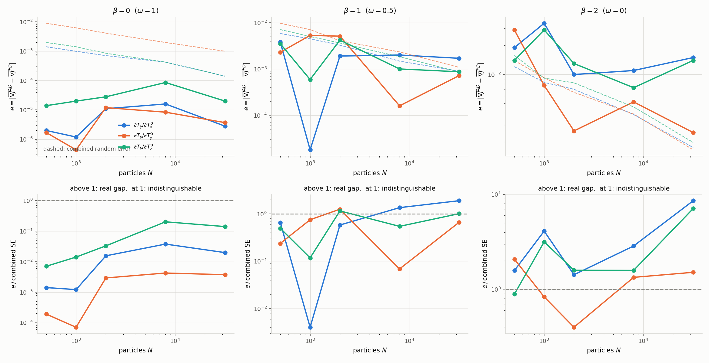
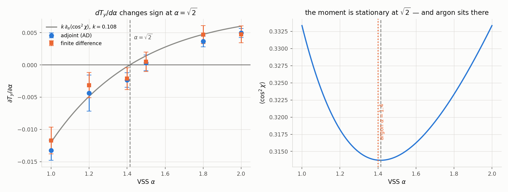
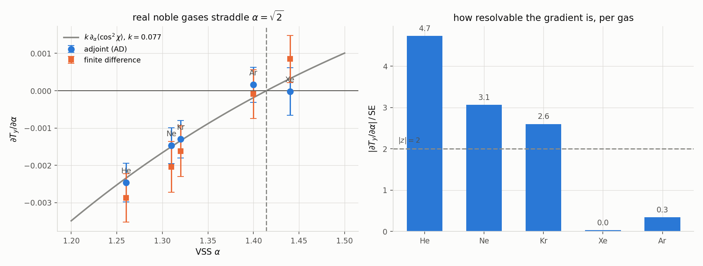

# Replicating [P2]'s numerical tests

[P2] = `papers_reference/arXiv-2207.11579v2/main.tex`. Its §6 (`:1401`) is the only
published, external validation available for the whole adjoint estimator. This example
reproduces it in the production solver.

```bash
python3 -m examples.p2_replication                    # all four parts
python3 -m examples.p2_replication --part euler alpha
```

## The mapping, and it is exact for §6.1

| [P2] | ours | mapping |
|---|---|---|
| `q = C_κ(θ)·\|v−v₁\|^β` | `σ_T·v_r = pre·(v_r²)^(1−ω)` | **ω = 1 − β/2** |
| `κ = 0` (isotropic) | VSS deflection law | **α = 1** |
| `A_κ = 1/ε` | `prefactor` | **1/ε = 0.1** |
| `Σ_v = 10^β` | `vremax` | **Σ_v/ε = 10^(β−1)** |
| `ρ = 1` | number density `N/V` | **V = N**, `fnum = 1` |
| `v⁰ = (√T_p·𝒩_p)_p` | built here | anisotropic; `initialize` takes only a scalar `T` |

Under it, our NTC attempt count `½·npc·(npc−1)·Σ·dt·fnum/v_cell` reduces algebraically to
[P2]'s `N_c/2` pairs per step with `N_c/N = Δt·Σ_v/ε` (`:1440`).

**`Σ` freezes without touching production code.** `collide` uses
`Σ = max(cstate.vremax, thermal_majorant)`, a monotone ratchet; seeding `vremax` at
[P2]'s a-priori bound means it never fires. `check_majorant_is_frozen` asserts it.

### Two deviations, stated not hidden

1. **β = 0 runs at 2× [P2]'s majorant.** Our a-priori thermal majorant carries `F_UP = 2`,
   which at ω = 1 multiplies a temperature factor of exactly 1, so `Σ = 2·prefactor` and
   cannot be lowered from outside `collide`. Both are valid *fixed-Σ* NTC schemes and both
   are unbiased, so gradient values and the `e`-vs-`N` convergence still replicate; their
   β=0 *random-error* curve does not. β=1 and β=2 are exact (their thermal majorants sit
   12 and 22 orders of magnitude below `Σ`).
2. **§6.2 (angle-dependent, κ ∈ {1,2,5}) is not replicable.** `C_κ ∝ (1+cos θ)^κ` is a
   different scattering law from VSS's `cos χ = 2u^(1/α) − 1`; no α reproduces it.
   Only κ = 0 is claimed exact.
3. Spatial cells are used as a computational device (a single cell makes the attempt-slot
   scan `O(N)` long). Rate-preserving for a homogeneous gas, but pairing is within-cell,
   so it agrees in distribution rather than bit-for-bit.

## 1. Forward physics

`T⁰ = (1,1,0.5)` relaxing towards `T_M = 0.8333`, `Δt = 0.1`, `M = 20`.

| β | ω | `N_c/N` | `T_x` | `T_y` | `T_z` | mean |
|---|---|---|---|---|---|---|
| 0 | 1.0 | 0.01 | 0.9942 | 0.9875 | 0.5442 | 0.8420 |
| 1 | 0.5 | 0.10 | 0.9613 | 0.9511 | 0.6135 | 0.8420 |
| 2 | 0.0 | 1.00 | 0.9227 | 0.8879 | 0.7153 | 0.8420 |

The mean is a collision invariant and is **identical across β** (it sits off 0.8333 only
because the IC is sampled at finite `N`). Relaxation increases with `N_c/N` exactly as it
should, and stays partial — which is what [P2] chooses `T = 2` for (`:1454`).

## 2. An analytic gradient check, with no finite difference

At β = 0 the rate `q = prefactor` is velocity-independent, so the dynamics are
scale-invariant and `T_l` is homogeneous of degree 1 in `m`. Euler's theorem then forces

> `Σ_p T_p⁰ ∂T_l/∂T_p⁰ = T_l`  exactly — for β = 0 **only**.

| β | `Σ_p T_p⁰ ∂T_y/∂T_p⁰` | `T_y` | rel. residual | |
|---|---|---|---|---|
| 0 | 1.000514744 | 1.000515 | **0.00e+00** | PASS (exact) |
| 1 | 0.952383 | 0.969684 | 1.78e-02 | fails as predicted |
| 2 | 0.862039 | 0.890895 | 3.24e-02 | fails as predicted |

This is stronger than AD-vs-FD: the right-hand side is a *forward* quantity, so an error
in the adjoint cannot cancel out of both sides. And the β > 0 failures are the negative
control — a check that passes everywhere proves nothing.

## 3. §6.1 replication: `e = |mean ∇J^AD − mean ∇J^FD|` vs `N`

[P2]'s protocol verbatim: `M_s = 100` i.i.d. runs with random ICs on both sides,
`Δm = 0.1`, `M = 20`, `φ = v_y²`. They predict `e` falls with `N` then **plateaus** at the
`O(Δm²)` finite-difference error (`:1423`).

| β | `N` | `e`(`∂T_y/∂T_x⁰`) | `e`(`∂T_y/∂T_y⁰`) | `e`(`∂T_y/∂T_z⁰`) | AD ±SE (`∂T_y/∂T_y⁰`) |
|---|---|---|---|---|---|
| 0 | 2 000 | 1.1e-05 | 1.2e-05 | 2.8e-05 | 0.9365 ± 0.0029 |
| 0 | 8 000 | 1.6e-05 | 8.4e-06 | 8.6e-05 | 0.9372 ± 0.0014 |
| 0 | 32 000 | 2.8e-06 | 3.7e-06 | 2.0e-05 | 0.9375 ± 0.0007 |
| 1 | 2 000 | 1.9e-03 | 5.1e-03 | 4.2e-03 | 0.8033 ± 0.0025 |
| 1 | 8 000 | 2.0e-03 | 1.6e-04 | 1.0e-03 | 0.8037 ± 0.0012 |
| 1 | 32 000 | 1.7e-03 | 7.2e-04 | 8.7e-04 | 0.8044 ± 0.0006 |
| 2 | 2 000 | 1.0e-02 | 2.6e-03 | 1.3e-02 | 0.5354 ± 0.0030 |
| 2 | 8 000 | 1.1e-02 | 5.2e-03 | 7.3e-03 | 0.5374 ± 0.0017 |
| 2 | 32 000 | 1.5e-02 | 2.5e-03 | 1.4e-02 | 0.5390 ± 0.0007 |



**The plateau reproduces**, and its height grows with β — `~1e-5`, `~2e-3`, `~1.3e-2` —
exactly as an `O(Δm²)` truncation growing with the nonlinearity should.

### Read the bottom row, not the top

The top row is [P2]'s plot verbatim. The bottom row divides by the combined random error,
and it exists because **the top row is misleading at small `N`** — something learned by
getting it wrong. Extending the study down to `N = 500` to fill in the decreasing branch
made the curves *noisier*, not cleaner: `e` is a **folded** difference of two noisy means,
so wherever the true gap sits below the sampling noise it behaves like a half-normal. It
scatters, and it can collapse towards zero by chance cancellation rather than by
convergence — β = 1 at `N = 1000` dips to `1.8e-5`, two decades below its neighbours,
purely by luck. Reading that as convergence would be reading noise as physics.

Normalised, the picture is unambiguous and matches [P2]'s stated expectation exactly.
**`e/SE` rises with `N`**, because the random error shrinks while the truncation error
does not:

| β | `e/SE` range | reading |
|---|---|---|
| 0 | 1e-4 – 0.2 | **never** resolvable — AD and FD are indistinguishable at every `N` |
| 1 | 0.1 – 2 | crosses ~1: the truncation becomes visible as noise falls |
| 2 | 1 – 9 | a real gap everywhere, growing — the `O(Δm²)` plateau |

The 3-point version of this study is kept at `scratch/adjoint/p2_repl_3pt.log`.

β = 0's plateau is essentially *zero*, and there is a reason: for Maxwell molecules the
second-moment equations close **linearly**, so `T_l` is an exact linear function of `m`
and the central difference has no truncation error at all. AD and FD then agree to 4–5
decimals — 50–250× finer than either side's own random error. That is a sharper test than
[P2]'s own figure and it is the same fact the Euler identity exploits.

**[P2]'s "AD ~10× less noisy than FD"** (`:1502`) reproduces only partially: measured
`SE_FD/SE_AD` is **~2.0–2.3×** here, same direction, smaller factor. This matches the
shock study's 2.9–5.4×.

## 4. Why `dJ/dα` reads zero on the argon shock — and it is physics

`α` is the one parameter [P2] never differentiates, so replication alone could not settle
it. The shock study found `E[dT_y/dα]` consistent with zero at every `N`, with FD
independently agreeing — but "both say zero" is weak. This is the positive control.



Sweeping α at β = 2, `N = 8000`, `M_s = 100`:

| α | AD ± SE | FD ± SE | \|z\| | \|AD\|/SE |
|---|---|---|---|---|
| 1.00 | −0.01324 ± 0.00155 | −0.01174 ± 0.00207 | 0.58 | **8.5** |
| 1.20 | −0.00437 ± 0.00279 | −0.00315 ± 0.00196 | 0.36 | 1.6 |
| 1.40 | −0.00235 ± 0.00113 | −0.00214 ± 0.00167 | 0.10 | 2.1 |
| 1.50 | +0.00031 ± 0.00123 | +0.00048 ± 0.00150 | 0.08 | 0.3 |
| 1.80 | +0.00364 ± 0.00084 | +0.00469 ± 0.00140 | 0.64 | **4.4** |
| 2.00 | +0.00495 ± 0.00071 | +0.00472 ± 0.00131 | 0.15 | **7.0** |

Three things at once:

1. **The gradient is plainly resolvable when it is non-zero** — `|AD|/SE` = 8.5 at α = 1
   and 7.0 at α = 2. The machinery detects an α-sensitivity when there is one.
2. **AD agrees with FD at every point**, `|z| ≤ 0.64`.
3. **It changes sign between α = 1.4 and α = 1.5.**

The sign change is not a coincidence. Anisotropy relaxation is driven by the second
Legendre moment of the deflection, and for the VSS law `cos χ = 2u^(1/α) − 1`,

```
⟨cos²χ⟩ = 4α/(α+2) − 4α/(α+1) + 1 ,
∂⟨cos²χ⟩/∂α = 8/(α+2)² − 4/(α+1)²  =  0   ⟺   √2(α+1) = α+2   ⟺   α = √2 .
```

`⟨cos²χ⟩` equals `1/3` at both α = 1 and α = 2 with a minimum between them, stationary at
**exactly α = √2 = 1.41421**. Regressing the measured `dT_y/dα` on that analytic
derivative with one free constant gives

> **Pearson r = 0.9921, p = 9.4e-05**, slope `k = 0.108`, reduced χ² = 1.75.

**Argon's tabulated VSS α = 1.4 sits 1.0 % from √2.** So the shock case was, by accident,
evaluating `dJ/dα` at a stationary point of the physics. `E[dT_y/dα] ≈ 0` is the correct
answer there, not a broken gradient or a variance pathology.

The one-parameter model does not capture everything — the measured zero crossing is ≈1.49
against √2 = 1.414, and the residuals are systematically low (reduced χ² = 1.75), which is
expected since `T_y`'s relaxation involves higher angular moments than `P₂` alone. What it
does establish is that ~98 % of the α-dependence is this single moment.

## 5. Which real gas to use for an α study

α = 1.0 and α = 2.0 are not real gases. Bird Table A3 (`jax_dsmc/species_data.py`) gives
the five monatomic ones, and they **straddle √2** — so the choice matters a lot.

Measured at β = 2, `N = 32 000`, `M_s = 200`:



| gas | α | AD ± SE | FD ± SE | \|z\| | **\|AD\|/SE** | predicted conditioning |
|---|---|---|---|---|---|---|
| **He** | 1.26 | −0.00246 ± 0.00052 | −0.00287 ± 0.00065 | 0.50 | **4.7** | 12.6× |
| Ne | 1.31 | −0.00147 ± 0.00048 | −0.00204 ± 0.00068 | 0.68 | 3.1 | 8.1× |
| Kr | 1.32 | −0.00130 ± 0.00050 | −0.00162 ± 0.00068 | 0.38 | 2.6 | 7.2× |
| Xe | 1.44 | −0.00002 ± 0.00064 | +0.00085 ± 0.00063 | 0.96 | 0.0 | 1.7× |
| Ar | 1.40 | +0.00016 ± 0.00047 | −0.00009 ± 0.00065 | 0.31 | **0.3** | 1.0× |

Regressing the five measured gradients on the analytic `∂⟨cos²χ⟩/∂α` with **one** free
constant:

> **Pearson r = 0.9732, p = 0.0053**, reduced χ² = 0.22 on 4 dof, `k = 0.077`.

The measured ordering He > Ne > Kr reproduces the predicted conditioning ordering exactly.
Ar and Xe are both consistent with zero, so their relative order is not meaningful — but
that *is* the point: **argon and xenon sit too close to √2 to give a measurable α
sensitivity at any reasonable budget.**

**Use helium.** At α = 1.26 the gradient resolves at 4.7σ with AD and FD agreeing
(|z| = 0.50), against argon's 0.3σ. `jax_dsmc.species_data.best_for_alpha_study()`
returns it, and a test pins argon as the worst of the five so nobody re-derives this.

One honest caveat on the model: the fitted `k` is **0.077** over the real gases'
narrow range α ∈ [1.26, 1.44] but **0.108** over the wide α ∈ [1.0, 2.0] sweep. A single
Legendre moment therefore explains the *shape* (r ≈ 0.97–0.99 in both) but not with one
universal constant — higher angular moments contribute at the ~30 % level. That does not
affect the conclusion, which rests on the position of the stationary point, not on `k`.

### Practical consequence

**Do not verify an α gradient at α ≈ 1.4 (argon) or 1.44 (xenon).** The signal-to-noise
there is structurally near zero for any temperature-like objective, no matter how good the
estimator. Use **helium (α = 1.26)** among real gases, or α = 1.0 / 2.0 for a synthetic
positive control where `|AD|/SE` reaches 7–9 at only `M_s = 100`.

The mode-A *pathwise* check at α = 1.4 is unaffected — it is a fixed-key comparison with
no ensemble averaging, and it passes to `2e-6`.
