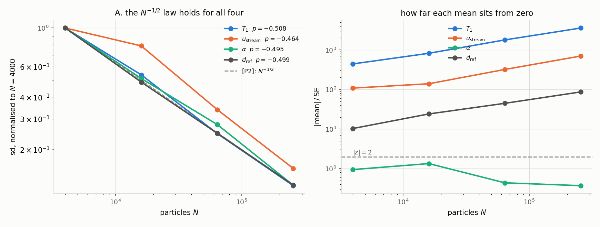
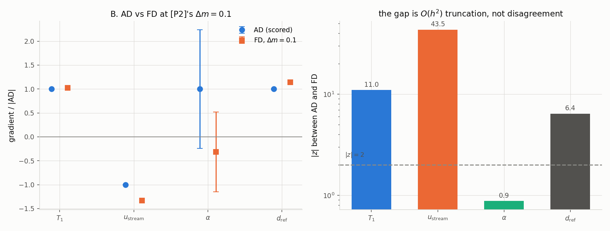
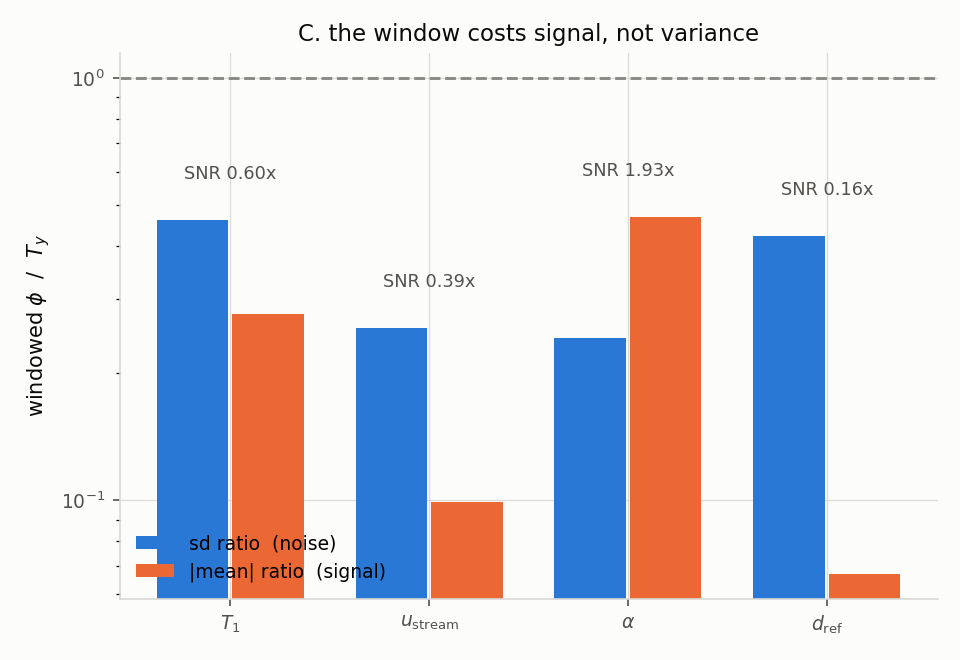
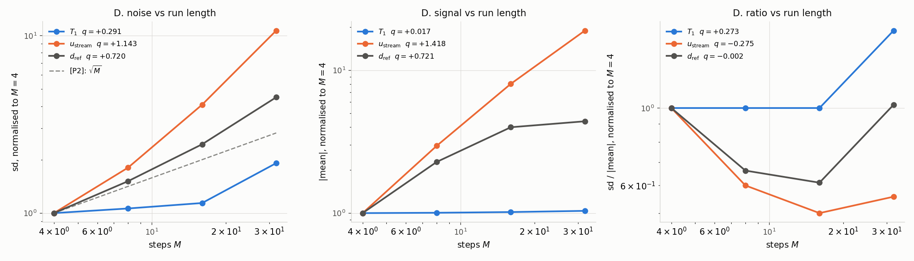
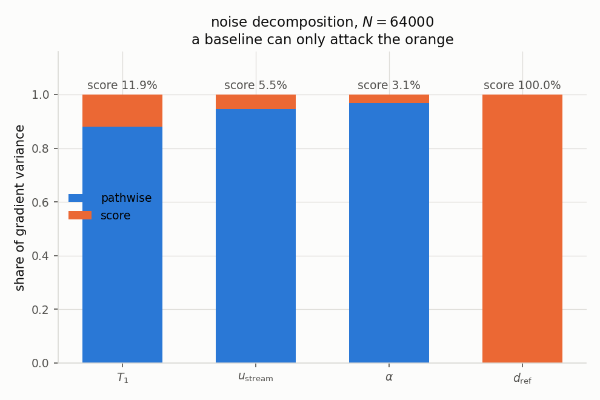

# The score estimator's variance — study results

Everything below was measured on the Mach-2 reflected-shock case, `D = 2` unless stated,
with `φ = T_y` — [P2]'s own objective. Regenerate the tables and figures with:

```bash
python3 -m examples.shock_adjoint.variance_report      # tables + 5 PNGs, no GPU needed
python3 -m examples.shock_adjoint.variance_report --no-plot
```

That command **parses the probe logs**; it does not restate their numbers, so the logs stay
the single source of truth and a half-finished run raises instead of plotting blanks.

| section | question | probe | log |
|---|---|---|---|
| 0 | is the estimator unbiased where the truth is known? | `probe_variance.py` | `scratch/adjoint/variance.log` |
| A | does `sd ~ N^-1/2` hold? | `probe_variance.py` | `scratch/adjoint/variance.log` |
| B | what happens at [P2]'s own `Δm = 0.1`? | `probe_variance.py` | `scratch/adjoint/variance.log` |
| C | what does the spatial window cost? | `probe_variance.py` | `scratch/adjoint/variance.log` |
| D | does `sd ~ √M` hold? | `probe_variance.py`, `probe_M_scaling.py` | `variance.log`, `m_scaling.log` |
| — | is the noise pathwise or score? | `probe_split_variance.py` | `scratch/adjoint/split_var.log` |

Prose discussion lives in `docs/PSEUDOCODE.md` §23.3.1–23.3.7.

---

## 0. Zero-check against a known truth

`Σ|v|²` is a **collision invariant** — VSS conserves pair energy and a specular wall conserves
it — so `dJ/d(any collision parameter)` is *exactly* zero, pathwise and in expectation. This is
the only place in the study with a ground truth rather than a second estimator.

| parameter | max abs pathwise | scored mean ± SE | `\|z\|` from 0 |
|---|---|---|---|
| `alpha` | 1.045e-12 | −1.380e+01 ± 5.442e+01 | 0.25 |
| `diam` | 0.0 | −3.503e+12 ± 2.296e+12 | 1.53 |
| `omega` | 0.0 | 5.538e+02 ± 5.616e+02 | 0.99 |

Both halves pass: pathwise is machine zero, and the noisy score estimator is consistent with the
true zero in all three cases.

---

## A. `sd ~ N^-1/2` — confirmed for all four parameters

`D = 2` widened **transversely**, so `npc` (and therefore `A_max = 256`) is held fixed while `N`
and `C` grow together. `M = 16`, 128 keys per point.

| `N` | `C` | `sd(temp)` | `sd(ux)` | `sd(alpha)` | `sd(diam)` |
|---|---|---|---|---|---|
| 4 000 | 80 | 5.451 | 3.756 | 1.961e+03 | 1.351e+13 |
| 16 000 | 320 | 2.931 | 2.964 | 1.005e+03 | 6.599e+12 |
| 64 000 | 1 280 | 1.346 | 1.274 | 5.458e+02 | 3.348e+12 |
| 256 000 | 5 120 | 0.6745 | 0.5842 | 2.441e+02 | 1.686e+12 |
| **fitted `p`** | | **−0.508** | **−0.464** | **−0.495** | **−0.499** |

Against [P2]'s predicted −0.5, over a 64× range in `N`, and holding for a pathwise parameter
(`temp`, `ux`), a mixed one (`alpha`) and a pure-score one (`diam`) alike.

Read the same runs the other way:

| `N` | mean `dJ/dα` ± SE | mean `dJ/d(diam)` ± SE |
|---|---|---|
| 4 000 | +164 ± 173 | 1.233e13 ± 1.19e12 |
| 16 000 | +119 ± 89 | 1.405e13 ± 0.58e12 |
| 64 000 | −21 ± 48 | 1.322e13 ± 0.30e12 |
| 256 000 | −8 ± 22 | 1.292e13 ± 0.15e12 |

`diam` converges on a well-defined non-zero value, stable to ~10% while its error bar shrinks 8×.
**`alpha`'s mean is consistent with zero at every `N`** — which is the whole reason its
*relative* error looks alarming. Its *absolute* error bar falls 8× like everything else.



The right panel is the point: `α` never rises above `|z| = 2`, while the other three climb.

---

## B. At [P2]'s own protocol — the gap is truncation, not disagreement

`N = 256 000`, `M_s = 100`, `Δm = 0.1` (a **10%** step), so `N·M_s = 2.6e7` against [P2]'s `1e8`.

| parameter | AD mean ± SE | FD mean ± SE | `\|z\|` | gap |
|---|---|---|---|---|
| `temp` | 2.1247e+02 ± 7.3e-02 | 2.1688e+02 ± 4.0e-01 | 11.0 | 2.1% |
| `ux` | −3.6217e+01 ± 9.1e-02 | −4.8333e+01 ± 2.6e-01 | 43.5 | 33.5% |
| `alpha` | 8.667e+01 ± 1.08e+02 | −2.756e+01 ± 7.2e+01 | 0.88 | — |
| `diam` | 1.2885e+13 ± 1.5e+11 | 1.4656e+13 ± 2.3e+11 | 6.4 | 13.7% |

**These `z` are not an AD/FD disagreement.** A central difference carries `O(h²)` truncation, and
`Δm = 0.1` is "nearly optimal" in [P2] only at *their* noise level. Our AD standard error here is
0.03–0.25%, low enough that truncation dominates. `ux` is worst for a physical reason: a 10% step
moves this case from `Ma = 2.0` to `Ma = 2.2`. **Mode A is the precision test** (agreement to
`1e-9`–`1e-6` at a flip-free step); mode B's step is chosen to make decisions flip.

[P2] reports AD ~10× less noisy than FD. Measured `SE_FD/SE_AD`: **5.4× (`temp`), 2.9× (`ux`),
1.5× (`diam`)** — same direction, smaller factor — and **0.7× for `alpha`**, the one parameter
whose mean is ~0. A partial reproduction, not a clean one.



---

## C. The spatial window costs signal, not variance

Same case and keys, `N = 64 000`, 128 keys. `T_y` is [P2]'s objective; `windowed` is the
Gaussian-windowed `φ` the mode-A verification sweep uses.

| parameter | sd ratio (noise) | mean ratio (signal) | net SNR |
|---|---|---|---|
| `temp` | 0.46 | 0.276 | **0.60×** |
| `ux` | 0.26 | 0.099 | **0.39×** |
| `alpha` | 0.24 | 0.468 | 1.93× |
| `diam` | 0.42 | 0.067 | **0.16×** |

The window **lowers** the absolute sd in every case — fewer particles carry weight, so there is
less to fluctuate. What it lowers *faster* is the mean. For `diam` the spread falls 2.4× while
the signal falls 15×. `alpha` is the exception and is also the parameter whose mean is ~0, so its
ratio is not meaningful.

This is a design note, not a defect: a localised objective is a legitimate thing to want, and it
costs sample budget in proportion to the fraction of the gas it looks at.



---

## D. `sd ~ √M` — and why the raw exponent is the wrong comparison

[P2]'s `M`-sweep is a 0-D relaxation **towards equilibrium**, where the objective saturates, so
their `sd` growth is pure score accumulation. Ours is a **developing shock**: `dJ/dm` itself grows
with `M`, and a steeper `sd` is expected on signal grounds alone. So measure the mean too
(`probe_M_scaling.py`).

| parameter | `q(sd)` | `q(\|mean\|)` | `q(sd/\|mean\|)` | reading |
|---|---|---|---|---|
| `temp` | 0.291 | **0.017** | +0.273 | signal saturated — the only one in [P2]'s regime |
| `ux` | 1.143 | 1.418 | **−0.275** | signal outgrows noise |
| `alpha` | 1.293 | 1.632 | −0.339 | **not readable** — mean flips sign across the sweep |
| `diam` | **0.720** | **0.721** | −0.002 | signal and noise grow at indistinguishable rates |

Three readings:

1. **`temp` is the only parameter in [P2]'s regime** (saturated signal), so it is the only one
   whose raw `sd` exponent is comparable — and it is **0.291**, i.e. our noise grows *more
   slowly* than the published 0.5.
2. **`diam`'s signal and noise exponents are indistinguishable** (0.720 vs 0.721).
3. **For `ux` the relative spread falls** as `M^-0.275`: a longer integration is a better
   gradient, not a worse one.

**Caveat.** Four points over an 8× range is a short lever arm, and `diam`'s ratio is *not*
monotone (0.414, 0.274, 0.253, 0.423) — its fitted ratio exponent is flat partly because the
endpoints coincide. What the fit supports is that its two *exponents* agree, not that the ratio
is constant point by point.



---

## Decomposition: the noise is pathwise, not score

The `sd(score)` column elsewhere is `sd(full − pathwise)`, which bounds the score *contribution*
but cannot attribute the rest — the halves may be correlated. Measuring all three settles it
(256 keys, `φ = T_y`, `N = 64 000`).

| parameter | `sd(pathwise)` | `sd(score)` | corr | score % of **variance** | perfect-baseline ceiling |
|---|---|---|---|---|---|
| `temp` | 1.275 | 0.469 | −0.01 | 11.9% | 1.065× |
| `ux` | 1.095 | 0.263 | +0.08 | 5.5% | 1.029× |
| `alpha` | 679.5 | 121.1 | −0.10 | **3.1%** | **1.016×** |
| `diam` | 0.0 | 3.45e12 | — | 100% | unbounded |

Correlations are within ±0.2 of zero, so the halves are effectively independent and their
**variances** add — which is the right unit, since a baseline removes score *variance*. Quoting
the score's share of the *standard deviation* (17.8% for `alpha`) overstates it by ~6×.

**A correction worth stating plainly.** It is tempting to say this explains §11.4's measured
~1.2× baseline gain. It does not: 1.2× **exceeds** the 1.016× ceiling computed here, so they are
not the same quantity — §11.4 was measured on a windowed `φ` at `D = 1, N = 2000`, a different
configuration. What survives is directional and is enough: **wherever a parameter has a pathwise
route, the score is a minority of the gradient variance, so a baseline is correspondingly
limited.** The 84× applies only where the score is the *entire* variance — the count score in
isolation, and score-only parameters like `diam`.

The practical consequence is the useful one: **for `temp`, `ux` and `alpha` the only lever on the
dominant noise term is more particles**, exactly as the `N^-1/2` law says. No estimator change,
baseline, or ensemble size touches pathwise Monte Carlo error.


